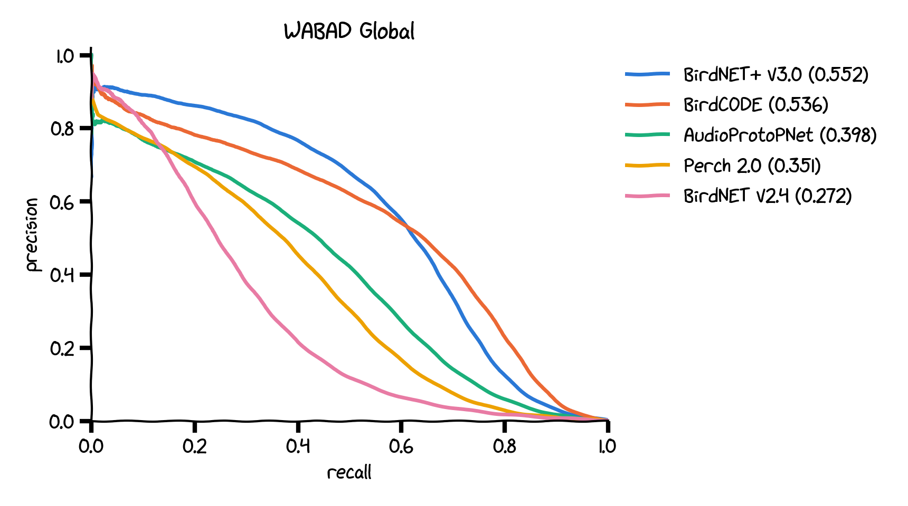
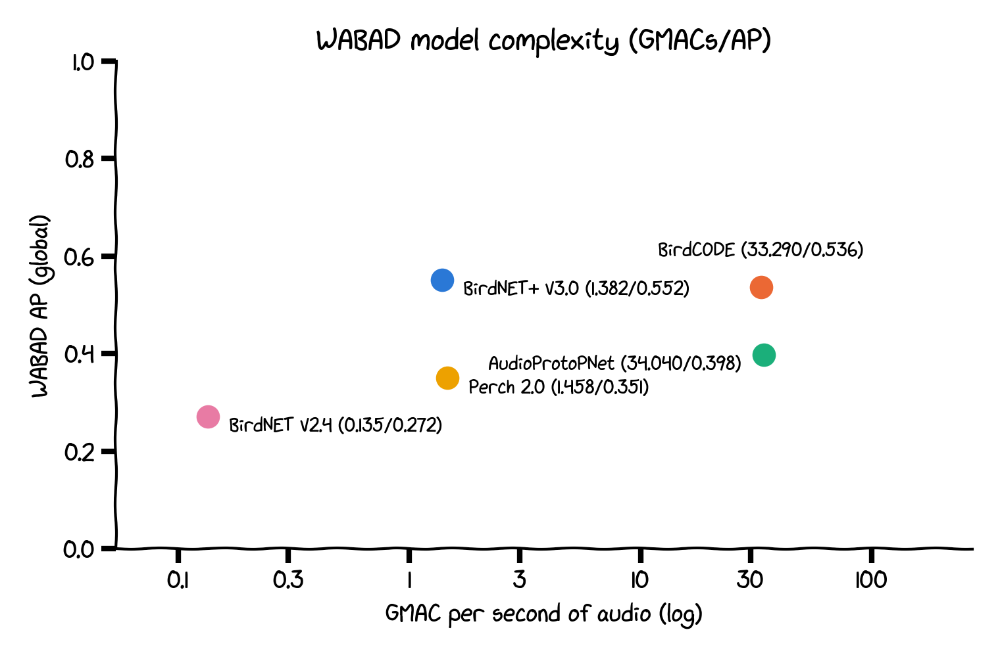

<p align="center">
  
</p>

<h1 align="center">BirdNET+ V3.0 models and code examples</h1>

<p align="center">
  <a href="LICENSE"></a>
  <a href="MODEL_LICENSE.md"></a>
  <a href="https://www.python.org/"></a>
  <a href="https://doi.org/10.5281/zenodo.24362980"></a>
  
  
</p>

<p align="center">
  BirdNET+ V3.0 identifies 11,709 animal species and 16 non-animal sound classes in audio recordings.<br>
  This repository is the developer entry point: model files, reference code, examples, tips, and benchmarks.
</p>

<p align="center">
  <a href="#quick-start">Quick start</a> ·
  <a href="#benchmark">Benchmark</a> ·
  <a href="#models">Models</a> ·
  <a href="#usage">Usage</a> ·
  <a href="#tips-and-details">Tips</a> ·
  <a href="#birdnet-ecosystem">Ecosystem</a> ·
  <a href="#citation">Citation</a>
</p>

## Contents

- [Overview](#overview)
- [Quick start](#quick-start)
- [Benchmark](#benchmark)
- [Models](#models)
- [Usage](#usage): [command line](#command-line-analyzepy) · [Streamlit demo](#streamlit-demo-apppy) · [examples](#examples) · [your own code](#in-your-own-python-code)
- [Tips and details](#tips-and-details): [input](#input) · [output](#output) · [labels](#labels) · [precision and size](#precision-and-size) · [GPU](#gpu) · [practical tips](#practical-tips) · [going further](#going-further)
- [BirdNET ecosystem](#birdnet-ecosystem)
- [Repository layout](#repository-layout)
- [Contributing](#contributing) · [License](#license) · [Acceptable Use](#acceptable-use) · [Citation](#citation) · [Funding](#funding) · [Partners](#partners)

## Overview

BirdNET+ V3.0 Global 12K (November 2026) recognizes 9,788 birds, 802 insects, 649 amphibians, 419 mammals (including humans), 35 fishes, 15 reptiles, and 1 arachnid, plus 16 non-animal classes such as gun, chainsaw, and siren. Labels are linked to the [BirdNET+ Taxonomy](https://birdnet.cornell.edu/taxonomy/) with common names in 36 languages.

**Changes compared to BirdNET V2.4:**

- About twice the average precision on [WABAD](#benchmark) (0.552 vs. 0.272)
- Nearly twice as many classes (11,725 vs. 6,522), with many more non-bird species
- Variable-length input instead of fixed 3 s segments
- 32 kHz input instead of 48 kHz
- Improved architecture and training on a much larger, more diverse dataset (see [docs/model.md](docs/model.md))

> **Before you build your own pipeline**, check whether these already do what you need:
>
> - **[birdnet](https://github.com/birdnet-team/birdnet)**: Python package with a simple API and automatic model downloads (`pip install birdnet`).
> - **[BirdNET-Analyzer](https://github.com/birdnet-team/BirdNET-Analyzer)**: GUI and CLI for batch analysis, result review, and training custom classifiers.
>
> This repository is for working with the model files directly: integrating them into your own software, apps, or devices.

## Quick start

```bash
git clone https://github.com/birdnet-team/birdnet-V3.0-dev.git
cd birdnet-V3.0-dev
python3 -m venv .venv
source .venv/bin/activate        # Windows: .venv\Scripts\activate
pip install -r requirements.txt

python analyze.py examples/audio/soundscape.wav   # downloads the model on first run, writes results.csv
streamlit run app.py                       # interactive demo in your browser
```

Optional backends: `pip install ai-edge-litert` for `.tflite` models, `pip install torch` for `.pt` models, and `onnxruntime-gpu` instead of `onnxruntime` for NVIDIA GPUs.

## Benchmark

BirdNET+ V3.0 is the most accurate of five large bird sound classifiers on [WABAD](https://zenodo.org/records/14191524), a public set of expert-annotated soundscapes from 66 sites on six continents (88,967 calls, about 1,000 species). It also uses a fraction of the compute of the closest competitor.



| Model | AP | GMAC per second of audio |
|---|---:|---:|
| **BirdNET+ V3.0** | **0.552** | 1.38 |
| BirdCODE | 0.536 | 33.29 |
| AudioProtoPNet | 0.398 | 34.04 |
| Perch 2.0 | 0.351 | 1.46 |
| BirdNET V2.4 | 0.272 | 0.135 |

- **AP** (average precision) measures how well a model ranks true detections above false ones, from 0 to 1 (higher is better). It is pooled over all 3 s windows and species, on the 945 species all five models can predict, so no threshold has to be chosen.
- **GMAC per second of audio** is the compute a model needs: billions of multiply-accumulate operations (the basic step of a neural network) to process one second of audio. It does not depend on hardware, so it compares models fairly; lower means faster, cheaper analysis of large archives and longer battery life on small devices.

BirdNET+ V3.0 roughly doubles the AP of BirdNET V2.4 and leads in five of seven regions. It edges out BirdCODE with about a twenty-fourth of the compute, and needs about the same compute as Perch 2.0 while scoring much higher. In the plot below, up and to the left is better; note the logarithmic compute axis.



See [docs/wabad.md](docs/wabad.md) for results by region, site, and species, and for how we evaluated.

### Embeddings for other tasks

[probeBench](https://github.com/birdnet-team/probeBench) tests how well the 1280-d embeddings transfer to tasks the model was not trained for. It has 15 tasks from public datasets: marine mammals, bats, insects, individual animals, call types, Arctic soundscapes, and environmental sounds. One logistic-regression probe is fit per task on frozen embeddings, and splits are grouped so that no recording, site, or individual appears in both train and test.

| Model | Mean over 15 tasks |
|---|---:|
| Perch 2.0 | 0.787 |
| AudioProtoPNet-20 | 0.774 |
| **BirdNET+ V3.0** | **0.757** |
| BirdNET V2.4 | 0.752 |
| BirdCODE | 0.728 |
| Log-mel baseline | 0.615 |

The scores are each task's headline metric (accuracy, macro-F1, mAP, or AUC), where higher is better. All five models are well above the log-mel baseline and within 0.06 of each other. BirdNET+ V3.0 is best on Arctic soundscapes and minke whales. It also does well on gibbons, right whales, and environmental sounds (ESC-50). On bats and on telling individual animals apart, it trails the best model. If you plan to train a small classifier on BirdNET+ V3.0 embeddings for non-bird sounds, the per-task results in probeBench show what to expect.

## Models

Download from [Zenodo](https://zenodo.org/records/24362980) (DOI [10.5281/zenodo.24362980](https://doi.org/10.5281/zenodo.24362980)). The record also holds the [Geomodel, the Taxonomy, and the BirdNET Live models](#other-files-in-the-record).

**Version 3.0.1 (November 19, 2026)** replaces the first release (3.0.0). Weights, classes, and labels are unchanged; all models were exported again with conversion fixes:

- Silent (all-zero) input no longer returns NaN in the ONNX and FP16 LiteRT models.
- The FP16 ONNX models are mixed precision: same size, closer to the FP32 scores, and safe from float16 overflow on GPUs and mobile devices.
- The second output of the FP16 ONNX models is named `embeddings` (was `embeddings_out`), as in the FP32 model.
- The spectrogram is computed without the STFT operator, so more runtimes can run the models.
- The TF SavedModel raises an error for input shapes other than `[1, 96000]`.

If you downloaded models before this date, delete the `BirdNET+_V3.0_Global_12K_*` files in `models/` so the scripts fetch them again. The file names did not change, so existing files are not replaced.

### Audio model

All files start with `BirdNET+_V3.0_Global_12K_` and share one label file.

| File suffix | Format | Size | Use it for |
|---|---|---:|---|
| `_FP16.onnx` | ONNX | 174 MB | **Default.** Desktop and server, CPU or GPU, any language with ONNX Runtime |
| `_FP32.onnx` | ONNX | 345 MB | Reference precision |
| `_FP32.pt` | TorchScript | 345 MB | PyTorch, GPU batch processing, fine-tuning experiments |
| `_FP16.tflite` / `_FP32.tflite` | LiteRT (TFLite) | 172 / 344 MB | Android, Raspberry Pi, embedded Linux |
| `_FP16_pruned.onnx` / `_FP16_pruned.tflite` | ONNX / LiteRT | 72 / 71 MB | Mobile and edge devices (one of three classifier heads) |
| `_FP16.mlpackage.zip` / `_FP32.mlpackage.zip` | Core ML | 157 / 317 MB | iOS 16+ and macOS 13+ |
| `_FP32_Protobuf.zip` | TF SavedModel | 317 MB | TensorFlow serving |
| `_Labels.csv` / `_Labels.xlsx` | CSV / Excel | 8 / 5 MB | One row per model output, same order for all models |
| `_Source_Checkpoint.zip` | TorchScript + ONNX | 837 MB | Research: unpruned model with all 16,852 training classes |

The scripts in this repository download the FP16 ONNX model and labels to `models/` next to `birdnet_v3.py` on first use (set `BIRDNET_MODEL_DIR` to change the location). The Geomodel zip is downloaded the first time you filter by location.

### Other files in the record

| File | Size | Contents |
|---|---:|---|
| `BirdNET+_Geomodel_V3.0.5_Global_14K.zip` | 111 MB | [Geomodel](https://github.com/birdnet-team/geomodel): occurrence probability per species for a latitude, longitude, and week (1–48). TorchScript, ONNX, LiteRT, TF SavedModel, and Core ML, plus labels |
| `BirdNET+_Taxonomy_v0.5-Nov2026.zip` | 70 MB | [BirdNET+ Taxonomy](https://birdnet.cornell.edu/taxonomy/) as CSV and JSON: 18,093 records with BirdNET IDs, names in 36 languages, and iNaturalist, eBird, and GBIF IDs |
| `BirdNET+_V3.0_Global_10K_BNL.zip` | 70 MB | The two models the [BirdNET Live](https://github.com/birdnet-team/birdnet-live-app) app runs on-device, with one shared labels file and a README |

- **Geomodel V3.0.5** has the trained weights of Geomodel V3.0.4. Its 14,057 classes are the ones in the BirdNET+ Taxonomy, and its labels carry BirdNET IDs, so its output joins to the audio model's labels on `birdnet_id`. The TorchScript geomodel returns logits (apply a sigmoid); the other formats return probabilities.
- **BirdNET Live models** are both FP16 ONNX: an audio model with 10,064 classes (68 MB, one classifier head, like `_FP16_pruned.onnx`) and a geomodel for the same 10,048 species (7 MB). The audio model keeps a species only if the geomodel can predict it somewhere in the world. The labels file has a `geo_ix` column with each species' index in the geomodel output. Use them when you want one small, matched pair of models; the README in the zip has a code example.

## Usage

### Command line: `analyze.py`

```bash
python analyze.py examples/audio/soundscape.wav                         # one file -> results.csv
python analyze.py recordings/ -o results.csv --min-conf 0.5      # whole folder, recursive
python analyze.py recordings/ --lat 42.48 --lon -76.45 --week 20 # only species likely at this place and week
python analyze.py recordings/ --groups Aves --lang de            # birds only, German names
python analyze.py recordings/ --embeddings embeddings.npz        # also save 1280-d embeddings
```

| Option | Default | Description |
|---|---|---|
| `--model` | FP16 ONNX | Any `.onnx`, `.tflite` or `.pt` model file |
| `--min-conf` | 0.25 | Minimum score to report |
| `--chunk` / `--overlap` | 3.0 / 0.0 | Chunk length and overlap in seconds |
| `--lat`, `--lon`, `--week` | off | Geomodel species filter; week 1–48 (four per month), 0 = whole year |
| `--species` | off | Text file with scientific names to keep, one per line |
| `--groups` | all | Taxon groups to keep, e.g. `Aves Amphibia Insecta` |
| `--lang` | en | Common name language: `de`, `fr`, `es_MX`, `ja`, `zh`, ... (36 total) |
| `--embeddings` | off | Save per-chunk embeddings to an `.npz` file |
| `--device` | cpu | `cuda` for ONNX (with `onnxruntime-gpu`) and TorchScript |

Output is one CSV for all files: `file, start_sec, end_sec, scientific_name, common_name, confidence`.

### Streamlit demo: `app.py`

```bash
streamlit run app.py
```

Upload a recording (or try the example) to see the spectrogram, top species, and detections, with model, language, taxon group, and location filters. Results download as CSV or Audacity labels.

Streamlit limits uploads to 200 MB. For longer recordings, raise the limit (in MB), e.g. `streamlit run app.py --server.maxUploadSize 2048`, or use `analyze.py`.

### Examples

Short, standalone scripts in [`examples/`](examples/). Run them from the repository root.

| Script | What it shows |
|---|---|
| [`onnx_minimal.py`](examples/onnx_minimal.py) | The whole pipeline in about 20 lines: load, resample, run, print top species |
| [`tflite_minimal.py`](examples/tflite_minimal.py) | LiteRT inference with the pruned model, as on Android or a Raspberry Pi |
| [`torchscript_minimal.py`](examples/torchscript_minimal.py) | PyTorch inference on CPU or GPU |
| [`embeddings_search.py`](examples/embeddings_search.py) | Find chunks that sound like a query with cosine similarity on embeddings |
| [`geo_species_list.py`](examples/geo_species_list.py) | Species list for a location and week from the Geomodel |

### In your own Python code

[`birdnet_v3.py`](birdnet_v3.py) is a single file with no framework, so you can copy it into your own project:

```python
import birdnet_v3 as bn

model = bn.Model()  # FP16 ONNX; also takes .tflite or .pt paths
labels = bn.load_labels()
chunks, starts = bn.chunk(bn.load_audio("examples/audio/soundscape.wav"), length=3.0)
scores, embeddings = model.predict(chunks)  # [N, 11725], [N, 1280]

mask = bn.GeoModel().mask(labels, lat=42.48, lon=-76.45, week=20)
scores[:, ~mask] = 0
```

## Tips and details

### Input

- Float32 waveform in [-1, 1] at **32 kHz**, shape `[batch, samples]`. The spectrogram is computed inside the model, so you only need to resample audio.
- Stereo and multichannel recordings work: average the channels (as the scripts here do), or pass each channel as its own row in the batch to analyze the microphones separately.
- Any length works, but **about 2–12 s** matches training best. The scripts here use 3 s chunks. LiteRT models are most accurate at 3 s and drift slightly on other lengths; Core ML models take exactly 3 s.
- ONNX and TorchScript accept any batch size. LiteRT models have a fixed batch size of 1: resize the input to `[1, samples]` and loop.
- The TF SavedModel (`_FP32_Protobuf.zip`) only accepts `[1, 96000]` (one 3 s chunk) and raises an error for other shapes. Loop over chunks, or use ONNX or TorchScript for other lengths and batch sizes.
- Digital silence (all zeros, or any constant input) is fine: the models return low scores. ONNX and FP16 LiteRT files from before release 3.0.1 returned NaN instead.
- Zero-pad the last chunk of a file to the full chunk length.

### Output

- Two outputs: `predictions` (scores, one per class) and `embeddings` (1280-d). In LiteRT, the output names are generic; tell them apart by size.
- Scores are independent per class (0–1, multi-label), not a softmax: several species can score high in the same chunk, and scores do not sum to 1.
- Scores are not calibrated probabilities. 0.25 is a reasonable starting threshold. On WABAD, 65% of annotated calls had a window scoring 0.25 or higher for the right species, and 54% scored 0.5 or higher. Some species rank well but score low, so species-specific thresholds help.
- Embeddings are useful for similarity search, clustering, and training small classifiers for sounds or call types the model does not know.

### Labels

- `BirdNET+_V3.0_Global_12K_Labels.csv` is comma-separated, one row per model output, in output order (`ix`).
- Columns: `birdnet_id` (stable BirdNET+ Taxonomy ID, e.g. `BN00001`), `scientific_name`, `common_name`, `taxon_group` (`Aves`, `Insecta`, `Amphibia`, `Mammalia`, `Actinopterygii`, `Reptilia`, `Arachnida`, `Anthropogenic`, `Geophony`, `Music`), `inat_id`, `ebird_code`, and `common_name_<lang>` for 36 languages. Fall back to `common_name` when a translation is empty.
- Look up more species metadata (descriptions, images, aliases) in the [BirdNET+ Taxonomy](https://birdnet.cornell.edu/taxonomy/).

### Precision and size

- FP16 is half the size of FP32 with minimal accuracy loss. On the example soundscape, the largest score difference from FP32 TorchScript was 0.005 for both FP16 ONNX and FP16 LiteRT.
- The pruned models keep one of the three classifier heads. They are less than half the size, and scores differ by up to about 0.14 from the full model. Use them where size matters more than the last bit of accuracy.
- The FP16 ONNX model analyzes 2 minutes of audio in about 2.5 s on an 8-thread desktop CPU.

### GPU

- **NVIDIA GPUs: TorchScript is the tested path.** On a TITAN RTX, FP32 TorchScript analyzes a batch of 128 × 3 s in about 0.5 s. Load the model with `torch.jit.load(path, map_location="cuda")`, as the scripts here do.
- The ONNX models no longer contain the STFT operator, which has no CUDA kernel in ONNX Runtime and kept the spectrogram on the CPU in the first release. We have not benchmarked the 3.0.1 ONNX models on a GPU yet.

### Practical tips

- **Filter by location.** The [Geomodel](https://github.com/birdnet-team/geomodel) removes species that are unlikely at a given place and time, a simple way to reduce false positives. It covers 10,926 of the 11,725 classes; uncovered classes (including all non-animal classes) are never filtered.
- **Overlap chunks** (e.g., `--overlap 1.5`) to catch calls that straddle chunk boundaries, at the cost of more compute.
- **Pool over time** for presence/absence per file or day: the maximum score per species over all chunks is a simple, effective summary.
- **Report the model file and precision** with your results so they stay reproducible.

### Going further

- Architecture, spectrogram settings, and training: [docs/model.md](docs/model.md).
- Custom species subsets, other precisions, or other formats: [model-converter](https://github.com/birdnet-team/model-converter).
- Microcontrollers: [birdnet-stm32](https://github.com/birdnet-team/birdnet-stm32) has a tiny model for the STM32N6 NPU.

## BirdNET ecosystem

| Project | Description |
|---|---|
| [birdnet](https://github.com/birdnet-team/birdnet) | Python package: `pip install birdnet`, then `birdnet.load("acoustic", "3.0", "onnx").predict("audio.wav")` |
| [BirdNET-Analyzer](https://github.com/birdnet-team/BirdNET-Analyzer) | GUI and CLI for batch analysis, review, and custom classifier training |
| [Geomodel](https://github.com/birdnet-team/geomodel) | Species occurrence by location and week (14,057 species in V3.0.5) to filter detections |
| [BirdNET+ Taxonomy](https://github.com/birdnet-team/birdnet-taxonomy) | Species IDs, localized names, and metadata ([browse](https://birdnet.cornell.edu/taxonomy/)) |
| [BirdNET Live](https://github.com/birdnet-team/birdnet-live-app) | Mobile app that runs BirdNET+ V3.0 on-device |
| [BirdBox](https://github.com/birdnet-team/BirdBox) | Bird call detection in time and frequency with an object detection model ([demo](https://birdnet-team.github.io/BirdBox/demo/)) |
| [model-converter](https://github.com/birdnet-team/model-converter) | Converts BirdNET+ V3.0 PyTorch models to ONNX, LiteRT, TorchScript, and Core ML |
| [birdnet-stm32](https://github.com/birdnet-team/birdnet-stm32) | Tiny acoustic model for the STM32N6 microcontroller |
| [probeBench](https://github.com/birdnet-team/probeBench) | Linear-probe benchmark for bioacoustic audio embeddings on 15 tasks, from whales and bats to insects and individual animals |
| [birdnetR](https://github.com/birdnet-team/birdnetR) | R wrapper for the birdnet Python package |

## Repository layout

```
birdnet_v3.py     Reference code: audio loading, chunking, all model formats, Geomodel filter
analyze.py        Command-line batch analysis
app.py            Streamlit demo
examples/         Short standalone scripts
examples/audio/   Example soundscape (2 min)
docs/model.md     Model architecture and training
docs/wabad.md     WABAD benchmark results
```

## Contributing

See [CONTRIBUTING.md](CONTRIBUTING.md). AI-assisted contributions are welcome; keep PRs focused and review every line. To report wrong or missed detections, open an issue with the audio, time range, and expected species.

## License

The source code is licensed under the MIT License — see the [LICENSE](LICENSE) file for details.

Trained model weights are licensed under the [Apache License, Version 2.0](MODEL_LICENSE.md).

## Acceptable Use

BirdNET is built to support biodiversity research and conservation. See [ACCEPTABLE_USE.md](ACCEPTABLE_USE.md) for how we expect the BirdNET+ V3.0 models to be used, including uses we consider unacceptable and guidance on branding derivative work.

## Citation

If you use BirdNET+ V3.0, please cite the model release:

Lasseck, M., Eibl, M., Klinck, H., & Kahl, S. (2026). BirdNET+ V3.0 model files (Version 3.0.1). Zenodo. https://doi.org/10.5281/zenodo.24362980

```bibtex
@misc{lasseck2026birdnet,
  title     = {{BirdNET+ V3.0} model files},
  author    = {Lasseck, Mario and Eibl, Maximilian and Klinck, Holger and Kahl, Stefan},
  year      = {2026},
  version   = {3.0.1},
  publisher = {Zenodo},
  doi       = {10.5281/zenodo.24362980},
  url       = {https://doi.org/10.5281/zenodo.24362980}
}
```

## Funding

Our work in the Cornell K. Lisa Yang Center for Conservation Bioacoustics is made possible by the generosity of K. Lisa Yang to advance innovative conservation technologies to inspire and inform the conservation of wildlife and habitats.

The development of BirdNET is supported by the German Federal Ministry of Research, Technology and Space (FKZ 01|S22072), the German Federal Ministry for the Environment, Climate Action, Nature Conservation and Nuclear Safety (FKZ 67KI31040E), the German Federal Ministry of Economic Affairs and Energy (FKZ 16KN095550), the Deutsche Bundesstiftung Umwelt (project 39263/01) and the European Social Fund.

## Partners

BirdNET is a joint effort of partners from academia and industry.
Without these partnerships, this project would not have been possible.
Thank you!


