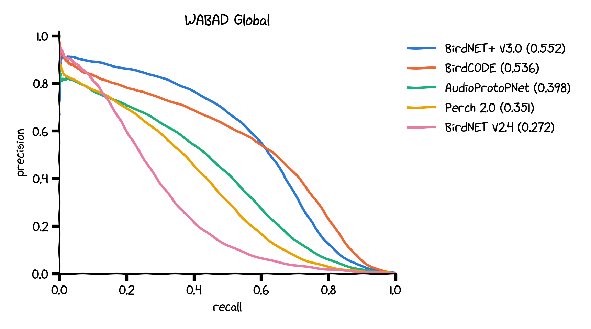

<p align="center">
  
</p>

<h1 align="center">BirdNET+ V3.0</h1>

<p align="center">
  <a href="LICENSE"></a>
  <a href="MODEL_LICENSE.md"></a>
  <a href="https://www.python.org/"></a>
  <a href="https://doi.org/10.5281/zenodo.24162518"></a>
  <a href="https://github.com/birdnet-team/birdnet-V3.0-dev/actions/workflows/tests.yml"></a>
  
  
</p>

<p align="center">
  BirdNET+ V3.0 identifies 11,709 animal species and 16 non-animal sound classes in audio recordings.<br>
  This repository is the developer entry point: model files, reference code, examples, tips, and benchmarks.
</p>

## Overview

BirdNET+ V3.0 Global 12K (November 2026) recognizes 9,788 birds, 802 insects, 649 amphibians, 419 mammals (including humans), 35 fishes, 15 reptiles, and 1 arachnid, plus 16 non-animal classes such as gun, chainsaw, and siren. Labels are linked to the [BirdNET+ Taxonomy](https://birdnet.cornell.edu/taxonomy/) with common names in 36 languages.

**Changes compared to BirdNET V2.4:**

- About twice the average precision on [WABAD](docs/wabad.md) (0.552 vs. 0.272)
- Nearly twice as many classes (11,725 vs. 6,522), with many more non-bird species
- Variable-length input instead of fixed 3 s segments
- 32 kHz input instead of 48 kHz
- Improved architecture and training on a much larger, more diverse dataset

> **Before you build your own pipeline**, check whether these already do what you need:
>
> - **[birdnet](https://github.com/birdnet-team/birdnet)**: Python package with a simple API and automatic model downloads (`pip install birdnet`).
> - **[BirdNET-Analyzer](https://github.com/birdnet-team/BirdNET-Analyzer)**: GUI and CLI for batch analysis, result review, and training custom classifiers.
>
> This repository is for working with the model files directly: integrating them into your own software, apps, or devices.

## Models

Download from [Zenodo](https://zenodo.org/records/24162518) (DOI [10.5281/zenodo.24162518](https://doi.org/10.5281/zenodo.24162518)). All files start with `BirdNET+_V3.0_Global_12K_` and share one label file.

| File suffix | Format | Size | Use it for |
|---|---|---:|---|
| `_FP16.onnx` | ONNX | 173 MB | **Default.** Desktop and server, CPU or GPU, any language with ONNX Runtime |
| `_FP32.onnx` | ONNX | 345 MB | Reference precision |
| `_FP32.pt` | TorchScript | 345 MB | PyTorch, GPU batch processing, fine-tuning experiments |
| `_FP16.tflite` / `_FP32.tflite` | LiteRT (TFLite) | 172 / 344 MB | Android, Raspberry Pi, embedded Linux |
| `_FP16_pruned.onnx` / `_FP16_pruned.tflite` | ONNX / LiteRT | 72 / 71 MB | Mobile and edge devices (one of three classifier heads) |
| `_FP16.mlpackage.zip` / `_FP32.mlpackage.zip` | Core ML | 172 / 332 MB | iOS 16+ and macOS 13+ |
| `_FP32_Protobuf.zip` | TF SavedModel | 318 MB | TensorFlow serving |
| `_Labels.csv` / `_Labels.xlsx` | CSV / Excel | 8 / 5 MB | One row per model output, same order for all models |
| `_Source_Checkpoint.zip` | TorchScript + ONNX | 838 MB | Research: unpruned model with all 16,852 training classes |

The scripts in this repository download the FP16 ONNX model and labels to `models/` on first use (set `BIRDNET_MODEL_DIR` to change the location).

## Setup

```bash
git clone https://github.com/birdnet-team/birdnet-V3.0-dev.git
cd birdnet-V3.0-dev
python3 -m venv .venv
source .venv/bin/activate        # Windows: .venv\Scripts\activate
pip install -r requirements.txt
```

Optional backends: `pip install ai-edge-litert` for `.tflite` models, `pip install torch` for `.pt` models, and `onnxruntime-gpu` instead of `onnxruntime` for NVIDIA GPUs.

## Usage

### Command line: `analyze.py`

```bash
python analyze.py example/soundscape.wav                         # one file -> results.csv
python analyze.py recordings/ -o results.csv --min-conf 0.5      # whole folder, recursive
python analyze.py recordings/ --lat 42.48 --lon -76.45 --week 20 # only species likely at this place and week
python analyze.py recordings/ --groups Aves --lang de            # birds only, German names
python analyze.py recordings/ --embeddings embeddings.npz        # also save 1280-d embeddings
```

| Option | Default | Description |
|---|---|---|
| `--model` | FP16 ONNX | Any `.onnx`, `.tflite` or `.pt` model file |
| `--min-conf` | 0.25 | Minimum score to report |
| `--chunk` / `--overlap` | 3.0 / 0.0 | Chunk length and overlap in seconds |
| `--lat`, `--lon`, `--week` | off | Geomodel species filter; week 1–48 (four per month), 0 = whole year |
| `--species` | off | Text file with scientific names to keep, one per line |
| `--groups` | all | Taxon groups to keep, e.g. `Aves Amphibia Insecta` |
| `--lang` | en | Common name language: `de`, `fr`, `es_MX`, `ja`, `zh`, ... (36 total) |
| `--embeddings` | off | Save per-chunk embeddings to an `.npz` file |
| `--device` | cpu | `cuda` for ONNX (with `onnxruntime-gpu`) and TorchScript |

Output is one CSV for all files: `file, start_sec, end_sec, scientific_name, common_name, confidence`.

### Streamlit demo: `app.py`

```bash
streamlit run app.py
```

Upload a recording (or try the example) to see the spectrogram, top species, and detections, with model, language, taxon group, and location filters. Results download as CSV or Audacity labels.

### Examples

Short, standalone scripts in [`examples/`](examples/). Run them from the repository root.

| Script | What it shows |
|---|---|
| [`onnx_minimal.py`](examples/onnx_minimal.py) | The whole pipeline in about 20 lines: load, resample, run, print top species |
| [`tflite_minimal.py`](examples/tflite_minimal.py) | LiteRT inference with the pruned model, as on Android or a Raspberry Pi |
| [`torchscript_minimal.py`](examples/torchscript_minimal.py) | PyTorch inference on CPU or GPU |
| [`embeddings_search.py`](examples/embeddings_search.py) | Find chunks that sound like a query with cosine similarity on embeddings |
| [`geo_species_list.py`](examples/geo_species_list.py) | Species list for a location and week from the Geomodel |

### In your own Python code

[`birdnet_v3.py`](birdnet_v3.py) is a single file with no framework, so you can copy it into your own project:

```python
import birdnet_v3 as bn

model = bn.Model()  # FP16 ONNX; also takes .tflite or .pt paths
labels = bn.load_labels()
chunks, starts = bn.chunk(bn.load_audio("example/soundscape.wav"), length=3.0)
scores, embeddings = model.predict(chunks)  # [N, 11725], [N, 1280]

mask = bn.GeoModel().mask(labels, lat=42.48, lon=-76.45, week=20)
scores[:, ~mask] = 0
```

## Tips and details

**Input**

- Mono float32 waveform in [-1, 1] at **32 kHz**, shape `[batch, samples]`. The spectrogram is computed inside the model, so you only need to resample audio.
- Any length works, but **3 s chunks** match training best. LiteRT models are most accurate at 3 s and drift slightly on other lengths; Core ML models take exactly 3 s.
- ONNX and TorchScript accept any batch size. LiteRT models have a fixed batch size of 1: resize the input to `[1, samples]` and loop.
- Digital silence (all zeros, or any zero-variance input) returns **NaN**. Replace NaN with 0, or skip silent chunks.
- Zero-pad the last chunk of a file to the full chunk length.

**Output**

- Two outputs: `predictions` (scores, one per class) and `embeddings_out` (1280-d). In LiteRT, the output names are generic; tell them apart by size.
- Scores are independent per class (0–1, multi-label), not a softmax: several species can score high in the same chunk, and scores do not sum to 1.
- Scores are not calibrated probabilities. 0.25 is a reasonable starting threshold. On WABAD, 65% of annotated calls had a window scoring 0.25 or higher for the right species, and 54% scored 0.5 or higher. Some species rank well but score low, so species-specific thresholds help.
- Embeddings are useful for similarity search, clustering, and training small classifiers for sounds or call types the model does not know.

**Labels**

- `BirdNET+_V3.0_Global_12K_Labels.csv` is comma-separated, one row per model output, in output order (`ix`).
- Columns: `birdnet_id` (stable BirdNET+ Taxonomy ID, e.g. `BN00001`), `scientific_name`, `common_name`, `taxon_group` (`Aves`, `Insecta`, `Amphibia`, `Mammalia`, `Actinopterygii`, `Reptilia`, `Arachnida`, `Anthropogenic`, `Geophony`, `Music`), `inat_id`, `ebird_code`, and `common_name_<lang>` for 36 languages. Fall back to `common_name` when a translation is empty.
- Look up more species metadata (descriptions, images, aliases) in the [BirdNET+ Taxonomy](https://birdnet.cornell.edu/taxonomy/).

**Precision and size**

- FP16 is half the size of FP32 with minimal accuracy loss. On the example soundscape, the largest score difference from FP32 TorchScript was 0.019 (FP16 ONNX) and 0.005 (FP16 LiteRT).
- The pruned models keep one of the three classifier heads. They are less than half the size, and scores differ by up to about 0.14 from the full model. Use them where size matters more than the last bit of accuracy.
- The FP16 ONNX model analyzes 2 minutes of audio in about 2.5 s on an 8-thread desktop CPU.

**Practical tips**

- **Filter by location.** The [Geomodel](https://github.com/birdnet-team/geomodel) removes species that are unlikely at a given place and time, a simple way to reduce false positives. It covers 10,874 of the 11,725 classes; uncovered classes (including all non-animal classes) are never filtered.
- **Overlap chunks** (e.g., `--overlap 1.5`) to catch calls that straddle chunk boundaries, at the cost of more compute.
- **Pool over time** for presence/absence per file or day: the maximum score per species over all chunks is a simple, effective summary.
- **Report the model file and precision** with your results so they stay reproducible.

**Going further**

- Custom species subsets, other precisions, or other formats: [model-converter](https://github.com/birdnet-team/model-converter).
- Microcontrollers: [birdnet-stm32](https://github.com/birdnet-team/birdnet-stm32) has a tiny model for the STM32N6 NPU.

## Benchmark



On [WABAD](https://zenodo.org/records/14191524) (66 sites on six continents, 88,967 expert-annotated calls), BirdNET+ V3.0 has the highest average precision overall and in five of seven regions, at a fraction of the compute of the next best model:

| Model | AP | GMAC per second of audio |
|---|---:|---:|
| **BirdNET+ V3.0** | **0.552** | 1.38 |
| BirdCODE | 0.536 | 33.29 |
| AudioProtoPNet | 0.398 | 34.04 |
| Perch 2.0 | 0.351 | 1.46 |
| BirdNET V2.4 | 0.272 | 0.135 |

AP is pooled over all 3 s windows on the 945 species all five models can predict. See [docs/wabad.md](docs/wabad.md) for results by region, site, and species, and for how we evaluated.

## BirdNET ecosystem

| Project | Description |
|---|---|
| [birdnet](https://github.com/birdnet-team/birdnet) | Python package: `pip install birdnet`, then `birdnet.load("acoustic", "3.0", "onnx").predict("audio.wav")` |
| [BirdNET-Analyzer](https://github.com/birdnet-team/BirdNET-Analyzer) | GUI and CLI for batch analysis, review, and custom classifier training |
| [Geomodel](https://github.com/birdnet-team/geomodel) | Species occurrence by location and week (14,082 species) to filter detections |
| [BirdNET+ Taxonomy](https://github.com/birdnet-team/birdnet-taxonomy) | Species IDs, localized names, and metadata ([browse](https://birdnet.cornell.edu/taxonomy/)) |
| [BirdBox](https://github.com/birdnet-team/BirdBox) | Bird call detection in time and frequency with an object detection model ([demo](https://birdnet-team.github.io/BirdBox/demo/)) |
| [model-converter](https://github.com/birdnet-team/model-converter) | Converts BirdNET+ V3.0 PyTorch models to ONNX, LiteRT, TorchScript, and Core ML |
| [birdnet-stm32](https://github.com/birdnet-team/birdnet-stm32) | Tiny acoustic model for the STM32N6 microcontroller |
| [birdnetR](https://github.com/birdnet-team/birdnetR) | R wrapper for the birdnet Python package |

## Repository layout

```
birdnet_v3.py     Reference code: audio loading, chunking, all model formats, Geomodel filter
analyze.py        Command-line batch analysis
app.py            Streamlit demo
examples/         Short standalone scripts
docs/wabad.md     WABAD benchmark results
example/          Example soundscape (2 min)
```

## Contributing

See [CONTRIBUTING.md](CONTRIBUTING.md). AI-assisted contributions are welcome; keep PRs focused and review every line. To report wrong or missed detections, open an issue with the audio, time range, and expected species.

## License

The source code is licensed under the MIT License — see the [LICENSE](LICENSE) file for details.

Trained model weights are licensed under the [Apache License, Version 2.0](MODEL_LICENSE.md).

## Acceptable Use

BirdNET is built to support biodiversity research and conservation. See [ACCEPTABLE_USE.md](ACCEPTABLE_USE.md) for how we expect the BirdNET+ V3.0 models to be used, including uses we consider unacceptable and guidance on branding derivative work.

## Citation

If you use BirdNET+ V3.0, please cite the model release:

Lasseck, M., Eibl, M., Klinck, H., & Kahl, S. (2026). BirdNET+ V3.0 model files (Version 3.0). Zenodo. https://doi.org/10.5281/zenodo.24162518

```bibtex
@misc{lasseck2026birdnet,
  title     = {{BirdNET+ V3.0} model files},
  author    = {Lasseck, Mario and Eibl, Maximilian and Klinck, Holger and Kahl, Stefan},
  year      = {2026},
  version   = {3.0},
  publisher = {Zenodo},
  doi       = {10.5281/zenodo.24162518},
  url       = {https://doi.org/10.5281/zenodo.24162518}
}
```

## Funding

Our work in the Cornell K. Lisa Yang Center for Conservation Bioacoustics is made possible by the generosity of K. Lisa Yang to advance innovative conservation technologies to inspire and inform the conservation of wildlife and habitats.

The development of BirdNET is supported by the German Federal Ministry of Research, Technology and Space (FKZ 01|S22072), the German Federal Ministry for the Environment, Climate Action, Nature Conservation and Nuclear Safety (FKZ 67KI31040E), the German Federal Ministry of Economic Affairs and Energy (FKZ 16KN095550), the Deutsche Bundesstiftung Umwelt (project 39263/01) and the European Social Fund.

## Partners

BirdNET is a joint effort of partners from academia and industry.
Without these partnerships, this project would not have been possible.
Thank you!


