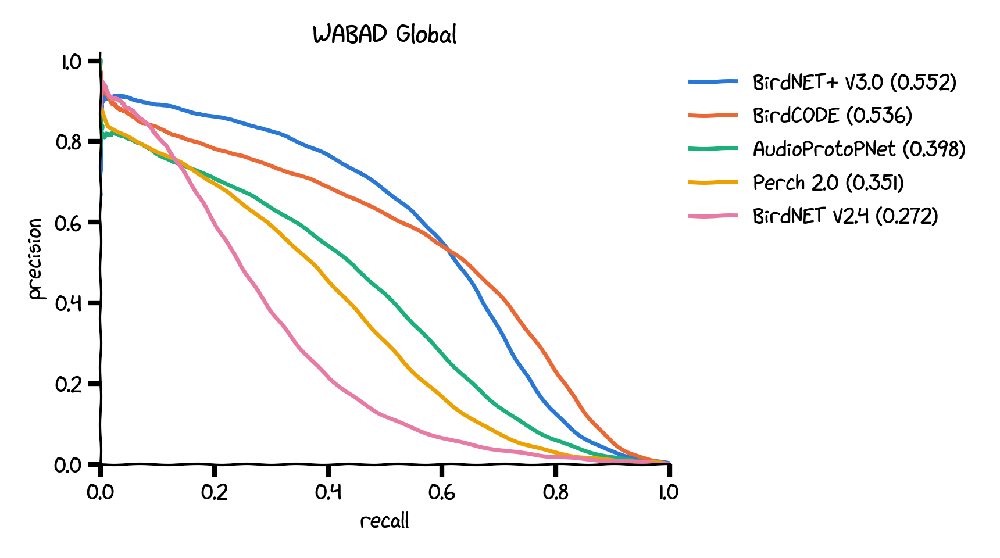
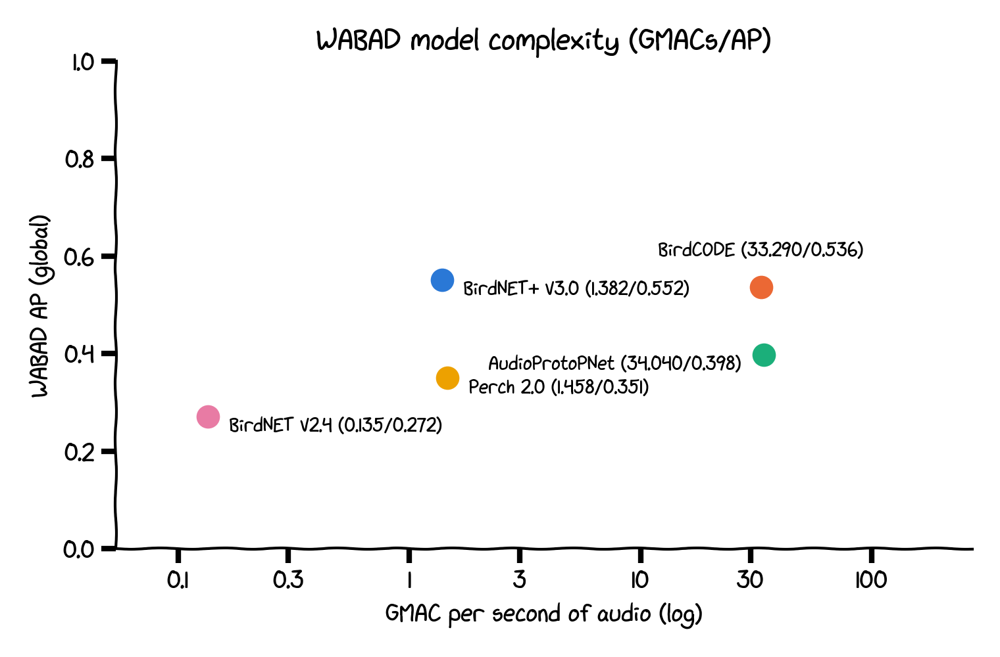
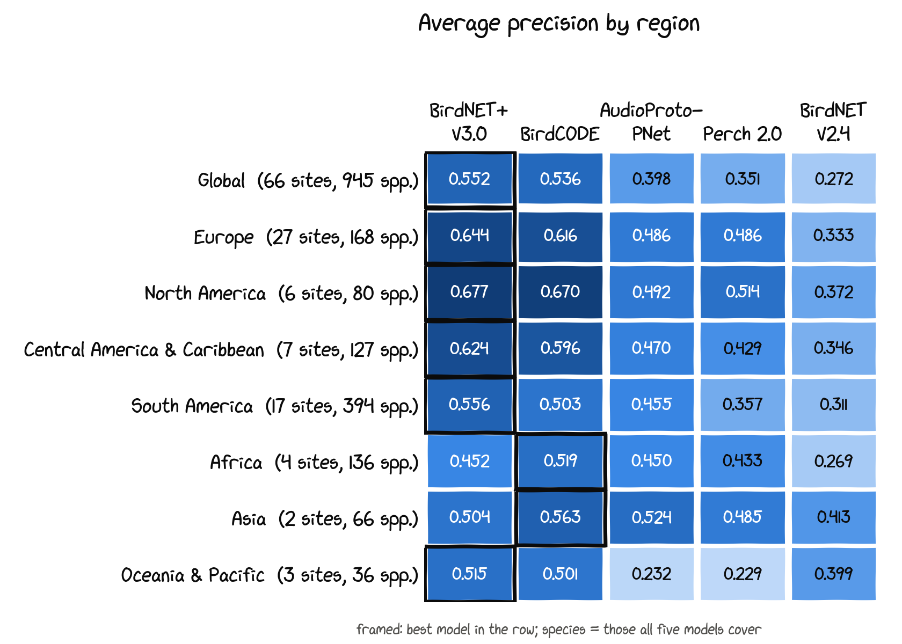
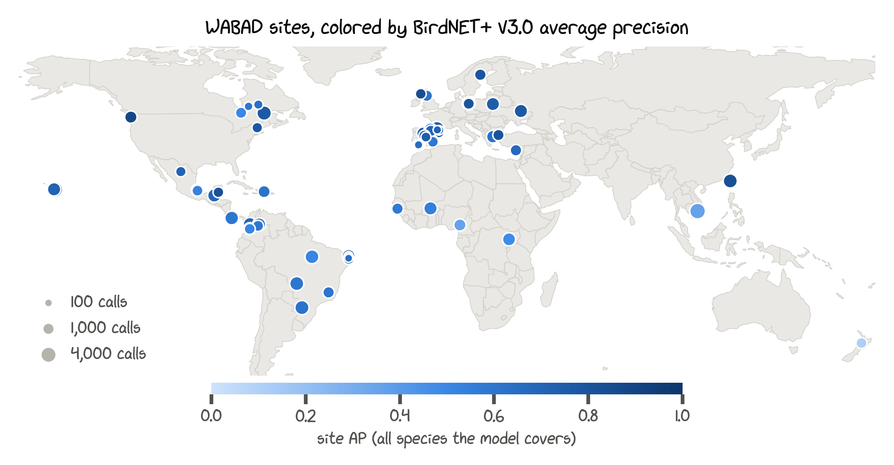

# BirdNET+ V3.0 on WABAD

How well do large bird sound classifiers find birds in real soundscapes? We ran BirdNET+ V3.0 and four other large models on WABAD, a public set of expert-annotated recordings from around the world: 66 sites, 88,967 annotated calls and about a thousand species. HawkEars joins for the North American sites. This page gives the overall scores, a breakdown by region and site, and per-species results for BirdNET+ V3.0. Results as of November 2026.

## Results at a glance

Scores are average precision (AP) pooled over every 3-second window and species, on the 945 species that all five models can predict.

|  | Model | AP | GMAC per second of audio | WABAD species it can predict |
| ---: | --- | ---: | ---: | ---: |
| 1 | BirdNET+ V3.0 | 0.552 | 1.382 | 1,066 |
| 2 | BirdCODE | 0.536 | 33.290 | 1,013 |
| 3 | AudioProtoPNet | 0.398 | 34.040 | 1,030 |
| 4 | Perch 2.0 | 0.351 | 1.458 | 1,066 |
| 5 | BirdNET V2.4 | 0.272 | 0.135 | 1,027 |

On the six North American sites, HawkEars reaches 0.618 on the 79 species it shares with the other models. On the same species BirdNET+ V3.0 scores 0.680 and BirdCODE 0.672.

BirdNET+ V3.0 has the highest AP overall and in five of the seven regions. BirdCODE comes close (0.536) and is ahead in Africa and Asia, the two regions with the fewest sites. AudioProtoPNet (0.398), Perch 2.0 (0.351) and BirdNET V2.4 (0.272) follow at some distance. BirdNET+ V3.0 roughly doubles the AP of its predecessor V2.4.

Compute matters for anyone running these models on large archives or small devices. BirdNET+ V3.0 and Perch 2.0 need about 1.4 GMAC per second of audio. BirdCODE and AudioProtoPNet need about 33 to 34, so BirdNET+ V3.0 does slightly better than BirdCODE with about a twenty-fourth of the compute.

## Regions

Each region is scored on the species all five models can predict there, so the species count differs from region to region.

| Region | Sites | Species | Windows | V3.0 | BirdCODE | AudioProtoPNet | Perch 2.0 | V2.4 | HawkEars |
| --- | ---: | ---: | ---: | ---: | ---: | ---: | ---: | ---: | ---: |
| All sites | 66 | 945 | 203,320 | **0.552** | 0.536 | 0.398 | 0.351 | 0.272 | – |
| Europe | 27 | 168 | 83,403 | **0.644** | 0.616 | 0.486 | 0.486 | 0.333 | – |
| North America | 6 | 80 | 13,959 | **0.677** | 0.670 | 0.492 | 0.514 | 0.372 | 0.618 |
| Central America & Caribbean | 7 | 127 | 26,206 | **0.624** | 0.596 | 0.470 | 0.429 | 0.346 | – |
| South America | 17 | 394 | 44,183 | **0.556** | 0.503 | 0.455 | 0.357 | 0.311 | – |
| Africa | 4 | 136 | 19,166 | 0.452 | **0.519** | 0.450 | 0.433 | 0.269 | – |
| Asia | 2 | 66 | 5,640 | 0.504 | **0.563** | 0.524 | 0.485 | 0.413 | – |
| Oceania & Pacific | 3 | 36 | 10,763 | **0.515** | 0.501 | 0.232 | 0.229 | 0.399 | – |

BirdNET+ V3.0's largest margin over BirdCODE is in South America (0.556 against 0.503, on 394 species). In Oceania, AudioProtoPNet and Perch 2.0 drop to 0.232 and 0.229. Asia has only two sites and Africa four, so the order there could change with more data.

## BirdNET+ V3.0 in detail

BirdNET+ V3.0 can predict 1,066 of the 1,069 species annotated at the evaluated sites. The three it lacks are rare in WABAD: Bannerman's Turaco (26 windows), Bannerman's Weaver (6 windows), Shelley's Oliveback (3 windows). Everything in this section uses all the species BirdNET+ V3.0 can predict, not only the set shared with the other models.

A call counts as found at a threshold when a window overlapping it scores at least that value for its species. Over all annotated calls:

| Threshold | 0.1 | 0.25 | 0.5 |
| --- | ---: | ---: | ---: |
| Calls found (share of all calls) | 0.734 | 0.651 | 0.536 |
| Calls found (mean over species) | 0.535 | 0.452 | 0.358 |

Across 1,065 species, the median window AP is 0.446 (quartiles 0.122 and 0.669). 126 species reach 0.8 or more and 349 stay below 0.2. Species with more annotated calls tend to score higher. Part of that is statistics: with only a handful of calls, one missed call moves the AP a lot.

| Calls per species | Species | Median AP | Species with AP ≥ 0.8 |
| --- | ---: | ---: | ---: |
| 1–9 | 380 | 0.121 | 29 |
| 10–49 | 326 | 0.415 | 29 |
| 50–199 | 247 | 0.573 | 29 |
| 200 or more | 112 | 0.739 | 39 |

### By region

AP here is on the shared species, as in the regions table. Mean site cmAP averages the per-species AP at each site over all species BirdNET+ V3.0 can predict, then averages the sites.

| Region | Sites | Calls | Species | AP | Mean site cmAP | Calls found at 0.1 | 0.25 | 0.5 |
| --- | ---: | ---: | ---: | ---: | ---: | ---: | ---: | ---: |
| Europe | 27 | 29,766 | 168 | 0.644 | 0.521 | 0.815 | 0.740 | 0.614 |
| North America | 6 | 6,625 | 80 | 0.677 | 0.563 | 0.845 | 0.788 | 0.690 |
| Central America & Caribbean | 7 | 9,549 | 127 | 0.624 | 0.556 | 0.728 | 0.643 | 0.535 |
| South America | 17 | 21,678 | 394 | 0.556 | 0.583 | 0.739 | 0.661 | 0.559 |
| Africa | 4 | 6,455 | 136 | 0.452 | 0.444 | 0.435 | 0.279 | 0.153 |
| Asia | 2 | 7,270 | 66 | 0.504 | 0.546 | 0.477 | 0.427 | 0.374 |
| Oceania & Pacific | 3 | 7,624 | 36 | 0.515 | 0.453 | 0.813 | 0.695 | 0.510 |

Africa stands out: the ranking is reasonable (AP 0.452) but scores are low, so few calls pass a fixed threshold.

### By site

Files, calls and species are what WABAD annotates at each site. AP (all) and cmAP use every species BirdNET+ V3.0 can predict that occurs at the site; AP (shared) uses the five-model species set and matches the per-site comparison further down.

| Site | Region | Country | Study area | Files | Calls | Species | AP (all) | cmAP | AP (shared) | Found at 0.25 | 0.5 |
| --- | --- | --- | --- | ---: | ---: | ---: | ---: | ---: | ---: | ---: | ---: |
| BIAL | Europe | Poland | Bialowieza forest district | 100 | 2,046 | 36 | 0.747 | 0.632 | 0.730 | 0.893 | 0.778 |
| BOLIN | Europe | Spain | Torre Palacio. Doñana | 93 | 1,154 | 42 | 0.286 | 0.280 | 0.286 | 0.536 | 0.390 |
| CAT | Europe | Spain | Solsona | 59 | 1,254 | 16 | 0.859 | 0.674 | 0.859 | 0.762 | 0.586 |
| CLH | Europe | Scotland | Eastern Scotland | 61 | 963 | 15 | 0.613 | 0.688 | 0.612 | 0.860 | 0.769 |
| COU | Europe | France | Couserans | 14 | 178 | 21 | 0.712 | 0.615 | 0.712 | 0.579 | 0.500 |
| DYOM | Europe | Cyprus | Western Cyprus | 62 | 1,029 | 16 | 0.664 | 0.409 | 0.669 | 0.690 | 0.561 |
| EVROS | Europe | Greece | Evros River Delta National Park | 80 | 934 | 19 | 0.798 | 0.443 | 0.803 | 0.844 | 0.753 |
| GLEN | Europe | Scotland | Glencrippesdale | 60 | 753 | 24 | 0.837 | 0.627 | 0.859 | 0.914 | 0.849 |
| HAG | Europe | France | Haute Garonne | 124 | 3,243 | 63 | 0.729 | 0.582 | 0.734 | 0.611 | 0.431 |
| HAR | Europe | France | Haute Ariège | 16 | 351 | 26 | 0.742 | 0.573 | 0.742 | 0.638 | 0.536 |
| HONDO | Europe | Spain | El Hondo Natural Park | 72 | 771 | 36 | 0.593 | 0.449 | 0.594 | 0.682 | 0.578 |
| JUNCA | Europe | Spain | Juncabalejo. Doñana | 31 | 403 | 14 | 0.835 | 0.520 | 0.835 | 0.864 | 0.769 |
| KAR | Europe | Sweden | Ecopark Käringberget | 112 | 1,053 | 26 | 0.797 | 0.659 | 0.797 | 0.887 | 0.803 |
| MARTI | Europe | Spain | Caño de Martinazo. Doñana | 57 | 392 | 21 | 0.374 | 0.239 | 0.374 | 0.589 | 0.548 |
| MILLAN | Europe | Spain | Cancela Millán. Doñana | 32 | 174 | 10 | 0.648 | 0.358 | 0.648 | 0.793 | 0.678 |
| MONTEB | Europe | Spain | Monteblanco entrada. Doñana | 72 | 335 | 15 | 0.481 | 0.313 | 0.468 | 0.540 | 0.436 |
| MOPU | Europe | Spain | Monte Público. Zarzalejo | 56 | 923 | 33 | 0.812 | 0.472 | 0.812 | 0.789 | 0.677 |
| NAV | Europe | Spain | Navarra | 58 | 1,549 | 33 | 0.655 | 0.480 | 0.655 | 0.661 | 0.558 |
| OLIV | Europe | Spain | Ontigola Toledo & Villaconejos | 71 | 484 | 21 | 0.741 | 0.605 | 0.741 | 0.661 | 0.521 |
| PINA | Europe | Spain | Tierra de Pinares. Valladolid | 60 | 1,670 | 37 | 0.721 | 0.607 | 0.721 | 0.819 | 0.676 |
| PITI | Europe | Spain | Pitillas Lagoon | 48 | 990 | 30 | 0.701 | 0.529 | 0.701 | 0.792 | 0.705 |
| POZO | Europe | Spain | Pozo de Santa Olalla. Doñana | 74 | 1,260 | 38 | 0.503 | 0.295 | 0.502 | 0.501 | 0.355 |
| SCHF | Europe | Germany | Schorfheide-Chorin | 60 | 884 | 20 | 0.797 | 0.759 | 0.797 | 0.971 | 0.861 |
| SCHG | Europe | Germany | Schorfheide-Chorin | 80 | 2,107 | 34 | 0.735 | 0.517 | 0.735 | 0.772 | 0.637 |
| SITH | Europe | Greece | Sithonia Penninsula. Chalkidiki | 99 | 1,658 | 20 | 0.629 | 0.451 | 0.641 | 0.647 | 0.476 |
| SLOB | Europe | Ukraine | North-Eastern Ukraine | 70 | 2,183 | 32 | 0.773 | 0.708 | 0.767 | 0.855 | 0.759 |
| VIL | Europe | Spain | Villena shrublands | 56 | 1,025 | 33 | 0.768 | 0.588 | 0.782 | 0.643 | 0.494 |
| CB | North America | Canada | Eeyou Istchee James Bay | 35 | 920 | 34 | 0.496 | 0.400 | 0.509 | 0.730 | 0.642 |
| FEU | North America | Canada | 2018 Wildfire. Labrieville. Québec | 69 | 3,079 | 34 | 0.772 | 0.609 | 0.774 | 0.722 | 0.606 |
| MABI | North America | USA | Marsh-Billings-Rockefeller NHP | 47 | 646 | 26 | 0.781 | 0.602 | 0.781 | 0.904 | 0.848 |
| NL | North America | Canada | Eeyou Istchee James Bay | 10 | 224 | 12 | 0.603 | 0.482 | 0.620 | 0.710 | 0.670 |
| OESF | North America | USA | Olympic Experimental SF | 126 | 1,428 | 18 | 0.884 | 0.767 | 0.825 | 0.933 | 0.854 |
| SD | North America | Canada | Eeyou Istchee James Bay | 10 | 328 | 18 | 0.635 | 0.518 | 0.641 | 0.771 | 0.598 |
| CRAT | Central America & Caribbean | Mexico | Parque Ecologico Macuiltepetl | 1 | 1,524 | 13 | 0.769 | 0.647 | 0.771 | 0.608 | 0.438 |
| CRUZ | Central America & Caribbean | Costa Rica | Las Cruces Biological Station | 78 | 2,437 | 29 | 0.594 | 0.453 | 0.608 | 0.645 | 0.579 |
| GTLU | Central America & Caribbean | Guatemala | Mayan Biosphere Reserve | 60 | 2,141 | 34 | 0.695 | 0.562 | 0.642 | 0.623 | 0.506 |
| LIM | Central America & Caribbean | Dominican Republic | Los Limones. Monte Plata | 92 | 1,324 | 15 | 0.615 | 0.399 | 0.630 | 0.636 | 0.482 |
| MAPIMI | Central America & Caribbean | Mexico | Reserva de la Biosfera Mapimi | 64 | 623 | 13 | 0.712 | 0.669 | 0.712 | 0.777 | 0.682 |
| QR | Central America & Caribbean | Mexico | Yucatán peninsula (Quintana Roo) | 65 | 705 | 58 | 0.815 | 0.741 | 0.825 | 0.835 | 0.774 |
| SBN | Central America & Caribbean | Mexico | Santuario del Bosque de Niebla | 72 | 795 | 22 | 0.526 | 0.420 | 0.530 | 0.499 | 0.430 |
| ARD | South America | Argentina | San Jorge Private Reserve, Misiones province | 84 | 2,834 | 88 | 0.614 | 0.580 | 0.616 | 0.774 | 0.678 |
| BMT | South America | Brazil | Pantanal Baia das Pedras | 60 | 2,729 | 93 | 0.601 | 0.420 | 0.613 | 0.599 | 0.488 |
| BRE | South America | Colombia | Reserva Natural Bremen-La Popa | 49 | 1,277 | 26 | 0.770 | 0.467 | 0.805 | 0.792 | 0.705 |
| CARI | South America | Colombia | Vereda Caribabare. Tame. Arauca | 62 | 2,056 | 33 | 0.621 | 0.490 | 0.617 | 0.614 | 0.475 |
| DUNAS | South America | Brazil | Parque Estadual Dunas de Natal | 60 | 1,718 | 25 | 0.741 | 0.783 | 0.698 | 0.706 | 0.616 |
| EMP | South America | Brazil | Mata do Jiqui - EMPARN | 14 | 198 | 18 | 0.651 | 0.746 | 0.594 | 0.884 | 0.854 |
| FNCA | South America | Brazil | Floresta Nacional de Carajás | 190 | 2,573 | 111 | 0.512 | 0.408 | 0.513 | 0.470 | 0.383 |
| PETI | South America | Brazil | Estação Ambiental de Peti | 60 | 1,006 | 30 | 0.613 | 0.632 | 0.585 | 0.756 | 0.689 |
| RBA | South America | Brazil | Mata Rio Baldum | 15 | 363 | 28 | 0.654 | 0.714 | 0.622 | 0.691 | 0.620 |
| RFP | South America | Brazil | RPPN Fazenda Pacatuba | 31 | 684 | 41 | 0.748 | 0.814 | 0.753 | 0.782 | 0.643 |
| RGU | South America | Brazil | RPPN REBIO Guaribas | 13 | 125 | 14 | 0.645 | 0.627 | 0.705 | 0.792 | 0.752 |
| RME | South America | Brazil | RPPN Mata Estrela | 13 | 175 | 21 | 0.559 | 0.730 | 0.495 | 0.811 | 0.777 |
| SAL | South America | Colombia | Reserva Natural La Montaña | 57 | 1,104 | 41 | 0.490 | 0.465 | 0.521 | 0.476 | 0.341 |
| SPMCO | South America | Colombia | San Pedro de los Milagros | 62 | 2,109 | 46 | 0.675 | 0.514 | 0.693 | 0.699 | 0.619 |
| TAM | South America | Colombia | Bosque el Algarrobo, Tamara. | 29 | 856 | 15 | 0.591 | 0.623 | 0.594 | 0.675 | 0.540 |
| UNI | South America | Colombia | Jardín Botánico Univ. del Quindío | 83 | 1,080 | 25 | 0.601 | 0.386 | 0.529 | 0.744 | 0.620 |
| VER | South America | Colombia | Alto Quindío. EL Vergel. Quindío | 57 | 791 | 32 | 0.520 | 0.517 | 0.566 | 0.587 | 0.470 |
| BAM | Africa | Cameroon | Bamenda Highlands. Big Babanki | 118 | 1,365 | 39 | 0.356 | 0.414 | 0.352 | 0.173 | 0.096 |
| BUR | Africa | Burkina Faso | Ouagadougou | 90 | 2,172 | 45 | 0.546 | 0.455 | 0.547 | 0.329 | 0.190 |
| KIB | Africa | Uganda | Kibale National Park | 140 | 1,917 | 74 | 0.478 | 0.314 | 0.488 | 0.269 | 0.130 |
| OIO | Africa | Guinea-Bissau | Oio Region. Guinea-Bissau | 60 | 1,001 | 41 | 0.578 | 0.593 | 0.572 | 0.331 | 0.195 |
| BRCAS | Asia | Taiwan | Tengjhih, Kaohsiung | 60 | 2,729 | 27 | 0.825 | 0.668 | 0.834 | 0.935 | 0.884 |
| DONG | Asia | Vietnam | Dong Nai Province | 60 | 4,541 | 61 | 0.359 | 0.423 | 0.368 | 0.121 | 0.068 |
| HAK | Oceania & Pacific | Hawaii (USA) | Hakalau NFWR | 70 | 4,693 | 14 | 0.796 | 0.547 | 0.788 | 0.784 | 0.560 |
| PUUL | Oceania & Pacific | Hawaii (USA) | Pu'u Lā'au. Hawai'i | 60 | 2,149 | 12 | 0.710 | 0.634 | 0.710 | 0.616 | 0.500 |
| ROTOK | Oceania & Pacific | New Zealand | Rotokare Scenic Reserve | 99 | 782 | 19 | 0.110 | 0.177 | 0.106 | 0.381 | 0.238 |

### Best and worst species

Among the 359 species with at least 50 annotated calls, these 20 score highest:

| Species | Scientific name | Calls | Sites | Window AP | Found at 0.25 | 0.5 |
| --- | --- | ---: | ---: | ---: | ---: | ---: |
| Great Crested Flycatcher | *Myiarchus crinitus* | 60 | 1 | 0.988 | 1.000 | 1.000 |
| Ladder-backed Woodpecker | *Dryobates scalaris* | 136 | 1 | 0.980 | 1.000 | 1.000 |
| Stripe-throated Hermit | *Phaethornis striigularis* | 590 | 1 | 0.977 | 0.990 | 0.981 |
| Gray-chested Dove | *Leptotila cassinii* | 76 | 1 | 0.977 | 0.974 | 0.829 |
| Rufous Nightjar | *Antrostomus rufus* | 212 | 5 | 0.945 | 0.910 | 0.868 |
| Pied Avocet | *Recurvirostra avosetta* | 111 | 2 | 0.934 | 0.919 | 0.829 |
| Western Flycatcher | *Empidonax difficilis* | 585 | 3 | 0.932 | 0.956 | 0.893 |
| Black-eared Barbet | *Psilopogon duvaucelii* | 95 | 1 | 0.932 | 0.042 | 0.000 |
| Apapane | *Himatione sanguinea* | 1,361 | 1 | 0.928 | 0.974 | 0.763 |
| Lesser Greenlet | *Pachysylvia decurtata* | 315 | 2 | 0.925 | 0.959 | 0.879 |
| Chestnut-capped Brushfinch | *Arremon brunneinucha* | 722 | 5 | 0.924 | 0.757 | 0.597 |
| Varied Thrush | *Ixoreus naevius* | 205 | 1 | 0.923 | 0.951 | 0.805 |
| Black-headed Trogon | *Trogon melanocephalus* | 265 | 2 | 0.921 | 0.830 | 0.763 |
| Rufous-faced Warbler | *Abroscopus albogularis* | 691 | 1 | 0.915 | 0.988 | 0.973 |
| Rufous-capped Spinetail | *Synallaxis ruficapilla* | 91 | 1 | 0.914 | 0.978 | 0.967 |
| Black-necklaced Scimitar Babbler | *Erythrogenys erythrocnemis* | 90 | 1 | 0.912 | 0.889 | 0.811 |
| Vinaceous Dove | *Streptopelia vinacea* | 246 | 2 | 0.911 | 0.435 | 0.158 |
| Wood Warbler | *Phylloscopus sibilatrix* | 328 | 2 | 0.910 | 0.976 | 0.951 |
| Pauraque | *Nyctidromus albicollis* | 217 | 3 | 0.909 | 0.959 | 0.912 |
| Azara's Spinetail | *Synallaxis azarae* | 282 | 1 | 0.905 | 0.954 | 0.904 |

And these 20 lowest:

| Species | Scientific name | Calls | Sites | Window AP | Found at 0.25 | 0.5 |
| --- | --- | ---: | ---: | ---: | ---: | ---: |
| White-browed Brushfinch | *Arremon torquatus* | 84 | 1 | 0.001 | 0.000 | 0.000 |
| Spectacled Thrush | *Turdus nudigenis* | 88 | 1 | 0.007 | 0.000 | 0.000 |
| Guira Tanager | *Hemithraupis guira* | 57 | 3 | 0.050 | 0.017 | 0.000 |
| Ashy Drongo | *Dicrurus leucophaeus* | 54 | 1 | 0.053 | 0.000 | 0.000 |
| Red-crowned Ant Tanager | *Habia rubica* | 111 | 1 | 0.055 | 0.000 | 0.000 |
| Northern Yellow White-eye | *Zosterops senegalensis* | 63 | 2 | 0.066 | 0.000 | 0.000 |
| Dark-throated Oriole | *Oriolus xanthonotus* | 128 | 1 | 0.070 | 0.000 | 0.000 |
| New Zealand Fantail | *Rhipidura fuliginosa* | 75 | 1 | 0.078 | 0.533 | 0.400 |
| Common Iora | *Aegithina tiphia* | 109 | 1 | 0.095 | 0.000 | 0.000 |
| Garden Sunbird | *Cinnyris jugularis* | 319 | 1 | 0.096 | 0.000 | 0.000 |
| Sulphur-bellied Flycatcher | *Myiodynastes luteiventris* | 137 | 1 | 0.102 | 0.255 | 0.175 |
| Blue-black Grassquit | *Volatinia jacarina* | 57 | 1 | 0.116 | 0.123 | 0.035 |
| American Three-toed Woodpecker | *Picoides dorsalis* | 59 | 1 | 0.124 | 0.102 | 0.051 |
| Silvereye | *Zosterops lateralis* | 97 | 1 | 0.126 | 0.660 | 0.536 |
| Hawaii Elepaio | *Chasiempis sandwichensis* | 70 | 1 | 0.132 | 0.086 | 0.000 |
| Red Junglefowl | *Gallus gallus* | 72 | 7 | 0.147 | 0.486 | 0.278 |
| Little Greenbul | *Eurillas virens* | 51 | 1 | 0.152 | 0.059 | 0.000 |
| Tui | *Prosthemadera novaeseelandiae* | 204 | 1 | 0.152 | 0.255 | 0.083 |
| Tomtit | *Petroica macrocephala* | 83 | 1 | 0.162 | 0.277 | 0.157 |
| Black-crested Bulbul | *Rubigula flaviventris* | 90 | 1 | 0.165 | 0.022 | 0.000 |

Three of the weakest species, Tui, New Zealand Fantail and Silvereye, all come from ROTOK in New Zealand, where every model does poorly (BirdNET+ V3.0 site AP 0.110). We suspect the annotations there are shifted in time but have not checked. Another three, Dark-throated Oriole, Common Iora and Garden Sunbird, are from DONG in Vietnam (site AP 0.359).

A high AP does not always mean calls pass a fixed threshold. Black-eared Barbet ranks almost perfectly (AP 0.932), but its scores are so low that only 4% of its calls reach 0.25. Vinaceous Dove (AP 0.911) has 16% of its calls above 0.5. Species-specific thresholds would recover these.

## All models by site

AP per site on the five-model species set; HawkEars on the North American sites. The best score in each row is in bold. Single sites rest on few species and windows, so read them together rather than one by one.

| Site | Region | Species | V3.0 | BirdCODE | AudioProtoPNet | Perch 2.0 | V2.4 | HawkEars |
| --- | --- | ---: | ---: | ---: | ---: | ---: | ---: | ---: |
| BIAL | Europe | 34 | **0.730** | 0.639 | 0.466 | 0.529 | 0.247 | – |
| BOLIN | Europe | 42 | 0.286 | **0.343** | 0.261 | 0.231 | 0.196 | – |
| CAT | Europe | 16 | **0.859** | 0.807 | 0.719 | 0.696 | 0.659 | – |
| CLH | Europe | 14 | **0.612** | 0.606 | 0.533 | 0.567 | 0.586 | – |
| COU | Europe | 21 | **0.712** | 0.683 | 0.613 | 0.530 | 0.527 | – |
| DYOM | Europe | 15 | 0.669 | **0.693** | 0.509 | 0.516 | 0.479 | – |
| EVROS | Europe | 18 | **0.803** | 0.803 | 0.738 | 0.745 | 0.726 | – |
| GLEN | Europe | 22 | **0.859** | 0.816 | 0.707 | 0.713 | 0.717 | – |
| HAG | Europe | 62 | **0.734** | 0.715 | 0.579 | 0.538 | 0.354 | – |
| HAR | Europe | 26 | 0.742 | **0.777** | 0.657 | 0.612 | 0.558 | – |
| HONDO | Europe | 34 | **0.594** | 0.552 | 0.427 | 0.593 | 0.521 | – |
| JUNCA | Europe | 14 | **0.835** | 0.790 | 0.726 | 0.721 | 0.704 | – |
| KAR | Europe | 26 | **0.797** | 0.741 | 0.631 | 0.644 | 0.413 | – |
| MARTI | Europe | 21 | 0.374 | **0.378** | 0.284 | 0.324 | 0.227 | – |
| MILLAN | Europe | 10 | **0.648** | 0.645 | 0.528 | 0.553 | 0.489 | – |
| MONTEB | Europe | 13 | 0.468 | **0.489** | 0.429 | 0.310 | 0.309 | – |
| MOPU | Europe | 33 | **0.812** | 0.797 | 0.689 | 0.682 | 0.531 | – |
| NAV | Europe | 33 | **0.655** | 0.648 | 0.534 | 0.563 | 0.442 | – |
| OLIV | Europe | 21 | **0.741** | 0.734 | 0.631 | 0.634 | 0.562 | – |
| PINA | Europe | 37 | **0.721** | 0.675 | 0.561 | 0.576 | 0.585 | – |
| PITI | Europe | 30 | 0.701 | **0.750** | 0.665 | 0.684 | 0.651 | – |
| POZO | Europe | 36 | 0.502 | **0.525** | 0.464 | 0.417 | 0.271 | – |
| SCHF | Europe | 20 | **0.797** | 0.675 | 0.585 | 0.672 | 0.554 | – |
| SCHG | Europe | 34 | **0.735** | 0.700 | 0.620 | 0.586 | 0.503 | – |
| SITH | Europe | 19 | **0.641** | 0.641 | 0.576 | 0.558 | 0.531 | – |
| SLOB | Europe | 29 | **0.767** | 0.710 | 0.550 | 0.572 | 0.423 | – |
| VIL | Europe | 30 | 0.782 | **0.801** | 0.731 | 0.692 | 0.630 | – |
| CB | North America | 32 | **0.509** | 0.497 | 0.403 | 0.437 | 0.391 | 0.505 |
| FEU | North America | 33 | 0.774 | **0.793** | 0.614 | 0.624 | 0.415 | 0.734 |
| MABI | North America | 26 | **0.781** | 0.710 | 0.544 | 0.598 | 0.567 | 0.758 |
| NL | North America | 10 | **0.620** | 0.608 | 0.439 | 0.536 | 0.416 | 0.549 |
| OESF | North America | 17 | **0.825** | 0.749 | 0.654 | 0.700 | 0.677 | 0.764 |
| SD | North America | 17 | 0.641 | **0.717** | 0.508 | 0.525 | 0.498 | 0.619 |
| CRAT | Central America & Caribbean | 12 | 0.771 | **0.782** | 0.741 | 0.760 | 0.640 | – |
| CRUZ | Central America & Caribbean | 27 | **0.608** | 0.529 | 0.427 | 0.470 | 0.352 | – |
| GTLU | Central America & Caribbean | 31 | 0.642 | **0.672** | 0.537 | 0.464 | 0.328 | – |
| LIM | Central America & Caribbean | 12 | **0.630** | 0.606 | 0.502 | 0.559 | 0.479 | – |
| MAPIMI | Central America & Caribbean | 13 | **0.712** | 0.675 | 0.649 | 0.689 | 0.676 | – |
| QR | Central America & Caribbean | 53 | **0.825** | 0.768 | 0.659 | 0.730 | 0.701 | – |
| SBN | Central America & Caribbean | 21 | 0.530 | **0.547** | 0.429 | 0.416 | 0.282 | – |
| ARD | South America | 82 | **0.616** | 0.580 | 0.499 | 0.417 | 0.217 | – |
| BMT | South America | 87 | 0.613 | **0.645** | 0.626 | 0.504 | 0.411 | – |
| BRE | South America | 23 | **0.805** | 0.502 | 0.707 | 0.774 | 0.678 | – |
| CARI | South America | 31 | 0.617 | **0.642** | 0.568 | 0.524 | 0.346 | – |
| DUNAS | South America | 23 | **0.698** | 0.670 | 0.599 | 0.575 | 0.571 | – |
| EMP | South America | 15 | 0.594 | 0.639 | 0.580 | **0.691** | 0.641 | – |
| FNCA | South America | 99 | 0.513 | **0.576** | 0.524 | 0.340 | 0.265 | – |
| PETI | South America | 27 | **0.585** | 0.535 | 0.472 | 0.430 | 0.332 | – |
| RBA | South America | 25 | 0.622 | **0.623** | 0.576 | 0.557 | 0.558 | – |
| RFP | South America | 34 | 0.753 | **0.764** | 0.693 | 0.599 | 0.563 | – |
| RGU | South America | 12 | 0.705 | 0.612 | 0.504 | 0.633 | **0.746** | – |
| RME | South America | 17 | 0.495 | **0.694** | 0.567 | 0.680 | 0.660 | – |
| SAL | South America | 39 | 0.521 | **0.532** | 0.457 | 0.492 | 0.468 | – |
| SPMCO | South America | 42 | **0.693** | 0.656 | 0.564 | 0.544 | 0.509 | – |
| TAM | South America | 14 | 0.594 | **0.598** | 0.596 | 0.487 | 0.521 | – |
| UNI | South America | 23 | 0.529 | 0.519 | 0.497 | 0.532 | **0.559** | – |
| VER | South America | 27 | 0.566 | **0.573** | 0.545 | 0.560 | 0.561 | – |
| BAM | Africa | 24 | **0.352** | 0.316 | 0.331 | 0.335 | 0.340 | – |
| BUR | Africa | 44 | 0.547 | **0.664** | 0.581 | 0.559 | 0.409 | – |
| KIB | Africa | 62 | 0.488 | **0.539** | 0.470 | 0.521 | 0.242 | – |
| OIO | Africa | 39 | 0.572 | 0.595 | **0.604** | 0.595 | 0.354 | – |
| BRCAS | Asia | 22 | **0.834** | 0.786 | 0.686 | 0.717 | 0.621 | – |
| DONG | Asia | 46 | 0.368 | **0.512** | 0.470 | 0.399 | 0.302 | – |
| HAK | Oceania & Pacific | 13 | **0.788** | 0.747 | 0.313 | 0.596 | 0.404 | – |
| PUUL | Oceania & Pacific | 12 | 0.710 | **0.711** | 0.497 | 0.502 | 0.691 | – |
| ROTOK | Oceania & Pacific | 15 | 0.106 | **0.117** | 0.100 | 0.095 | 0.082 | – |

BirdNET+ V3.0 has the best score at 35 sites and BirdCODE at 27; the other models lead at 4 sites between them. Head to head, BirdCODE beats BirdNET+ V3.0 at 29 of 66 sites.

## How we evaluated

**Data.** WABAD (Pérez-Granados et al. 2025, Zenodo record 14191524, CC BY-NC 4.0) contains 4,298 one-minute recordings from 70 passive acoustic monitoring sites on six continents. Local experts annotated each bird call with its species and start and end time.

**Sites.** We score 66 of the 70 sites (4,202 files). Three Indonesian sites (BERB, EFFOR, EFFOU) only have weak labels and are left out, as in the BirdCODE paper. We also leave out HUAP in China: it has 1,098 annotations of only three species (427, 427 and 244 calls), which looks like annotation of target species only. Other birds calling there would count as false positives.

**Species.** 1,069 bird species are annotated at the 67 sites with strong labels. Names were matched to the BirdNET taxonomy by scientific name and synonyms; eleven spellings needed a manual fix and one annotation stayed unmatched. Each model's outputs were mapped to these species by name.

**Fair comparison.** A model is only scored on species it can predict. Every comparison uses the species all its models share, so adding a model can shrink the set: the five-model global set has 945 species, 30 fewer than without AudioProtoPNet.

**Windows.** We cut each recording into 3-second windows with a 1.25-second hop. A window counts as positive for a species if it overlaps one of its annotations. Every model scores the same windows, each with its usual input:

- BirdNET+ V3.0 and BirdNET V2.4 take the 3-second window itself.
- Perch 2.0 and AudioProtoPNet take 5 seconds of audio centered on the window.
- BirdCODE predicts 7.6 frames per second over the whole recording (5-second windows, half overlapping); a window gets the highest frame score inside it.
- HawkEars averages its six-model ensemble on each 3-second window.

**Metrics.**

- *AP* is average precision over all window and species pairs of a comparison, pooled across sites. This is the number in the plots.
- *cmAP* is the mean of the per-species AP at a site, over the species that occur there.
- *Calls found at t* is the share of annotated calls with an overlapping window scoring at least t for the right species. Score scales differ between models, so we report it only for BirdNET+ V3.0.

**Compute.** Multiply-accumulate operations of the convolutions and matrix multiplications for one input window at batch size 1, divided by the window length. HawkEars counts all six models of its ensemble.

## Models

| Model | Version | Input | WABAD species | GMAC/s |
| --- | --- | --- | ---: | ---: |
| BirdNET+ V3.0 | global release, about 12,000 species | 3 s at 32 kHz | 1,066 | 1.38 |
| BirdCODE | Earth Species Project sound event detector | 5 s at 32 kHz, 7.6 frames per second | 1,013 | 33.29 |
| AudioProtoPNet | AudioProtoPNet-20 | 5 s at 32 kHz | 1,030 | 34.04 |
| Perch 2.0 | ONNX export | 5 s at 32 kHz | 1,066 | 1.46 |
| BirdNET V2.4 | global, about 6,000 species | 3 s at 48 kHz | 1,027 | 0.135 |
| HawkEars 2.3 | North American birds, six-model ensemble | 3 s at 28 kHz | 82 | 1.96 |

We also tried ESP AVES2 and AvesEcho in earlier runs. Both scored well below the models above, so we left them out.

## Caveats

- Asia is two sites (DONG, BRCAS) and Africa four. Regional rankings there are tentative.
- ROTOK (New Zealand) is included, although its annotations may be offset in time. It pulls the Oceania numbers down for every model.
- APs from different tables can rest on different species sets and are then not directly comparable: BirdNET+ V3.0 scores 0.677 on the 80 North American species shared by five models and 0.680 on the 79 it shares with HawkEars as well.
- All models learned from public sound archives. BirdNET+ V3.0 was not trained on WABAD (see [training data](model.md#data)), but we can't rule out that some models trained on recordings from the same places or recordists as WABAD.
- BirdNET Tiny N6 model cards also report WABAD, but on 61 sites and their own 1,013 classes. Those numbers are not comparable with this page. Restricting the species list hides much of the tropical diversity: at BRCAS in Taiwan, BirdCODE scores 0.122 on the 414 calls of species in that list and 0.672 on all 2,729 calls.

## Appendix: every species, BirdNET+ V3.0

All 1,065 species, ordered by the number of annotated calls. Sites lists where the species was annotated.

| Species | Scientific name | Calls | Window AP | Found at 0.25 | 0.5 | Sites |
| --- | --- | ---: | ---: | ---: | ---: | --- |
| Eurasian Chaffinch | *Fringilla coelebs* | 3,324 | 0.819 | 0.903 | 0.813 | BIAL, CLH, COU, DYOM, GLEN, HAG, HAR, KAR, MOPU, NAV, OLIV, PINA, ROTOK, SCHF, SCHG, SITH, SLOB, VIL |
| Common Blackbird | *Turdus merula* | 2,308 | 0.724 | 0.817 | 0.655 | BIAL, BOLIN, CAT, CLH, COU, DYOM, GLEN, HAG, HAR, KAR, MONTEB, MOPU, NAV, OLIV, PINA, PITI, POZO, ROTOK, SCHF, SCHG, SITH, SLOB, VIL |
| Common Nightingale | *Luscinia megarhynchos* | 1,583 | 0.740 | 0.772 | 0.590 | BOLIN, BUR, EVROS, HAG, MARTI, MOPU, PINA, PITI, POZO, SCHG |
| Corn Bunting | *Emberiza calandra* | 1,541 | 0.828 | 0.864 | 0.803 | BOLIN, EVROS, HAG, JUNCA, MARTI, MILLAN, MOPU, PITI, POZO, SCHG, VIL |
| European Robin | *Erithacus rubecula* | 1,395 | 0.734 | 0.794 | 0.604 | BIAL, BOLIN, CAT, CLH, GLEN, HAG, HAR, HONDO, KAR, NAV, OLIV, PINA, SCHF, SLOB |
| Apapane | *Himatione sanguinea* | 1,361 | 0.928 | 0.974 | 0.763 | HAK |
| Hawaii Amakihi | *Chlorodrepanis virens* | 1,356 | 0.745 | 0.654 | 0.515 | HAK, PUUL |
| Iiwi | *Drepanis coccinea* | 1,213 | 0.833 | 0.956 | 0.739 | HAK |
| Great Tit | *Parus major* | 1,161 | 0.698 | 0.688 | 0.507 | BIAL, BOLIN, CAT, CLH, COU, DYOM, GLEN, HAG, HAR, KAR, MARTI, MONTEB, NAV, OLIV, PINA, PITI, POZO, SCHF, SCHG, SITH, SLOB |
| Chivi Vireo | *Vireo chivi* | 1,069 | 0.846 | 0.933 | 0.861 | ARD, BMT, DUNAS, EMP, PETI, RBA, RFP, RGU, RME |
| Eurasian Blackcap | *Sylvia atricapilla* | 1,007 | 0.597 | 0.778 | 0.613 | BIAL, BOLIN, CAT, CLH, COU, GLEN, HAG, HAR, HONDO, NAV, OLIV, PITI, SCHF, SITH, SLOB |
| White-breasted Wood Wren | *Henicorhina leucosticta* | 902 | 0.601 | 0.660 | 0.573 | CRUZ, GTLU, UNI |
| Song Thrush | *Turdus philomelos* | 833 | 0.668 | 0.687 | 0.489 | BIAL, CAT, COU, HAG, HAR, KAR, NAV, PINA, SCHF, SCHG, SITH, SLOB |
| Common Chiffchaff | *Phylloscopus collybita* | 819 | 0.809 | 0.883 | 0.719 | BAM, BIAL, CLH, COU, HAG, HAR, HONDO, NAV, OLIV, SCHF, SCHG, SITH, SLOB |
| Coal Tit | *Periparus ater* | 768 | 0.685 | 0.690 | 0.563 | BIAL, COU, DYOM, GLEN, HAG, HAR, NAV, PINA, SCHF, SLOB |
| White-throated Sparrow | *Zonotrichia albicollis* | 749 | 0.725 | 0.741 | 0.615 | CB, FEU, MABI, NL, SD |
| Chestnut-capped Brushfinch | *Arremon brunneinucha* | 722 | 0.924 | 0.757 | 0.597 | BRE, CRAT, SAL, SPMCO, UNI |
| Common Nighthawk | *Chordeiles minor* | 708 | 0.886 | 0.934 | 0.927 | FEU |
| Eurasian Blue Tit | *Cyanistes caeruleus* | 707 | 0.659 | 0.646 | 0.487 | BIAL, BOLIN, CLH, GLEN, HAG, HAR, NAV, OLIV, PINA, SCHF, SCHG, SITH, SLOB |
| Rufous-faced Warbler | *Abroscopus albogularis* | 691 | 0.915 | 0.988 | 0.973 | BRCAS |
| Sardinian Warbler | *Curruca melanocephala* | 642 | 0.636 | 0.556 | 0.435 | BOLIN, DYOM, HONDO, MARTI, MONTEB, MOPU, OLIV, POZO, SITH, VIL |
| Hermit Thrush | *Catharus guttatus* | 602 | 0.808 | 0.819 | 0.705 | CB, FEU, MABI, NL, SD |
| Bananaquit | *Coereba flaveola* | 598 | 0.521 | 0.554 | 0.388 | BMT, DUNAS, EMP, FNCA, LIM, PETI, UNI |
| Common Bulbul | *Pycnonotus barbatus* | 598 | 0.790 | 0.600 | 0.369 | BAM, BUR, KIB, OIO |
| Stripe-throated Hermit | *Phaethornis striigularis* | 590 | 0.977 | 0.990 | 0.981 | CRUZ |
| Western Flycatcher | *Empidonax difficilis* | 585 | 0.932 | 0.956 | 0.893 | CRAT, OESF, SBN |
| Eurasian Wren | *Troglodytes troglodytes* | 530 | 0.725 | 0.949 | 0.872 | BIAL, BOLIN, CLH, COU, DYOM, GLEN, HAG, HAR, NAV, SCHF |
| Golden-crowned Warbler | *Basileuterus culicivorus* | 528 | 0.609 | 0.829 | 0.720 | ARD, CRAT, FNCA, PETI, SBN |
| Omao | *Myadestes obscurus* | 501 | 0.741 | 0.800 | 0.467 | HAK |
| Lesser Violetear | *Colibri cyanotus* | 498 | 0.839 | 0.926 | 0.900 | BRE, SPMCO |
| Thekla's Lark | *Galerida theklae* | 491 | 0.741 | 0.556 | 0.417 | MARTI, MONTEB, POZO, VIL |
| Javan Leafbird | *Chloropsis cochinchinensis* | 473 | 0.294 | 0.000 | 0.000 | DONG |
| Pale-breasted Thrush | *Turdus leucomelas* | 452 | 0.478 | 0.551 | 0.427 | ARD, BMT, CARI, DUNAS, PETI, RBA, RFP, RGU |
| Pectoral Antwren | *Herpsilochmus pectoralis* | 448 | 0.846 | 0.672 | 0.576 | DUNAS, EMP, RBA, RME |
| American Robin | *Turdus migratorius* | 444 | 0.636 | 0.795 | 0.594 | CB, FEU, NL, OESF, SD |
| Goldcrest | *Regulus regulus* | 437 | 0.619 | 0.371 | 0.270 | BIAL, GLEN, HAR, KAR, NAV, SITH, SLOB |
| Zitting Cisticola | *Cisticola juncidis* | 429 | 0.751 | 0.758 | 0.662 | BUR, HAG, HONDO, JUNCA, MARTI, POZO |
| Willow Warbler | *Phylloscopus trochilus* | 418 | 0.894 | 0.971 | 0.907 | BAM, GLEN, KAR, POZO, SCHG |
| Blue-capped Motmot | *Momotus coeruliceps* | 415 | 0.895 | 0.446 | 0.176 | CRAT |
| Rufous-collared Sparrow | *Zonotrichia capensis* | 406 | 0.872 | 0.980 | 0.931 | SPMCO |
| Warbling White-eye | *Zosterops japonicus* | 406 | 0.708 | 0.658 | 0.419 | HAK, PUUL |
| Eurasian Skylark | *Alauda arvensis* | 405 | 0.738 | 0.889 | 0.765 | EVROS, HAG, HAR, MARTI, PITI, PUUL, SCHG |
| House Finch | *Haemorhous mexicanus* | 383 | 0.637 | 0.775 | 0.637 | PUUL |
| Ochre-lored Flatbill | *Tolmomyias flaviventris* | 377 | 0.762 | 0.767 | 0.676 | CARI, DUNAS, EMP, RBA, RFP, RME, TAM |
| Dark-necked Tailorbird | *Orthotomus atrogularis* | 373 | 0.660 | 0.139 | 0.056 | DONG |
| Black-whiskered Vireo | *Vireo altiloquus* | 372 | 0.615 | 0.699 | 0.476 | LIM |
| Piratic Flycatcher | *Legatus leucophaius* | 367 | 0.892 | 0.929 | 0.921 | ARD, BMT, CARI, FNCA, TAM |
| Woodlark | *Lullula arborea* | 367 | 0.731 | 0.763 | 0.610 | COU, HAG, HAR, MOPU, OLIV, PINA, POZO, SITH |
| Rufous-browed Peppershrike | *Cyclarhis gujanensis* | 365 | 0.618 | 0.756 | 0.633 | ARD, CARI, DUNAS, FNCA, QR, RBA, RFP, TAM |
| European Stonechat | *Saxicola rubicola* | 344 | 0.603 | 0.523 | 0.418 | BOLIN, HAG, HAR, JUNCA, MARTI, MOPU, POZO, SCHG, VIL |
| Slate-colored Grosbeak | *Saltator grossus* | 330 | 0.766 | 0.682 | 0.588 | FNCA |
| Wood Warbler | *Phylloscopus sibilatrix* | 328 | 0.910 | 0.976 | 0.951 | BIAL, SLOB |
| Cirl Bunting | *Emberiza cirlus* | 322 | 0.768 | 0.652 | 0.519 | BOLIN, CAT, HAG, MOPU, PITI |
| Garden Sunbird | *Cinnyris jugularis* | 319 | 0.096 | 0.000 | 0.000 | DONG |
| Short-toed Treecreeper | *Certhia brachydactyla* | 318 | 0.765 | 0.877 | 0.836 | BOLIN, DYOM, HAG, NAV, PINA |
| Lesser Greenlet | *Pachysylvia decurtata* | 315 | 0.925 | 0.959 | 0.879 | GTLU, QR |
| Buff-breasted Wren | *Cantorchilus leucotis* | 307 | 0.780 | 0.844 | 0.678 | BMT, CARI |
| Common Cuckoo | *Cuculus canorus* | 306 | 0.835 | 0.977 | 0.928 | BIAL, COU, GLEN, HAG, HAR, HONDO, KAR, MOPU, PINA, PITI, SCHG, SLOB |
| Yellow-fronted Canary | *Crithagra mozambica* | 305 | 0.518 | 0.380 | 0.220 | BAM, BUR, PUUL |
| Southern Beardless Tyrannulet | *Camptostoma obsoletum* | 297 | 0.486 | 0.563 | 0.296 | ARD, BMT, CARI, DUNAS, EMP, RBA, RFP, RGU, RME |
| Whinchat | *Saxicola rubetra* | 296 | 0.811 | 0.787 | 0.713 | SCHG |
| Rufous-capped Babbler | *Cyanoderma ruficeps* | 294 | 0.824 | 0.986 | 0.952 | BRCAS |
| Dark-eyed Junco | *Junco hyemalis* | 293 | 0.565 | 0.692 | 0.577 | CB, FEU, NL |
| Erckel's Spurfowl | *Pternistis erckelii* | 291 | 0.676 | 0.326 | 0.189 | PUUL |
| Plain Antvireo | *Dysithamnus mentalis* | 291 | 0.756 | 0.900 | 0.839 | ARD, BMT, BRE, PETI, RFP |
| Yellow-rumped Warbler | *Setophaga coronata* | 291 | 0.399 | 0.553 | 0.351 | CB, FEU, MABI, NL, SD |
| Bright-rumped Attila | *Attila spadiceus* | 290 | 0.794 | 0.876 | 0.810 | CARI, FNCA, GTLU, QR |
| Scaly-breasted Illadopsis | *Illadopsis albipectus* | 290 | 0.755 | 0.431 | 0.214 | KIB |
| Eurasian Golden Oriole | *Oriolus oriolus* | 287 | 0.637 | 0.658 | 0.561 | BIAL, HAG, MOPU, PINA, SCHG, SLOB |
| Taiwan Yuhina | *Yuhina brunneiceps* | 283 | 0.874 | 0.951 | 0.873 | BRCAS |
| Azara's Spinetail | *Synallaxis azarae* | 282 | 0.905 | 0.954 | 0.904 | SPMCO |
| Green-winged Saltator | *Saltator similis* | 281 | 0.842 | 0.928 | 0.825 | ARD, PETI |
| Common Firecrest | *Regulus ignicapilla* | 280 | 0.685 | 0.761 | 0.675 | BIAL, BOLIN, HAG, MONTEB, NAV, PINA, SCHF, SITH |
| Crimson Sunbird | *Aethopyga siparaja* | 280 | 0.355 | 0.000 | 0.000 | DONG |
| Scarlet-backed Flowerpecker | *Dicaeum cruentatum* | 278 | 0.338 | 0.018 | 0.000 | DONG |
| Gray-cheeked Fulvetta | *Alcippe morrisonia* | 275 | 0.896 | 0.924 | 0.829 | BRCAS |
| Black-headed Trogon | *Trogon melanocephalus* | 265 | 0.921 | 0.830 | 0.763 | GTLU, QR |
| White-eared Sibia | *Heterophasia auricularis* | 265 | 0.900 | 1.000 | 0.981 | BRCAS |
| Bleating Camaroptera | *Camaroptera brachyura* | 263 | 0.385 | 0.156 | 0.046 | BUR, KIB, OIO |
| Great Reed Warbler | *Acrocephalus arundinaceus* | 260 | 0.636 | 0.919 | 0.834 | HONDO, PITI |
| Hawaii Creeper | *Loxops mana* | 260 | 0.479 | 0.165 | 0.042 | HAK |
| Eurasian Collared Dove | *Streptopelia decaocto* | 255 | 0.562 | 0.580 | 0.330 | BOLIN, HAG, VIL |
| European Greenfinch | *Chloris chloris* | 255 | 0.402 | 0.537 | 0.396 | BOLIN, HAG, JUNCA, MONTEB, MOPU, NAV, OLIV, PINA, PITI, POZO, ROTOK, SITH, VIL |
| Western Yellow Wagtail | *Motacilla flava* | 255 | 0.740 | 0.800 | 0.636 | JUNCA, MARTI, MILLAN, PITI, POZO |
| Red-billed Leiothrix | *Leiothrix lutea* | 254 | 0.774 | 0.795 | 0.645 | HAK, PUUL |
| Slaty Brushfinch | *Atlapetes schistaceus* | 252 | 0.478 | 0.131 | 0.020 | SAL, VER |
| Yellow-breasted Boubou | *Laniarius atroflavus* | 252 | 0.635 | 0.127 | 0.079 | BAM, BUR, OIO |
| Common Whitethroat | *Curruca communis* | 248 | 0.509 | 0.492 | 0.371 | HAG |
| Vinaceous Dove | *Streptopelia vinacea* | 246 | 0.911 | 0.435 | 0.158 | BUR, OIO |
| Great Spotted Woodpecker | *Dendrocopos major* | 242 | 0.686 | 0.768 | 0.624 | BIAL, HAG, KAR, NAV, PINA, SCHF, SLOB |
| Blue Manakin | *Chiroxiphia caudata* | 239 | 0.808 | 0.887 | 0.770 | ARD, PETI |
| Rufous-breasted Wren | *Pheugopedius rutilus* | 238 | 0.480 | 0.848 | 0.537 | CARI, CRUZ, TAM |
| Yellow-faced Grassquit | *Tiaris olivaceus* | 236 | 0.762 | 0.886 | 0.831 | LIM, SPMCO |
| Wilson's Warbler | *Cardellina pusilla* | 235 | 0.380 | 0.434 | 0.391 | SBN |
| Orange-billed Nightingale-Thrush | *Catharus aurantiirostris* | 232 | 0.305 | 0.203 | 0.091 | CRUZ |
| Mistle Thrush | *Turdus viscivorus* | 229 | 0.470 | 0.581 | 0.423 | HAG, KAR, MOPU, NAV, PINA, SCHG |
| Brown Jay | *Cyanocorax morio* | 227 | 0.891 | 0.886 | 0.850 | CRAT, GTLU, QR, SBN |
| Taiwan Liocichla | *Liocichla steerii* | 226 | 0.864 | 0.947 | 0.903 | BRCAS |
| European Serin | *Serinus serinus* | 225 | 0.607 | 0.662 | 0.582 | BOLIN, DYOM, HAG, MARTI, MOPU, NAV, OLIV, PINA, PITI, POZO, SCHG, VIL |
| Pauraque | *Nyctidromus albicollis* | 217 | 0.909 | 0.959 | 0.912 | CARI, RBA, RFP |
| White-bellied Wren | *Uropsila leucogastra* | 217 | 0.811 | 0.571 | 0.452 | GTLU |
| Orange-tufted Sunbird | *Cinnyris bouvieri* | 216 | 0.490 | 0.000 | 0.000 | BAM |
| Variable Antshrike | *Thamnophilus caerulescens* | 214 | 0.874 | 0.991 | 0.977 | ARD, BMT |
| Rufous Nightjar | *Antrostomus rufus* | 212 | 0.945 | 0.910 | 0.868 | EMP, FNCA, RBA, RFP, RME |
| Scarlet Minivet | *Pericrocotus speciosus* | 210 | 0.400 | 0.000 | 0.000 | DONG |
| Common Wood Pigeon | *Columba palumbus* | 207 | 0.626 | 0.802 | 0.604 | BIAL, CLH, DYOM, HAG, KAR, NAV, PINA, SCHF, SCHG, VIL |
| Acadian Flycatcher | *Empidonax virescens* | 205 | 0.658 | 0.741 | 0.673 | BRE |
| Varied Thrush | *Ixoreus naevius* | 205 | 0.923 | 0.951 | 0.805 | OESF |
| Yellow-rumped Tinkerbird | *Pogoniulus bilineatus* | 205 | 0.840 | 0.215 | 0.078 | BAM, KIB |
| Tui | *Prosthemadera novaeseelandiae* | 204 | 0.152 | 0.255 | 0.083 | ROTOK |
| Gray-fronted Dove | *Leptotila rufaxilla* | 203 | 0.318 | 0.325 | 0.211 | ARD, FNCA, RBA |
| Hawaii Akepa | *Loxops coccineus* | 200 | 0.574 | 0.230 | 0.010 | HAK |
| Gray-breasted Wood Wren | *Henicorhina leucophrys* | 198 | 0.602 | 0.762 | 0.641 | BRE, SAL, SBN, SPMCO, UNI |
| Mato Grosso Antbird | *Cercomacra melanaria* | 196 | 0.758 | 0.296 | 0.158 | BMT |
| European Goldfinch | *Carduelis carduelis* | 192 | 0.317 | 0.386 | 0.286 | BOLIN, HAG, MARTI, MONTEB, MOPU, NAV, OLIV, PINA, POZO, VIL |
| Gray-chinned Minivet | *Pericrocotus solaris* | 192 | 0.776 | 0.969 | 0.943 | BRCAS |
| Northern Gray-headed Sparrow | *Passer griseus* | 192 | 0.565 | 0.057 | 0.010 | BUR |
| Yellowhammer | *Emberiza citrinella* | 192 | 0.624 | 0.677 | 0.521 | CAT, HAG, HAR, SCHG |
| Carrion Crow | *Corvus corone* | 191 | 0.410 | 0.393 | 0.230 | CLH, COU, HAG, NAV, PINA, PITI |
| Golden-fronted Whitestart | *Myioborus ornatus* | 190 | 0.721 | 0.700 | 0.537 | SAL, SPMCO, VER |
| Amazonian Motmot | *Momotus momota* | 189 | 0.626 | 0.736 | 0.598 | BMT, CARI, FNCA, RFP |
| Swainson's Thrush | *Catharus ustulatus* | 189 | 0.746 | 0.831 | 0.740 | CB, FEU |
| Blackish Tapaculo | *Scytalopus latrans* | 187 | 0.888 | 0.893 | 0.738 | SAL, SPMCO, VER |
| Parker's Antbird | *Cercomacroides parkeri* | 185 | 0.811 | 0.935 | 0.924 | UNI |
| Smooth-billed Ani | *Crotophaga ani* | 179 | 0.845 | 0.961 | 0.883 | BMT, LIM |
| Swallow Tanager | *Tersina viridis* | 179 | 0.693 | 0.911 | 0.883 | TAM |
| Tree Pipit | *Anthus trivialis* | 176 | 0.718 | 0.841 | 0.716 | BIAL, COU, HAG, HAR, KAR, SLOB |
| Brown Creeper | *Certhia americana* | 175 | 0.641 | 0.829 | 0.680 | MABI, OESF |
| Trilling Gnatwren | *Ramphocaenus melanurus* | 175 | 0.398 | 0.389 | 0.326 | CRUZ, FNCA, GTLU, QR, RFP, RGU |
| Bluish-gray Saltator | *Saltator coerulescens* | 171 | 0.669 | 0.813 | 0.713 | BMT |
| White-tipped Dove | *Leptotila verreauxi* | 171 | 0.657 | 0.760 | 0.509 | ARD, BMT, FNCA, GTLU, QR, RFP, SPMCO |
| Spotless Starling | *Sturnus unicolor* | 170 | 0.255 | 0.436 | 0.371 | BOLIN, MOPU, NAV, PINA, VIL |
| Dusky-capped Flycatcher | *Myiarchus tuberculifer* | 169 | 0.431 | 0.461 | 0.278 | CARI, FNCA, GTLU, QR |
| Solitary Cacique | *Cacicus solitarius* | 169 | 0.525 | 0.207 | 0.166 | BMT, DUNAS |
| Black-headed Saltator | *Saltator atriceps* | 167 | 0.673 | 0.563 | 0.509 | CRAT, QR |
| Greater Racket-tailed Drongo | *Dicrurus paradiseus* | 167 | 0.259 | 0.078 | 0.018 | DONG |
| Cetti's Warbler | *Cettia cetti* | 166 | 0.438 | 0.627 | 0.578 | BOLIN, DYOM, EVROS, HONDO, MARTI, PITI, POZO |
| European Bee-eater | *Merops apiaster* | 166 | 0.775 | 0.777 | 0.711 | BOLIN, DYOM, EVROS, HAG, MOPU, PINA, PITI, POZO, SLOB |
| Mayan Antthrush | *Formicarius moniliger* | 166 | 0.874 | 0.873 | 0.825 | GTLU, QR |
| Ochre-crowned Greenlet | *Tunchiornis ochraceiceps* | 166 | 0.494 | 0.368 | 0.169 | FNCA, GTLU |
| Chestnut-backed Chickadee | *Poecile rufescens* | 165 | 0.822 | 0.879 | 0.806 | OESF |
| House Sparrow | *Passer domesticus* | 165 | 0.196 | 0.509 | 0.303 | BOLIN, HAG, HONDO, MARTI, MOPU, OLIV, PITI, VIL |
| Lesson's Motmot | *Momotus lessonii* | 163 | 0.275 | 0.896 | 0.503 | GTLU, QR |
| Rose-throated Tanager | *Piranga roseogularis* | 163 | 0.691 | 0.110 | 0.043 | GTLU |
| Northern Double-collared Sunbird | *Cinnyris reichenowi* | 162 | 0.481 | 0.191 | 0.117 | BAM |
| Rufous-margined Antwren | *Herpsilochmus rufimarginatus* | 162 | 0.614 | 0.642 | 0.500 | ARD, FNCA, PETI |
| Eurasian Jay | *Garrulus glandarius* | 159 | 0.308 | 0.252 | 0.189 | BIAL, DYOM, HAG, KAR, NAV, POZO, SITH, SLOB |
| Western Bonelli's Warbler | *Phylloscopus bonelli* | 158 | 0.810 | 0.905 | 0.854 | HAG, PINA |
| Tambourine Dove | *Turtur tympanistria* | 157 | 0.758 | 0.452 | 0.159 | BAM, KIB |
| Ovenbird | *Seiurus aurocapilla* | 155 | 0.653 | 0.806 | 0.774 | CB, LIM, MABI |
| Social Flycatcher | *Myiozetetes similis* | 155 | 0.607 | 0.691 | 0.580 | CARI, DUNAS, QR, SBN |
| Spot-breasted Wren | *Pheugopedius maculipectus* | 155 | 0.671 | 0.961 | 0.826 | CRAT, GTLU, QR, SBN |
| Fork-tailed Drongo | *Dicrurus adsimilis* | 154 | 0.580 | 0.123 | 0.033 | BUR, OIO |
| Western Oriole | *Oriolus brachyrynchus* | 154 | 0.726 | 0.325 | 0.130 | KIB |
| Undulated Tinamou | *Crypturellus undulatus* | 151 | 0.763 | 0.940 | 0.881 | BMT |
| Yellow-olive Flatbill | *Tolmomyias sulphurescens* | 151 | 0.461 | 0.543 | 0.463 | CRUZ, FNCA, GTLU, PETI, QR |
| Acorn Woodpecker | *Melanerpes formicivorus* | 150 | 0.563 | 0.626 | 0.506 | SAL, SBN, SPMCO |
| Oriental Magpie-Robin | *Copsychus saularis* | 149 | 0.473 | 0.275 | 0.107 | DONG |
| Canada Goose | *Branta canadensis* | 145 | 0.791 | 0.793 | 0.607 | CB, FEU, SD |
| Meadow Pipit | *Anthus pratensis* | 144 | 0.654 | 0.708 | 0.611 | GLEN, JUNCA, MARTI, MILLAN, SCHG |
| Gray Antbird | *Cercomacra cinerascens* | 143 | 0.554 | 0.727 | 0.678 | FNCA |
| Orange-billed Sparrow | *Arremon aurantiirostris* | 143 | 0.572 | 0.510 | 0.406 | CRUZ |
| Rufous-naped Greenlet | *Pachysylvia semibrunnea* | 143 | 0.461 | 0.545 | 0.301 | BRE, UNI |
| Northern Cardinal | *Cardinalis cardinalis* | 142 | 0.290 | 0.429 | 0.254 | HAK, PUUL, QR |
| Dartford Warbler | *Curruca undata* | 140 | 0.527 | 0.800 | 0.729 | MONTEB, POZO, VIL |
| Collared Flycatcher | *Ficedula albicollis* | 139 | 0.670 | 0.878 | 0.835 | SLOB |
| Mountain Elaenia | *Elaenia frantzii* | 137 | 0.248 | 0.095 | 0.080 | SPMCO |
| Palm Tanager | *Thraupis palmarum* | 137 | 0.362 | 0.401 | 0.263 | CARI, DUNAS, FNCA |
| Sulphur-bellied Flycatcher | *Myiodynastes luteiventris* | 137 | 0.102 | 0.255 | 0.175 | CRAT |
| Ladder-backed Woodpecker | *Dryobates scalaris* | 136 | 0.980 | 1.000 | 1.000 | MAPIMI |
| Palmchat | *Dulus dominicus* | 136 | 0.747 | 0.404 | 0.257 | LIM |
| Carolina Wren | *Thryothorus ludovicianus* | 134 | 0.179 | 0.254 | 0.216 | GTLU |
| Common Reed Warbler | *Acrocephalus scirpaceus* | 134 | 0.724 | 0.426 | 0.380 | HONDO, PITI |
| White-bellied Tody-Tyrant | *Hemitriccus griseipectus* | 134 | 0.756 | 0.746 | 0.619 | RFP, RGU, RME |
| Stripe-necked Tody-Tyrant | *Hemitriccus striaticollis* | 133 | 0.669 | 0.647 | 0.474 | BMT, EMP, RBA, RME |
| Crested Tit | *Lophophanes cristatus* | 132 | 0.749 | 0.781 | 0.659 | COU, HAG, HAR, NAV, PINA |
| Purple-throated Euphonia | *Euphonia chlorotica* | 132 | 0.732 | 0.584 | 0.394 | ARD, BMT, DUNAS, EMP, FNCA, RBA, RME |
| Curve-billed Thrasher | *Toxostoma curvirostre* | 131 | 0.710 | 0.756 | 0.611 | MAPIMI |
| Dark-throated Oriole | *Oriolus xanthonotus* | 128 | 0.070 | 0.000 | 0.000 | DONG |
| Great Iora | *Aegithina lafresnayei* | 128 | 0.213 | 0.000 | 0.000 | DONG |
| Citrine Warbler | *Myiothlypis luteoviridis* | 127 | 0.849 | 0.858 | 0.622 | SAL, VER |
| White-lored Spinetail | *Synallaxis albilora* | 127 | 0.771 | 0.362 | 0.157 | BMT |
| Common Hoopoe | *Upupa epops* | 124 | 0.668 | 0.621 | 0.468 | BOLIN, BUR, HAG, MOPU, PINA, SLOB, VIL |
| Ruby-crowned Tanager | *Tachyphonus coronatus* | 124 | 0.491 | 0.935 | 0.895 | ARD |
| Ruby-crowned Kinglet | *Corthylio calendula* | 123 | 0.391 | 0.708 | 0.594 | CB, FEU, NL, SD |
| Yellow-rumped Cacique | *Cacicus cela* | 123 | 0.491 | 0.626 | 0.358 | BMT |
| Crested Guan | *Penelope purpurascens* | 122 | 0.443 | 0.254 | 0.180 | CARI |
| Chestnut-crowned Antpitta | *Grallaria ruficapilla* | 119 | 0.863 | 0.907 | 0.840 | SAL, SPMCO |
| Pacific Wren | *Troglodytes pacificus* | 119 | 0.903 | 0.992 | 0.975 | OESF |
| Andean Motmot | *Momotus aequatorialis* | 118 | 0.835 | 0.653 | 0.491 | BRE, SPMCO |
| Black-faced Antbird | *Myrmoborus myotherinus* | 117 | 0.733 | 0.812 | 0.718 | FNCA |
| Rufous-capped Motmot | *Baryphthengus ruficapillus* | 117 | 0.897 | 0.915 | 0.752 | ARD |
| Spotted Flycatcher | *Muscicapa striata* | 117 | 0.470 | 0.726 | 0.555 | POZO, SLOB |
| Tropical Kingbird | *Tyrannus melancholicus* | 116 | 0.757 | 0.888 | 0.810 | SPMCO, UNI |
| Pyrrhuloxia | *Cardinalis sinuatus* | 115 | 0.627 | 0.539 | 0.435 | MAPIMI |
| Masked Flowerpiercer | *Diglossa cyanea* | 114 | 0.415 | 0.404 | 0.325 | SPMCO, VER |
| Rufous-bellied Thrush | *Turdus rufiventris* | 114 | 0.308 | 0.596 | 0.395 | ARD, PETI, RGU |
| Scale-crested Pygmy Tyrant | *Lophotriccus pileatus* | 113 | 0.560 | 0.690 | 0.619 | CRUZ |
| Eurasian Magpie | *Pica pica* | 112 | 0.301 | 0.411 | 0.312 | CLH, DYOM, EVROS, HAG, MARTI, MILLAN, OLIV, POZO, VIL |
| Hispaniolan Woodpecker | *Melanerpes striatus* | 112 | 0.495 | 0.438 | 0.250 | LIM |
| Least Flycatcher | *Empidonax minimus* | 112 | 0.782 | 0.982 | 0.982 | CB |
| Wild Turkey | *Meleagris gallopavo* | 112 | 0.573 | 0.652 | 0.571 | PUUL |
| Chestnut-headed Tanager | *Thlypopsis pyrrhocoma* | 111 | 0.620 | 0.441 | 0.360 | ARD |
| Pied Avocet | *Recurvirostra avosetta* | 111 | 0.934 | 0.919 | 0.829 | EVROS, HONDO |
| Red-crowned Ant Tanager | *Habia rubica* | 111 | 0.055 | 0.000 | 0.000 | GTLU |
| Common Iora | *Aegithina tiphia* | 109 | 0.095 | 0.000 | 0.000 | DONG |
| Great Thrush | *Turdus fuscater* | 109 | 0.687 | 0.697 | 0.578 | SAL, SPMCO, VER |
| Red-faced Spinetail | *Cranioleuca erythrops* | 109 | 0.603 | 0.936 | 0.834 | CRUZ, UNI |
| Little Owl | *Athene noctua* | 108 | 0.594 | 0.546 | 0.408 | BOLIN, MOPU, VIL |
| Boat-billed Flycatcher | *Megarynchus pitangua* | 107 | 0.535 | 0.598 | 0.496 | PETI, QR, SBN, TAM |
| Clay-colored Thrush | *Turdus grayi* | 107 | 0.708 | 0.804 | 0.654 | CRAT, GTLU, QR |
| White-rumped Shama | *Copsychus malabaricus* | 107 | 0.311 | 0.159 | 0.084 | DONG |
| Chestnut-crowned Foliage-gleaner | *Automolus rufipileatus* | 105 | 0.417 | 0.305 | 0.276 | TAM |
| Puff-throated Babbler | *Pellorneum ruficeps* | 105 | 0.509 | 0.267 | 0.105 | DONG |
| White-naped Jay | *Cyanocorax cyanopogon* | 105 | 0.659 | 0.628 | 0.543 | DUNAS, FNCA |
| White-necked Thrush | *Turdus albicollis* | 104 | 0.386 | 0.500 | 0.452 | ARD, FNCA, PETI |
| Euler's Flycatcher | *Lathrotriccus euleri* | 102 | 0.359 | 0.716 | 0.637 | ARD, FNCA |
| Eurasian Siskin | *Spinus spinus* | 102 | 0.647 | 0.529 | 0.461 | BIAL, CB, FEU, KAR, SCHF, SCHG, SITH |
| Black-billed Wood Dove | *Turtur abyssinicus* | 101 | 0.586 | 0.139 | 0.030 | BUR |
| Greater Flamingo | *Phoenicopterus roseus* | 101 | 0.331 | 0.762 | 0.683 | HONDO |
| Orange-breasted Trogon | *Harpactes oreskios* | 99 | 0.585 | 0.323 | 0.232 | DONG |
| Yellow-throated Tinkerbird | *Pogoniulus subsulphureus* | 99 | 0.620 | 0.242 | 0.141 | KIB |
| Stripe-throated Bulbul | *Pycnonotus finlaysoni* | 98 | 0.395 | 0.143 | 0.071 | DONG |
| Silvereye | *Zosterops lateralis* | 97 | 0.126 | 0.660 | 0.536 | ROTOK |
| Yellow Bishop | *Euplectes capensis* | 97 | 0.176 | 0.000 | 0.000 | BAM |
| Brown Illadopsis | *Illadopsis fulvescens* | 96 | 0.513 | 0.240 | 0.031 | KIB |
| Eurasian Treecreeper | *Certhia familiaris* | 96 | 0.232 | 0.313 | 0.250 | BIAL, KAR, NAV, PINA, SLOB |
| Magnolia Warbler | *Setophaga magnolia* | 96 | 0.568 | 0.625 | 0.531 | CB, FEU, MABI, QR |
| Black-eared Barbet | *Psilopogon duvaucelii* | 95 | 0.932 | 0.042 | 0.000 | DONG |
| Northern Raven | *Corvus corax* | 94 | 0.574 | 0.638 | 0.521 | BIAL, CB, COU, HAG, KAR, MILLAN, NAV, OESF, PINA, SCHF, SCHG, SITH |
| Ochraceous Bulbul | *Alophoixus ochraceus* | 94 | 0.659 | 0.213 | 0.117 | DONG |
| Thrush-like Wren | *Campylorhynchus turdinus* | 94 | 0.879 | 0.989 | 0.979 | BMT |
| Andean Solitaire | *Myadestes ralloides* | 93 | 0.682 | 0.849 | 0.688 | BRE |
| Black-backed Woodpecker | *Picoides arcticus* | 93 | 0.290 | 0.387 | 0.280 | FEU |
| Eastern Wood Pewee | *Contopus virens* | 92 | 0.870 | 0.924 | 0.902 | MABI, SBN |
| Taiwan Barbet | *Psilopogon nuchalis* | 92 | 0.885 | 1.000 | 0.989 | BRCAS |
| Wood Thrush | *Hylocichla mustelina* | 92 | 0.870 | 0.848 | 0.837 | MABI, QR |
| Crested Lark | *Galerida cristata* | 91 | 0.254 | 0.626 | 0.461 | CAT, EVROS, HAG, MILLAN, MOPU, OLIV, PITI, POZO |
| Rufous-capped Spinetail | *Synallaxis ruficapilla* | 91 | 0.914 | 0.978 | 0.967 | ARD |
| Black-crested Bulbul | *Rubigula flaviventris* | 90 | 0.165 | 0.022 | 0.000 | DONG |
| Black-necklaced Scimitar Babbler | *Erythrogenys erythrocnemis* | 90 | 0.912 | 0.889 | 0.811 | BRCAS |
| Asian Fairy-bluebird | *Irena puella* | 89 | 0.561 | 0.416 | 0.382 | DONG |
| Spectacled Thrush | *Turdus nudigenis* | 88 | 0.007 | 0.000 | 0.000 | TAM |
| Common Moorhen | *Gallinula chloropus* | 87 | 0.418 | 0.575 | 0.471 | CLH, HONDO, PITI |
| African Hill Babbler | *Sylvia abyssinica* | 86 | 0.623 | 0.291 | 0.151 | BAM |
| Northern Red Bishop | *Euplectes franciscanus* | 85 | 0.586 | 0.412 | 0.341 | BUR |
| Rock Bunting | *Emberiza cia* | 85 | 0.592 | 0.600 | 0.530 | CAT, COU, HAR, MOPU, PINA |
| Senegal Parrot | *Poicephalus senegalus* | 85 | 0.519 | 0.235 | 0.142 | BUR, OIO |
| Tawny-breasted Tinamou | *Nothocercus julius* | 85 | 0.500 | 0.341 | 0.153 | SAL |
| Gray Apalis | *Apalis cinerea* | 84 | 0.416 | 0.214 | 0.060 | BAM |
| White-browed Brushfinch | *Arremon torquatus* | 84 | 0.001 | 0.000 | 0.000 | CRUZ |
| Ocellated Poorwill | *Nyctiphrynus ocellatus* | 83 | 0.651 | 0.627 | 0.494 | FNCA |
| Tomtit | *Petroica macrocephala* | 83 | 0.162 | 0.277 | 0.157 | ROTOK |
| White-shouldered Fire-eye | *Pyriglena leucoptera* | 82 | 0.684 | 0.854 | 0.732 | ARD, PETI |
| African Golden Oriole | *Oriolus auratus* | 80 | 0.356 | 0.125 | 0.087 | BUR, OIO |
| Red-eyed Vireo | *Vireo olivaceus* | 80 | 0.705 | 0.675 | 0.650 | FNCA, MABI |
| Yellow-fronted Tinkerbird | *Pogoniulus chrysoconus* | 79 | 0.573 | 0.177 | 0.064 | BUR, KIB, OIO |
| Blue-backed Manakin | *Chiroxiphia pareola* | 78 | 0.435 | 0.705 | 0.680 | DUNAS, EMP, FNCA, RBA, RFP, RGU, RME |
| Northern Red-billed Hornbill | *Tockus erythrorhynchus* | 77 | 0.694 | 0.130 | 0.039 | BUR |
| Red-winged Blackbird | *Agelaius phoeniceus* | 77 | 0.794 | 0.935 | 0.766 | CB |
| Vernal Hanging Parrot | *Loriculus vernalis* | 77 | 0.460 | 0.325 | 0.169 | DONG |
| Greater Short-toed Lark | *Calandrella brachydactyla* | 76 | 0.442 | 0.513 | 0.342 | EVROS, JUNCA, MILLAN, MONTEB, VIL |
| Gray-chested Dove | *Leptotila cassinii* | 76 | 0.977 | 0.974 | 0.829 | CRUZ |
| North Island Saddleback | *Philesturnus rufusater* | 76 | 0.349 | 0.276 | 0.145 | ROTOK |
| Saffron-billed Sparrow | *Arremon flavirostris* | 76 | 0.730 | 0.539 | 0.395 | BMT |
| California Quail | *Callipepla californica* | 75 | 0.661 | 0.640 | 0.493 | PUUL |
| Dunnock | *Prunella modularis* | 75 | 0.638 | 0.827 | 0.720 | BIAL, COU, GLEN, HAG, HAR, KAR |
| New Zealand Fantail | *Rhipidura fuliginosa* | 75 | 0.078 | 0.533 | 0.400 | ROTOK |
| Red-breasted Nuthatch | *Sitta canadensis* | 75 | 0.904 | 0.960 | 0.906 | MABI, OESF |
| Sepia-brown Wren | *Cinnycerthia olivascens* | 75 | 0.728 | 0.867 | 0.707 | SAL |
| Striped Cuckoo | *Tapera naevia* | 74 | 0.491 | 0.595 | 0.379 | ARD, BMT |
| Black-collared Apalis | *Oreolais pulcher* | 73 | 0.517 | 0.192 | 0.123 | BAM |
| Eurasian Stone-curlew | *Burhinus oedicnemus* | 73 | 0.708 | 0.890 | 0.795 | BOLIN, MONTEB, PITI, POZO, VIL |
| Green Jay | *Cyanocorax yncas* | 73 | 0.392 | 0.411 | 0.247 | QR, SAL, SPMCO |
| Tawny-flanked Prinia | *Prinia subflava* | 73 | 0.497 | 0.425 | 0.137 | BUR, OIO |
| Yellow-whiskered Greenbul | *Eurillas latirostris* | 73 | 0.488 | 0.110 | 0.027 | KIB |
| Blue Mockingbird | *Melanotis caerulescens* | 72 | 0.187 | 0.028 | 0.014 | CRAT, SBN |
| Red Junglefowl | *Gallus gallus* | 72 | 0.147 | 0.486 | 0.278 | BOLIN, DONG, HONDO, OLIV, SCHG, SLOB, VIL |
| Red-breasted Parakeet | *Psittacula alexandri* | 72 | 0.544 | 0.222 | 0.028 | DONG |
| Swamp Sparrow | *Melospiza georgiana* | 72 | 0.697 | 0.736 | 0.708 | CB, FEU, NL |
| Gray Gerygone | *Gerygone igata* | 71 | 0.185 | 0.507 | 0.394 | ROTOK |
| White-tailed Robin | *Myiomela leucura* | 71 | 0.634 | 0.775 | 0.507 | BRCAS |
| Green-eared Barbet | *Psilopogon faiostrictus* | 70 | 0.832 | 0.271 | 0.129 | DONG |
| Hawaii Elepaio | *Chasiempis sandwichensis* | 70 | 0.132 | 0.086 | 0.000 | HAK |
| Rock Sparrow | *Petronia petronia* | 70 | 0.765 | 0.571 | 0.529 | CAT, MOPU, OLIV, PINA |
| Flavescent Warbler | *Myiothlypis flaveola* | 69 | 0.779 | 0.826 | 0.797 | DUNAS, EMP, PETI, RBA, RFP, RME |
| Indochinese Blue Flycatcher | *Cyornis sumatrensis* | 69 | 0.276 | 0.000 | 0.000 | DONG |
| Red-cheeked Cordon-bleu | *Uraeginthus bengalus* | 69 | 0.394 | 0.043 | 0.000 | BUR |
| Andean Guan | *Penelope montagnii* | 67 | 0.579 | 0.418 | 0.388 | BRE, SAL, VER |
| Bar-bellied Pitta | *Hydrornis elliotii* | 67 | 0.411 | 0.075 | 0.030 | DONG |
| Eurasian Nuthatch | *Sitta europaea* | 67 | 0.191 | 0.328 | 0.239 | BIAL, BRCAS, HAG, NAV, PINA, SCHF, SLOB |
| Melodious Warbler | *Hippolais polyglotta* | 67 | 0.295 | 0.343 | 0.329 | HAG, HONDO, MARTI |
| Pale-vented Pigeon | *Patagioenas cayennensis* | 67 | 0.689 | 0.851 | 0.776 | ARD, BMT |
| Screaming Piha | *Lipaugus vociferans* | 67 | 0.643 | 0.776 | 0.687 | FNCA |
| Speckle-breasted Wren | *Pheugopedius sclateri* | 67 | 0.395 | 0.701 | 0.522 | UNI |
| Black-billed Peppershrike | *Cyclarhis nigrirostris* | 66 | 0.735 | 0.606 | 0.455 | SPMCO |
| Chaco Chachalaca | *Ortalis canicollis* | 66 | 0.743 | 0.788 | 0.667 | BMT |
| Red-throated Ant Tanager | *Driophlox fuscicauda* | 66 | 0.556 | 0.485 | 0.348 | GTLU, QR, SBN |
| Streaked Saltator | *Saltator striatipectus* | 66 | 0.386 | 0.242 | 0.015 | UNI |
| Yellow-throated Toucan | *Ramphastos ambiguus* | 66 | 0.888 | 0.985 | 0.924 | CRUZ |
| African Gray Hornbill | *Lophoceros nasutus* | 65 | 0.544 | 0.430 | 0.246 | BUR, OIO |
| Slaty-capped Shrike-Vireo | *Vireolanius leucotis* | 65 | 0.560 | 0.569 | 0.477 | FNCA |
| Blue-breasted Kingfisher | *Halcyon malimbica* | 64 | 0.682 | 0.563 | 0.469 | KIB, OIO |
| Eurasian Coot | *Fulica atra* | 64 | 0.202 | 0.375 | 0.219 | BOLIN, CLH, HONDO, PITI |
| Gray-headed Dove | *Leptotila plumbeiceps* | 64 | 0.484 | 0.172 | 0.063 | GTLU, UNI |
| Large Woodshrike | *Tephrodornis virgatus* | 64 | 0.268 | 0.141 | 0.031 | DONG |
| Slate-throated Whitestart | *Myioborus miniatus* | 64 | 0.418 | 0.859 | 0.766 | BRE, SBN, SPMCO, UNI |
| Fraser's Rufous Thrush | *Stizorhina fraseri* | 63 | 0.498 | 0.413 | 0.254 | KIB |
| Iberian Magpie | *Cyanopica cooki* | 63 | 0.228 | 0.206 | 0.095 | BOLIN, MONTEB, PINA |
| Northern Yellow White-eye | *Zosterops senegalensis* | 63 | 0.066 | 0.000 | 0.000 | BAM, KIB |
| Common Crane | *Grus grus* | 62 | 0.655 | 0.694 | 0.597 | BIAL, SCHG |
| Rufous-and-white Wren | *Thryophilus rufalbus* | 62 | 0.695 | 0.710 | 0.565 | CARI |
| Antioquia Brushfinch | *Atlapetes blancae* | 61 | 0.265 | 0.115 | 0.082 | SPMCO |
| Coraya Wren | *Pheugopedius coraya* | 61 | 0.330 | 0.344 | 0.246 | FNCA |
| Barred Antshrike | *Thamnophilus doliatus* | 60 | 0.801 | 0.767 | 0.700 | BMT, QR, TAM |
| Glossy Flowerpiercer | *Diglossa lafresnayii* | 60 | 0.749 | 0.683 | 0.667 | VER |
| Great Crested Flycatcher | *Myiarchus crinitus* | 60 | 0.988 | 1.000 | 1.000 | QR |
| Laughing Dove | *Spilopelia senegalensis* | 60 | 0.622 | 0.833 | 0.717 | BUR |
| Long-tailed Tit | *Aegithalos caudatus* | 60 | 0.488 | 0.600 | 0.450 | GLEN, HAG, NAV, PINA, SCHF, SITH |
| Red-chested Cuckoo | *Cuculus solitarius* | 60 | 0.503 | 0.167 | 0.000 | KIB, OIO |
| American Three-toed Woodpecker | *Picoides dorsalis* | 59 | 0.124 | 0.102 | 0.051 | FEU |
| Banded Bay Cuckoo | *Cacomantis sonneratii* | 59 | 0.559 | 0.339 | 0.136 | DONG |
| Blackish Antbird | *Cercomacroides nigrescens* | 59 | 0.584 | 0.627 | 0.525 | FNCA |
| Hawfinch | *Coccothraustes coccothraustes* | 59 | 0.418 | 0.627 | 0.525 | BIAL, PINA, SCHF, SITH, SLOB |
| Ivory-billed Woodcreeper | *Xiphorhynchus flavigaster* | 59 | 0.658 | 0.830 | 0.661 | GTLU, QR |
| Mallard | *Anas platyrhynchos* | 59 | 0.402 | 0.559 | 0.492 | BOLIN, GLEN, HAG, HONDO, MOPU, SCHG |
| Russet Antshrike | *Thamnistes anabatinus* | 59 | 0.404 | 0.085 | 0.017 | CRUZ |
| Thick-billed Seedeater | *Crithagra burtoni* | 59 | 0.247 | 0.000 | 0.000 | BAM |
| Long-tailed Glossy Starling | *Lamprotornis caudatus* | 58 | 0.654 | 0.500 | 0.362 | BUR, OIO |
| Ocellated Tapaculo | *Acropternis orthonyx* | 58 | 0.836 | 0.880 | 0.845 | SAL, VER |
| Surucua Trogon | *Trogon surrucura* | 58 | 0.705 | 0.897 | 0.810 | ARD, PETI |
| White Stork | *Ciconia ciconia* | 58 | 0.584 | 0.672 | 0.552 | BOLIN |
| Blue-black Grassquit | *Volatinia jacarina* | 57 | 0.116 | 0.123 | 0.035 | LIM |
| Guira Tanager | *Hemithraupis guira* | 57 | 0.050 | 0.017 | 0.000 | ARD, FNCA, RBA |
| Great Antshrike | *Taraba major* | 56 | 0.879 | 0.929 | 0.893 | BMT, DUNAS, RBA |
| Green-backed Tit | *Parus monticolus* | 56 | 0.415 | 0.482 | 0.375 | BRCAS |
| Red-billed Chough | *Pyrrhocorax pyrrhocorax* | 56 | 0.670 | 0.518 | 0.375 | HAR, OLIV, VIL |
| Scarlet-bellied Mountain Tanager | *Anisognathus igniventris* | 56 | 0.366 | 0.625 | 0.447 | SAL, VER |
| Spot-backed Antshrike | *Hypoedaleus guttatus* | 56 | 0.494 | 0.643 | 0.393 | ARD |
| Blue-crowned Trogon | *Trogon curucui* | 55 | 0.827 | 0.709 | 0.564 | BMT, EMP, RBA, RFP, RGU, RME |
| Gray-eyed Bulbul | *Iole propinqua* | 55 | 0.203 | 0.055 | 0.018 | DONG |
| Ashy Drongo | *Dicrurus leucophaeus* | 54 | 0.053 | 0.000 | 0.000 | DONG |
| Blackish-gray Antshrike | *Thamnophilus nigrocinereus* | 54 | 0.502 | 0.333 | 0.167 | CARI |
| Double-spurred Spurfowl | *Pternistis bicalcaratus* | 54 | 0.694 | 0.629 | 0.463 | BUR, OIO |
| Brambling | *Fringilla montifringilla* | 53 | 0.657 | 0.887 | 0.811 | KAR |
| Moustached Grass Warbler | *Melocichla mentalis* | 53 | 0.218 | 0.094 | 0.038 | OIO |
| Superciliaried Hemispingus | *Thlypopsis superciliaris* | 53 | 0.597 | 0.698 | 0.490 | SAL, VER |
| Yellow-billed Shrike | *Corvinella corvina* | 53 | 0.636 | 0.490 | 0.339 | BUR, OIO |
| Great Kiskadee | *Pitangus sulphuratus* | 52 | 0.701 | 0.846 | 0.808 | BMT, DUNAS, FNCA, QR, UNI |
| Stub-tailed Spadebill | *Platyrinchus cancrominus* | 52 | 0.784 | 0.712 | 0.577 | GTLU, QR |
| White-eyed Foliage-gleaner | *Automolus leucophthalmus* | 52 | 0.374 | 0.673 | 0.615 | ARD |
| Atlantic Plain Xenops | *Xenops minutus* | 51 | 0.542 | 0.235 | 0.039 | FNCA, RFP, RME |
| Canyon Towhee | *Melozone fusca* | 51 | 0.800 | 0.961 | 0.961 | MAPIMI |
| Little Greenbul | *Eurillas virens* | 51 | 0.152 | 0.059 | 0.000 | KIB |
| Red-headed Manakin | *Ceratopipra rubrocapilla* | 51 | 0.431 | 0.294 | 0.196 | FNCA |
| Ash-throated Flycatcher | *Myiarchus cinerascens* | 50 | 0.554 | 0.680 | 0.480 | MAPIMI |
| White-throated Quail-Dove | *Zentrygon frenata* | 50 | 0.446 | 0.580 | 0.380 | SAL |
| White-throated Toucan | *Ramphastos tucanus* | 50 | 0.597 | 0.840 | 0.720 | CARI, FNCA, TAM |
| Yellow Tyrannulet | *Capsiempis flaveola* | 50 | 0.527 | 0.760 | 0.680 | ARD |
| Black Kite | *Milvus migrans* | 49 | 0.059 | 0.183 | 0.142 | BOLIN, HAG, MARTI |
| Black Redstart | *Phoenicurus ochruros* | 49 | 0.143 | 0.326 | 0.224 | CAT, HAG, HAR |
| Black-capped Antwren | *Herpsilochmus atricapillus* | 49 | 0.175 | 0.633 | 0.592 | EMP, PETI, RBA, RFP, RGU, RME |
| Common Grackle | *Quiscalus quiscula* | 49 | 0.412 | 0.776 | 0.653 | CB |
| European Pied Flycatcher | *Ficedula hypoleuca* | 49 | 0.422 | 0.551 | 0.408 | KAR, NAV |
| Little Tinamou | *Crypturellus soui* | 49 | 0.691 | 0.857 | 0.817 | CARI, CRUZ, FNCA, TAM |
| European Herring Gull | *Larus argentatus* | 48 | 0.754 | 0.312 | 0.250 | CLH, EVROS, GLEN |
| Gosling's Bunting | *Emberiza goslingi* | 48 | 0.350 | 0.104 | 0.021 | BAM |
| Greater Yellowlegs | *Tringa melanoleuca* | 48 | 0.570 | 0.396 | 0.313 | CB, SD |
| New Zealand Bellbird | *Anthornis melanura* | 48 | 0.066 | 0.708 | 0.375 | ROTOK |
| Scaly-crowned Babbler | *Malacopteron cinereum* | 48 | 0.140 | 0.021 | 0.000 | DONG |
| Yellow-browed Warbler | *Phylloscopus inornatus* | 48 | 0.495 | 0.646 | 0.396 | BRCAS, DONG |
| Black-collared Jay | *Cyanolyca armillata* | 47 | 0.934 | 1.000 | 0.893 | SAL, VER |
| Calandra Lark | *Melanocorypha calandra* | 47 | 0.284 | 0.724 | 0.468 | EVROS, JUNCA, MILLAN |
| Pale-bellied Tyrant-Manakin | *Neopelma pallescens* | 47 | 0.798 | 0.724 | 0.638 | EMP, RBA, RFP, RGU |
| Spix's Warbling Antbird | *Hypocnemis striata* | 47 | 0.498 | 0.468 | 0.340 | FNCA |
| Tree Swallow | *Tachycineta bicolor* | 47 | 0.402 | 0.830 | 0.660 | CB, FEU, SD |
| Little Grebe | *Tachybaptus ruficollis* | 46 | 0.749 | 0.761 | 0.652 | HONDO, MARTI |
| Olive-sided Flycatcher | *Contopus cooperi* | 46 | 0.686 | 0.783 | 0.739 | FEU, NL, SD |
| Red-and-green Macaw | *Ara chloropterus* | 46 | 0.369 | 0.435 | 0.261 | FNCA |
| Singing Cisticola | *Cisticola cantans* | 46 | 0.155 | 0.217 | 0.152 | BUR, OIO |
| Common Reed Bunting | *Emberiza schoeniclus* | 45 | 0.488 | 0.733 | 0.378 | CAT, GLEN, SCHG |
| Masked Gnatcatcher | *Polioptila dumicola* | 45 | 0.305 | 0.267 | 0.111 | BMT |
| Tennessee Warbler | *Leiothlypis peregrina* | 45 | 0.761 | 0.733 | 0.644 | FEU |
| Common Grasshopper Warbler | *Locustella naevia* | 44 | 0.845 | 0.932 | 0.841 | SCHG |
| Coppersmith Barbet | *Psilopogon haemacephalus* | 44 | 0.880 | 0.909 | 0.818 | DONG |
| Flame-crested Tanager | *Loriotus cristatus* | 44 | 0.009 | 0.000 | 0.000 | FNCA |
| Ruddy Quail-Dove | *Geotrygon montana* | 44 | 0.144 | 0.045 | 0.000 | ARD, CRUZ, FNCA, GTLU |
| Rufous Casiornis | *Casiornis rufus* | 44 | 0.035 | 0.000 | 0.000 | PETI |
| Antillean Piculet | *Nesoctites micromegas* | 43 | 0.215 | 0.070 | 0.070 | LIM |
| Black-and-white-casqued Hornbill | *Bycanistes subcylindricus* | 43 | 0.740 | 0.558 | 0.395 | KIB |
| Black-goggled Tanager | *Trichothraupis melanops* | 43 | 0.183 | 0.163 | 0.070 | ARD |
| Scarlet Tanager | *Piranga olivacea* | 43 | 0.821 | 0.930 | 0.884 | MABI |
| Black-throated Bushtit | *Aegithalos concinnus* | 42 | 0.375 | 0.762 | 0.643 | BRCAS |
| Brown-capped Vireo | *Vireo leucophrys* | 42 | 0.816 | 0.929 | 0.929 | SPMCO |
| Brown-throated Wattle-eye | *Platysteira cyanea* | 42 | 0.698 | 0.786 | 0.643 | OIO |
| Greenish Elaenia | *Myiopagis viridicata* | 42 | 0.147 | 0.214 | 0.143 | ARD, BMT, CRUZ, PETI, QR |
| Senegal Coucal | *Centropus senegalensis* | 42 | 0.414 | 0.048 | 0.048 | BUR, OIO |
| Snethlage's Tody-Tyrant | *Hemitriccus minor* | 42 | 0.197 | 0.143 | 0.048 | FNCA |
| Whistling Cisticola | *Cisticola lateralis* | 42 | 0.554 | 0.357 | 0.190 | OIO |
| White-rimmed Warbler | *Myiothlypis leucoblephara* | 42 | 0.473 | 0.905 | 0.857 | ARD |
| Andean Pygmy Owl | *Glaucidium jardinii* | 41 | 0.591 | 0.390 | 0.098 | SAL, VER |
| Black-tailed Gnatcatcher | *Polioptila melanura* | 41 | 0.580 | 0.512 | 0.293 | MAPIMI |
| Common Quail | *Coturnix coturnix* | 41 | 0.570 | 0.732 | 0.683 | HAG, JUNCA, POZO |
| Gray-throated Tit-Flycatcher | *Fraseria griseigularis* | 41 | 0.134 | 0.049 | 0.024 | KIB |
| Lincoln's Sparrow | *Melospiza lincolnii* | 41 | 0.678 | 0.780 | 0.707 | CB, FEU, NL, SD |
| Gray-eyed Greenlet | *Hylophilus amaurocephalus* | 40 | 0.587 | 0.450 | 0.250 | DUNAS, RBA |
| Mountain Wren | *Troglodytes solstitialis* | 40 | 0.175 | 0.075 | 0.025 | SAL, SPMCO |
| Pectoral Sparrow | *Arremon taciturnus* | 40 | 0.811 | 0.975 | 0.900 | FNCA, RBA, RFP, TAM |
| Thick-billed Flowerpecker | *Pachyglossa agilis* | 40 | 0.029 | 0.000 | 0.000 | DONG |
| Golden-crowned Tanager | *Iridosornis rufivertex* | 39 | 0.552 | 0.000 | 0.000 | VER |
| Northern Waterthrush | *Parkesia noveboracensis* | 39 | 0.381 | 0.769 | 0.615 | FEU, SD |
| Scrub Greenlet | *Hylophilus flavipes* | 39 | 0.179 | 0.256 | 0.077 | TAM |
| White Wagtail | *Motacilla alba* | 39 | 0.668 | 0.795 | 0.692 | CAT, MARTI, MOPU, OLIV, PITI |
| White-winged Becard | *Pachyramphus polychopterus* | 39 | 0.405 | 0.718 | 0.641 | ARD, BMT, CARI, RBA, TAM |
| Black-chested Mountain Tanager | *Cnemathraupis eximia* | 38 | 0.294 | 0.053 | 0.000 | VER |
| Western Marsh Harrier | *Circus aeruginosus* | 38 | 0.662 | 0.737 | 0.632 | HONDO, PITI |
| Australian Magpie | *Gymnorhina tibicen* | 37 | 0.146 | 0.324 | 0.189 | ROTOK |
| Blue-spotted Wood Dove | *Turtur afer* | 37 | 0.096 | 0.000 | 0.000 | OIO |
| Chestnut-naped Antpitta | *Grallaria nuchalis* | 37 | 0.503 | 0.243 | 0.135 | SAL |
| Collared Trogon | *Trogon collaris* | 37 | 0.108 | 0.271 | 0.108 | BRE, GTLU, SAL, SBN |
| Common Pheasant | *Phasianus colchicus* | 37 | 0.151 | 0.621 | 0.405 | HAG, PUUL |
| Plumbeous Pigeon | *Patagioenas plumbea* | 37 | 0.801 | 0.946 | 0.946 | CARI, PETI |
| White-throated Tyrannulet | *Mecocerculus leucophrys* | 37 | 0.159 | 0.541 | 0.433 | SAL, VER |
| Asian Green Bee-eater | *Merops orientalis* | 36 | 0.380 | 0.389 | 0.278 | BUR |
| Black-headed Gull | *Chroicocephalus ridibundus* | 36 | 0.480 | 0.889 | 0.806 | GLEN, HONDO |
| Greater Flameback | *Chrysocolaptes guttacristatus* | 36 | 0.724 | 0.583 | 0.556 | DONG |
| Tropical Gnatcatcher | *Polioptila plumbea* | 36 | 0.742 | 0.778 | 0.444 | DUNAS, RBA |
| Tropical Parula | *Setophaga pitiayumi* | 36 | 0.540 | 0.722 | 0.639 | ARD, CARI, CRUZ |
| Bangwa Forest Warbler | *Bradypterus bangwaensis* | 35 | 0.653 | 0.371 | 0.229 | BAM |
| Slender-billed Greenbul | *Stelgidillas gracilirostris* | 35 | 0.425 | 0.143 | 0.086 | KIB |
| Western Nicator | *Nicator chloris* | 35 | 0.628 | 0.543 | 0.457 | KIB |
| White-throated Spadebill | *Platyrinchus mystaceus* | 35 | 0.654 | 0.571 | 0.486 | ARD, RFP, RME |
| Yucatan Jay | *Cyanocorax yucatanicus* | 35 | 0.746 | 0.571 | 0.514 | QR |
| Black-and-white Warbler | *Mniotilta varia* | 34 | 0.544 | 0.971 | 0.589 | CB, MABI |
| Blue-and-black Tanager | *Tangara vassorii* | 34 | 0.085 | 0.000 | 0.000 | SAL |
| Chubb's Cisticola | *Cisticola chubbi* | 34 | 0.507 | 0.324 | 0.265 | BAM |
| Common Redstart | *Phoenicurus phoenicurus* | 34 | 0.328 | 0.853 | 0.647 | SLOB |
| Grass Wren | *Cistothorus platensis* | 34 | 0.726 | 0.735 | 0.676 | VER |
| Rufous Wren | *Cinnycerthia unirufa* | 34 | 0.371 | 0.324 | 0.235 | SAL, VER |
| Willow Tit | *Poecile montanus* | 34 | 0.617 | 0.676 | 0.618 | KAR |
| Chukar Partridge | *Alectoris chukar* | 33 | 0.101 | 0.121 | 0.030 | DYOM, PUUL |
| Common Starling | *Sturnus vulgaris* | 33 | 0.024 | 0.788 | 0.455 | CAT, HAG, SCHG |
| Loggerhead Shrike | *Lanius ludovicianus* | 33 | 0.821 | 0.727 | 0.515 | MAPIMI |
| Ochre-faced Tody-Flycatcher | *Poecilotriccus plumbeiceps* | 33 | 0.410 | 0.515 | 0.485 | ARD |
| Rusty-winged Antwren | *Herpsilochmus frater* | 33 | 0.314 | 0.515 | 0.515 | RFP, RME |
| Village Weaver | *Ploceus cucullatus* | 33 | 0.376 | 0.121 | 0.091 | OIO |
| Yellow-breasted Brushfinch | *Atlapetes latinuchus* | 33 | 0.309 | 0.303 | 0.000 | SPMCO |
| Black Woodpecker | *Dryocopus martius* | 32 | 0.570 | 0.594 | 0.406 | BIAL, KAR, NAV |
| Black-capped Hemispingus | *Kleinothraupis atropileus* | 32 | 0.247 | 0.469 | 0.062 | SAL |
| Crested Oropendola | *Psarocolius decumanus* | 32 | 0.541 | 0.531 | 0.469 | BMT |
| Golden-olive Woodpecker | *Colaptes rubiginosus* | 32 | 0.030 | 0.031 | 0.000 | BRE, CRUZ, QR, SPMCO |
| Gray Heron | *Ardea cinerea* | 32 | 0.562 | 0.688 | 0.594 | HONDO, PINA, PITI |
| Hooded Mountain Tanager | *Buthraupis montana* | 32 | 0.311 | 0.563 | 0.500 | SAL, VER |
| Tufted Antshrike | *Mackenziaena severa* | 32 | 0.554 | 0.656 | 0.562 | ARD |
| White-crested Laughingthrush | *Garrulax leucolophus* | 32 | 0.659 | 0.500 | 0.344 | DONG |
| Blue Grosbeak | *Passerina caerulea* | 31 | 0.510 | 0.968 | 0.968 | MAPIMI |
| Plain-brown Woodcreeper | *Dendrocincla fuliginosa* | 31 | 0.568 | 0.290 | 0.258 | CARI |
| Pygmy Antwren | *Myrmotherula brachyura* | 31 | 0.225 | 0.226 | 0.097 | FNCA |
| Roadside Hawk | *Rupornis magnirostris* | 31 | 0.762 | 0.903 | 0.871 | DUNAS, QR, SBN, SPMCO |
| Southern Antpipit | *Corythopis delalandi* | 31 | 0.534 | 0.904 | 0.806 | ARD, PETI |
| Blackpoll Warbler | *Setophaga striata* | 30 | 0.034 | 0.166 | 0.166 | FEU, NL, SD |
| Buff-throated Saltator | *Saltator maximus* | 30 | 0.192 | 0.767 | 0.700 | FNCA, RFP |
| Chinese Hwamei | *Garrulax canorus* | 30 | 0.342 | 0.233 | 0.067 | HAK |
| Dusky Fulvetta | *Schoeniparus brunneus* | 30 | 0.756 | 0.900 | 0.833 | BRCAS |
| Iberian Green Woodpecker | *Picus sharpei* | 30 | 0.562 | 0.500 | 0.467 | COU, HAR, HONDO, MOPU, NAV, PINA, VIL |
| Ultramarine Grosbeak | *Cyanoloxia brissonii* | 30 | 0.774 | 0.800 | 0.667 | ARD |
| Black-naped Monarch | *Hypothymis azurea* | 29 | 0.530 | 0.379 | 0.241 | DONG |
| Collared Owlet | *Taenioptynx brodiei* | 29 | 0.480 | 0.655 | 0.621 | BRCAS |
| Downy Woodpecker | *Dryobates pubescens* | 29 | 0.003 | 0.000 | 0.000 | FEU |
| Ornate Stipplethroat | *Epinecrophylla ornata* | 29 | 0.249 | 0.138 | 0.069 | FNCA |
| Pine Warbler | *Setophaga pinus* | 29 | 0.866 | 0.931 | 0.897 | MABI |
| Silver-beaked Tanager | *Ramphocelus carbo* | 29 | 0.050 | 0.414 | 0.138 | BMT |
| Blyth's Paradise Flycatcher | *Terpsiphone affinis* | 28 | 0.144 | 0.000 | 0.000 | DONG |
| Common Squirrel Cuckoo | *Piaya cayana* | 28 | 0.618 | 0.821 | 0.786 | ARD, BMT, CRUZ, DUNAS, FNCA, QR, RBA, SBN |
| Ferruginous Pygmy Owl | *Glaucidium brasilianum* | 28 | 0.695 | 0.679 | 0.607 | ARD, BMT, CARI, QR |
| Gray-faced Tit-Babbler | *Mixornis kelleyi* | 28 | 0.503 | 0.036 | 0.036 | DONG |
| Lacrimose Mountain Tanager | *Anisognathus lacrymosus* | 28 | 0.046 | 0.000 | 0.000 | SAL, SPMCO, VER |
| Pale-legged Hornero | *Furnarius leucopus* | 28 | 0.241 | 0.036 | 0.036 | BMT |
| Red-tailed Bristlebill | *Bleda syndactylus* | 28 | 0.524 | 0.321 | 0.143 | KIB |
| Rusty Blackbird | *Euphagus carolinus* | 28 | 0.417 | 0.536 | 0.465 | CB, FEU, SD |
| Savannah Sparrow | *Passerculus sandwichensis* | 28 | 0.619 | 0.893 | 0.893 | SD |
| Streaked Flycatcher | *Myiodynastes maculatus* | 28 | 0.307 | 0.822 | 0.607 | ARD, PETI |
| Red-billed Pied Tanager | *Lamprospiza melanoleuca* | 27 | 0.026 | 0.000 | 0.000 | FNCA |
| Short-crested Flycatcher | *Myiarchus ferox* | 27 | 0.525 | 0.778 | 0.741 | BMT |
| Short-tailed Antthrush | *Chamaeza campanisona* | 27 | 0.738 | 0.963 | 0.852 | ARD |
| Western Tinkerbird | *Pogoniulus coryphaea* | 27 | 0.406 | 0.148 | 0.074 | BAM |
| Black-capped Chickadee | *Poecile atricapillus* | 26 | 0.810 | 0.962 | 0.808 | MABI |
| Black-faced Rufous Warbler | *Bathmocercus rufus* | 26 | 0.605 | 0.423 | 0.231 | KIB |
| Chestnut-fronted Macaw | *Ara severus* | 26 | 0.780 | 0.731 | 0.577 | CARI |
| Ochre-breasted Foliage-gleaner | *Anabacerthia lichtensteini* | 26 | 0.528 | 0.346 | 0.231 | ARD |
| Plain Greenbul | *Eurillas curvirostris* | 26 | 0.343 | 0.154 | 0.077 | KIB |
| Slaty Spinetail | *Synallaxis brachyura* | 26 | 0.635 | 0.885 | 0.846 | UNI |
| Southern Lapwing | *Vanellus chilensis* | 26 | 0.657 | 0.885 | 0.731 | EMP, SPMCO |
| Brown-crested Flycatcher | *Myiarchus tyrannulus* | 25 | 0.133 | 0.320 | 0.040 | BMT |
| Golden-crowned Kinglet | *Regulus satrapa* | 25 | 0.174 | 0.560 | 0.320 | CB, FEU, OESF |
| Lühder's Bushshrike | *Laniarius luehderi* | 25 | 0.615 | 0.320 | 0.080 | KIB |
| Mourning Warbler | *Geothlypis philadelphia* | 25 | 0.959 | 1.000 | 1.000 | MABI |
| Red Crossbill | *Loxia curvirostra* | 25 | 0.383 | 0.760 | 0.600 | HAR, KAR, OESF |
| Western Olivaceous Warbler | *Iduna opaca* | 25 | 0.058 | 0.000 | 0.000 | BUR |
| White-winged Dove | *Zenaida asiatica* | 25 | 0.757 | 0.960 | 0.880 | MAPIMI, QR |
| Ashy-headed Greenlet | *Hylophilus pectoralis* | 24 | 0.600 | 0.167 | 0.042 | BMT |
| Black-throated Blue Warbler | *Setophaga caerulescens* | 24 | 0.813 | 0.875 | 0.833 | MABI |
| Marble-faced Bristle Tyrant | *Pogonotriccus ophthalmicus* | 24 | 0.008 | 0.000 | 0.000 | BRE |
| Moustached Wren | *Pheugopedius genibarbis* | 24 | 0.758 | 0.958 | 0.833 | BMT, RFP |
| Rufous-tailed Jacamar | *Galbula ruficauda* | 24 | 0.513 | 0.208 | 0.208 | BMT, RFP, RGU |
| Verdin | *Auriparus flaviceps* | 24 | 0.727 | 0.917 | 0.917 | MAPIMI |
| White-naped Brushfinch | *Atlapetes albinucha* | 24 | 0.007 | 0.000 | 0.000 | BRE, SPMCO |
| Amazonian Black-throated Trogon | *Trogon rufus* | 23 | 0.442 | 0.087 | 0.000 | ARD, FNCA |
| Buff-throated Woodcreeper | *Xiphorhynchus guttatus* | 23 | 0.562 | 0.653 | 0.392 | FNCA, RGU, RME |
| Cinereous Antshrike | *Thamnomanes caesius* | 23 | 0.389 | 0.304 | 0.174 | FNCA |
| Eurasian Scops Owl | *Otus scops* | 23 | 0.010 | 0.000 | 0.000 | BOLIN, EVROS, HAG |
| Fasciated Antshrike | *Cymbilaimus lineatus* | 23 | 0.516 | 0.565 | 0.391 | FNCA |
| Heart-spotted Woodpecker | *Hemicircus canente* | 23 | 0.311 | 0.130 | 0.043 | DONG |
| Olive-green Camaroptera | *Camaroptera chloronota* | 23 | 0.557 | 0.435 | 0.261 | KIB |
| Pale-billed Woodpecker | *Campephilus guatemalensis* | 23 | 0.467 | 0.130 | 0.000 | GTLU |
| Spectacled Warbler | *Curruca conspicillata* | 23 | 0.357 | 0.652 | 0.478 | MONTEB, VIL |
| Thicket Tinamou | *Crypturellus cinnamomeus* | 23 | 0.630 | 0.739 | 0.478 | GTLU |
| Asian Barred Owlet | *Glaucidium cuculoides* | 22 | 0.505 | 0.318 | 0.136 | DONG |
| Brazilian Tinamou | *Crypturellus strigulosus* | 22 | 0.370 | 0.409 | 0.318 | FNCA |
| Brown Tinamou | *Crypturellus obsoletus* | 22 | 0.636 | 0.909 | 0.909 | ARD, PETI |
| Dwarf Tyrant-Manakin | *Tyranneutes stolzmanni* | 22 | 0.014 | 0.000 | 0.000 | FNCA |
| Fuscous Flycatcher | *Cnemotriccus fuscatus* | 22 | 0.209 | 0.136 | 0.091 | BMT |
| Green Hylia | *Hylia prasina* | 22 | 0.602 | 0.409 | 0.273 | KIB |
| Hooded Crow | *Corvus cornix* | 22 | 0.190 | 0.455 | 0.091 | GLEN, KAR, SITH, SLOB |
| Lined Quail-Dove | *Zentrygon linearis* | 22 | 0.127 | 0.000 | 0.000 | SPMCO |
| Oriole Finch | *Linurgus olivaceus* | 22 | 0.145 | 0.000 | 0.000 | BAM |
| Tyrian Metaltail | *Metallura tyrianthina* | 22 | 0.449 | 0.728 | 0.682 | SAL, SPMCO, VER |
| Winter Wren | *Troglodytes hiemalis* | 22 | 0.121 | 0.454 | 0.318 | CB, FEU |
| Common Linnet | *Linaria cannabina* | 21 | 0.073 | 0.286 | 0.191 | MARTI, MILLAN, OLIV, POZO, VIL |
| Eurasian Penduline Tit | *Remiz pendulinus* | 21 | 0.012 | 0.000 | 0.000 | HONDO, PITI |
| Green-backed Trogon | *Trogon viridis* | 21 | 0.417 | 0.524 | 0.381 | FNCA |
| Hispaniolan Mango | *Anthracothorax dominicus* | 21 | 0.560 | 0.143 | 0.000 | LIM |
| Northern House Wren | *Troglodytes aedon* | 21 | 0.003 | 0.000 | 0.000 | ARD, BMT, DUNAS, PETI |
| Short-tailed Nighthawk | *Lurocalis semitorquatus* | 21 | 0.485 | 1.000 | 0.809 | ARD, RFP, RME |
| Black-faced Antthrush | *Formicarius analis* | 20 | 0.466 | 0.700 | 0.550 | CRUZ, FNCA |
| Blue-headed Parrot | *Pionus menstruus* | 20 | 0.091 | 0.200 | 0.050 | FNCA, UNI |
| Chestnut-sided Warbler | *Setophaga pensylvanica* | 20 | 0.825 | 1.000 | 0.950 | MABI |
| Fox Sparrow | *Passerella iliaca* | 20 | 0.831 | 0.950 | 0.850 | SD |
| Graylag Goose | *Anser anser* | 20 | 0.217 | 0.350 | 0.200 | SCHG |
| Hispaniolan Lizard Cuckoo | *Coccyzus longirostris* | 20 | 0.082 | 0.050 | 0.000 | LIM |
| Pale-crested Woodpecker | *Celeus lugubris* | 20 | 0.326 | 0.150 | 0.100 | BMT |
| Planalto Slaty Antshrike | *Thamnophilus pelzelni* | 20 | 0.234 | 0.500 | 0.450 | RBA |
| Purple Roller | *Coracias naevius* | 20 | 0.213 | 0.000 | 0.000 | BUR |
| Sora | *Porzana carolina* | 20 | 0.191 | 0.150 | 0.100 | QR |
| Streak-headed Woodcreeper | *Lepidocolaptes souleyetii* | 20 | 0.317 | 0.400 | 0.400 | CARI, SAL, UNI |
| Violet Cuckoo | *Chrysococcyx xanthorhynchus* | 20 | 0.625 | 0.350 | 0.350 | DONG |
| White-eyed Parakeet | *Psittacara leucophthalmus* | 20 | 0.610 | 0.750 | 0.750 | ARD, FNCA |
| Yellow-billed Cacique | *Amblycercus holosericeus* | 20 | 0.719 | 0.850 | 0.650 | QR |
| Yellow-chevroned Parakeet | *Brotogeris chiriri* | 20 | 0.465 | 0.400 | 0.200 | BMT |
| Buff-breasted Babbler | *Pellorneum tickelli* | 19 | 0.002 | 0.000 | 0.000 | DONG |
| Burnished-buff Tanager | *Stilpnia cayana* | 19 | 0.041 | 0.106 | 0.106 | PETI, RBA |
| Eastern Subalpine Warbler | *Curruca cantillans* | 19 | 0.037 | 0.000 | 0.000 | SITH |
| Eurasian Oystercatcher | *Haematopus ostralegus* | 19 | 0.841 | 0.790 | 0.632 | CLH, GLEN, POZO |
| Great Blue Turaco | *Corythaeola cristata* | 19 | 0.730 | 0.631 | 0.474 | BAM, KIB |
| Green Hermit | *Phaethornis guy* | 19 | 0.281 | 0.474 | 0.316 | CRUZ |
| Gray Catbird | *Dumetella carolinensis* | 19 | 0.643 | 0.790 | 0.790 | QR, SBN |
| Hairy Woodpecker | *Leuconotopicus villosus* | 19 | 0.062 | 0.053 | 0.053 | CB, OESF |
| Lizard Buzzard | *Kaupifalco monogrammicus* | 19 | 0.247 | 0.105 | 0.000 | OIO |
| Ochraceous Piculet | *Picumnus limae* | 19 | 0.509 | 0.526 | 0.526 | DUNAS, RFP |
| Orange-winged Amazon | *Amazona amazonica* | 19 | 0.610 | 0.369 | 0.315 | BMT, RME |
| Rufous-crowned Greenlet | *Hylophilus poicilotis* | 19 | 0.556 | 0.579 | 0.579 | ARD |
| Sharp-tailed Streamcreeper | *Lochmias nematura* | 19 | 0.188 | 0.053 | 0.000 | UNI |
| Solitary Sandpiper | *Tringa solitaria* | 19 | 0.008 | 0.053 | 0.053 | CB, FEU |
| Yellow Tit | *Machlolophus holsti* | 19 | 0.667 | 0.842 | 0.684 | BRCAS |
| Yellow-margined Flatbill | *Tolmomyias assimilis* | 19 | 0.167 | 0.000 | 0.000 | FNCA |
| African Stonechat | *Saxicola torquatus* | 18 | 0.346 | 0.278 | 0.111 | BAM |
| Anhinga | *Anhinga anhinga* | 18 | 0.161 | 0.111 | 0.111 | BMT |
| Blue Ground Dove | *Claravis pretiosa* | 18 | 0.932 | 1.000 | 1.000 | ARD, QR |
| Common Sandpiper | *Actitis hypoleucos* | 18 | 0.667 | 0.722 | 0.722 | BOLIN, GLEN, HONDO, MONTEB, POZO |
| Guatemalan Tyrannulet | *Zimmerius vilissimus* | 18 | 0.040 | 0.000 | 0.000 | CRUZ |
| Large-headed Flatbill | *Ramphotrigon megacephalum* | 18 | 0.446 | 0.667 | 0.444 | ARD |
| Long-billed Wren | *Cantorchilus longirostris* | 18 | 0.059 | 0.167 | 0.000 | DUNAS |
| Speckled Tinkerbird | *Pogoniulus scolopaceus* | 18 | 0.483 | 0.167 | 0.111 | KIB |
| Spotted Tanager | *Ixothraupis punctata* | 18 | 0.024 | 0.000 | 0.000 | FNCA |
| Yellow-bellied Sapsucker | *Sphyrapicus varius* | 18 | 0.153 | 0.167 | 0.056 | CB, FEU |
| Common Kestrel | *Falco tinnunculus* | 17 | 0.313 | 0.530 | 0.530 | BOLIN, MOPU, POZO, VIL |
| Jandaya Parakeet | *Aratinga jandaya* | 17 | 0.921 | 0.765 | 0.647 | FNCA, RFP, RME |
| Laughing Falcon | *Herpetotheres cachinnans* | 17 | 0.532 | 0.588 | 0.471 | BMT, RFP |
| Redwing | *Turdus iliacus* | 17 | 0.170 | 0.588 | 0.412 | CAT, KAR |
| Southern White-fringed Antwren | *Formicivora grisea* | 17 | 0.775 | 0.941 | 0.823 | EMP, RME |
| Speckle-fronted Weaver | *Sporopipes frontalis* | 17 | 0.125 | 0.000 | 0.000 | BUR |
| Splendid Sunbird | *Cinnyris coccinigastrus* | 17 | 0.649 | 0.588 | 0.529 | OIO |
| Western Subalpine Warbler | *Curruca iberiae* | 17 | 0.131 | 0.471 | 0.294 | MOPU |
| White-flanked Antwren | *Myrmotherula axillaris* | 17 | 0.765 | 0.824 | 0.824 | RFP, RME |
| Yellow-bellied Elaenia | *Elaenia flavogaster* | 17 | 0.030 | 0.059 | 0.059 | CARI, CRUZ, RFP |
| Black-cheeked Gnateater | *Conopophaga melanops* | 16 | 0.842 | 0.813 | 0.625 | ARD, RFP |
| Cinnamon Flycatcher | *Pyrrhomyias cinnamomeus* | 16 | 0.335 | 1.000 | 0.938 | SPMCO |
| Golden-fronted Woodpecker | *Melanerpes aurifrons* | 16 | 0.499 | 0.812 | 0.750 | CRAT, QR, SBN |
| Green-headed Sunbird | *Cyanomitra verticalis* | 16 | 0.002 | 0.000 | 0.000 | KIB |
| Guianan Tyrannulet | *Zimmerius acer* | 16 | 0.552 | 0.750 | 0.438 | FNCA |
| Iberian Gray Shrike | *Lanius meridionalis* | 16 | 0.495 | 0.062 | 0.062 | MONTEB, MOPU, VIL |
| Ochre-throated Foliage-gleaner | *Automolus ochrolaemus* | 16 | 0.003 | 0.000 | 0.000 | SAL |
| Ruddy Shelduck | *Tadorna ferruginea* | 16 | 0.713 | 0.625 | 0.250 | EVROS |
| Sayaca Tanager | *Thraupis sayaca* | 16 | 0.002 | 0.000 | 0.000 | BMT |
| Scarlet Macaw | *Ara macao* | 16 | 0.193 | 0.000 | 0.000 | FNCA |
| White-bellied Green Pigeon | *Treron sieboldii* | 16 | 0.904 | 0.750 | 0.750 | BRCAS |
| White-sided Flowerpiercer | *Diglossa albilatera* | 16 | 0.055 | 0.000 | 0.000 | SPMCO |
| Alpine Accentor | *Prunella collaris* | 15 | 0.000 | 0.000 | 0.000 | BIAL |
| Barred Forest Falcon | *Micrastur ruficollis* | 15 | 0.372 | 0.733 | 0.600 | FNCA |
| Common Loon | *Gavia immer* | 15 | 0.736 | 0.867 | 0.800 | FEU |
| Cyprus Wheatear | *Oenanthe cypriaca* | 15 | 0.007 | 0.000 | 0.000 | DYOM |
| Dusky-capped Greenlet | *Pachysylvia hypoxantha* | 15 | 0.007 | 0.000 | 0.000 | FNCA |
| East Amazonian Fire-eye | *Pyriglena leuconota* | 15 | 0.102 | 0.000 | 0.000 | FNCA |
| European Turtle Dove | *Streptopelia turtur* | 15 | 0.858 | 0.933 | 0.800 | BOLIN, HAG, SLOB |
| Red-shouldered Macaw | *Diopsittaca nobilis* | 15 | 0.370 | 0.733 | 0.400 | RFP |
| Ruddy Ground Dove | *Columbina talpacoti* | 15 | 0.000 | 0.000 | 0.000 | SAL |
| Rufous Gnateater | *Conopophaga lineata* | 15 | 0.406 | 0.467 | 0.467 | ARD |
| Water Pipit | *Anthus spinoletta* | 15 | 0.708 | 0.733 | 0.667 | COU |
| White-whiskered Puffbird | *Malacoptila panamensis* | 15 | 0.497 | 0.067 | 0.000 | CRUZ |
| Band-tailed Antbird | *Hypocnemoides maculicauda* | 14 | 0.676 | 0.714 | 0.214 | BMT |
| Barn Swallow | *Hirundo rustica* | 14 | 0.191 | 0.429 | 0.286 | BOLIN, HAG, POZO |
| Black-winged Stilt | *Himantopus himantopus* | 14 | 0.752 | 0.857 | 0.857 | EVROS, HONDO, PITI |
| Common Shelduck | *Tadorna tadorna* | 14 | 0.298 | 0.571 | 0.571 | EVROS, HONDO |
| Gilt-edged Tanager | *Tangara cyanoventris* | 14 | 0.183 | 0.000 | 0.000 | PETI |
| Golden-faced Tyrannulet | *Zimmerius chrysops* | 14 | 0.549 | 0.714 | 0.714 | BRE, UNI |
| Gray-headed Tanager | *Eucometis penicillata* | 14 | 0.027 | 0.000 | 0.000 | BMT |
| Klaas's Cuckoo | *Chrysococcyx klaas* | 14 | 0.584 | 0.429 | 0.143 | OIO |
| Natterer's Slaty Antshrike | *Thamnophilus stictocephalus* | 14 | 0.529 | 0.286 | 0.071 | FNCA |
| Rainbow-bearded Thornbill | *Chalcostigma herrani* | 14 | 0.627 | 0.714 | 0.643 | VER |
| Red-legged Partridge | *Alectoris rufa* | 14 | 0.450 | 0.143 | 0.071 | BOLIN, HAG, VIL |
| Smoky-brown Woodpecker | *Leuconotopicus fumigatus* | 14 | 0.024 | 0.000 | 0.000 | SBN |
| Thrush Nightingale | *Luscinia luscinia* | 14 | 0.065 | 0.643 | 0.429 | SCHG, SLOB |
| Variegated Antpitta | *Grallaria varia* | 14 | 0.527 | 0.571 | 0.500 | ARD, FNCA |
| Velvet-fronted Nuthatch | *Sitta frontalis* | 14 | 0.630 | 0.357 | 0.357 | DONG |
| White-bellied Antbird | *Myrmeciza longipes* | 14 | 0.338 | 0.500 | 0.286 | TAM |
| Black-crested Antshrike | *Sakesphorus canadensis* | 13 | 0.835 | 1.000 | 1.000 | CARI |
| Golden-fronted Greenlet | *Pachysylvia aurantiifrons* | 13 | 0.001 | 0.000 | 0.000 | CARI |
| Laced Woodpecker | *Picus vittatus* | 13 | 0.569 | 0.154 | 0.000 | DONG |
| Northern Bentbill | *Oncostoma cinereigulare* | 13 | 0.453 | 0.462 | 0.462 | GTLU |
| Northern Mockingbird | *Mimus polyglottos* | 13 | 0.146 | 0.539 | 0.308 | LIM, MAPIMI |
| Purple-headed Starling | *Hylopsar purpureiceps* | 13 | 0.011 | 0.000 | 0.000 | KIB |
| Rose-ringed Parakeet | *Psittacula krameri* | 13 | 0.570 | 0.539 | 0.539 | BUR, OIO |
| Rufous-headed Tanager | *Hemithraupis ruficapilla* | 13 | 0.131 | 0.000 | 0.000 | PETI |
| Sparkling Violetear | *Colibri coruscans* | 13 | 0.048 | 0.154 | 0.154 | SPMCO |
| American Goldfinch | *Spinus tristis* | 12 | 0.007 | 0.083 | 0.000 | CB, MABI |
| Band-backed Wren | *Campylorhynchus zonatus* | 12 | 0.486 | 0.667 | 0.333 | CRAT |
| Black-crowned Tchagra | *Tchagra senegalus* | 12 | 0.648 | 0.583 | 0.500 | BUR |
| Blue-headed Vireo | *Vireo solitarius* | 12 | 0.562 | 1.000 | 0.583 | CB |
| Green-backed Sparrow | *Arremonops chloronotus* | 12 | 0.800 | 0.917 | 0.833 | QR |
| Gray Tinamou | *Tinamus tao* | 12 | 0.189 | 0.000 | 0.000 | FNCA |
| Large Elaenia | *Elaenia spectabilis* | 12 | 0.317 | 0.250 | 0.167 | BMT |
| Marsh Tit | *Poecile palustris* | 12 | 0.155 | 0.500 | 0.500 | COU, HAG, SCHG, SLOB |
| New Zealand Pigeon | *Hemiphaga novaeseelandiae* | 12 | 0.274 | 0.333 | 0.167 | ROTOK |
| Pale-legged Leaf Warbler | *Phylloscopus tenellipes* | 12 | 0.006 | 0.000 | 0.000 | DONG |
| Slaty Antwren | *Myrmotherula schisticolor* | 12 | 0.005 | 0.000 | 0.000 | BRE |
| Turquoise-fronted Amazon | *Amazona aestiva* | 12 | 0.379 | 0.333 | 0.333 | BMT |
| Whitehead | *Mohoua albicilla* | 12 | 0.124 | 0.167 | 0.083 | ROTOK |
| African Pygmy Kingfisher | *Ispidina picta* | 11 | 0.002 | 0.000 | 0.000 | KIB |
| African Thrush | *Turdus pelios* | 11 | 0.383 | 0.182 | 0.000 | BUR, KIB, OIO |
| Amazonian Grosbeak | *Cyanoloxia rothschildii* | 11 | 0.652 | 0.727 | 0.455 | FNCA |
| American Crow | *Corvus brachyrhynchos* | 11 | 0.915 | 0.909 | 0.909 | MABI, OESF |
| Band-winged Nightjar | *Systellura longirostris* | 11 | 0.930 | 1.000 | 1.000 | SAL |
| Black-throated Green Warbler | *Setophaga virens* | 11 | 0.576 | 1.000 | 0.818 | MABI |
| Chestnut Wattle-eye | *Dyaphorophyia castanea* | 11 | 0.340 | 0.364 | 0.273 | KIB |
| Common Potoo | *Nyctibius griseus* | 11 | 0.678 | 0.728 | 0.637 | ARD, RBA |
| Common Yellowthroat | *Geothlypis trichas* | 11 | 0.561 | 0.636 | 0.545 | CB, FEU |
| Eurasian Wryneck | *Jynx torquilla* | 11 | 0.895 | 0.909 | 0.818 | HAG, PINA, SLOB |
| Hooded Tanager | *Nemosia pileata* | 11 | 0.001 | 0.000 | 0.000 | BMT |
| Japanese Bush Warbler | *Horornis diphone* | 11 | 0.476 | 0.455 | 0.182 | HAK |
| Lesser Spotted Woodpecker | *Dryobates minor* | 11 | 0.150 | 0.091 | 0.091 | BOLIN, NAV |
| Mediterranean Gull | *Ichthyaetus melanocephalus* | 11 | 0.969 | 1.000 | 0.636 | HONDO |
| Olive-backed Foliage-gleaner | *Automolus infuscatus* | 11 | 0.004 | 0.000 | 0.000 | FNCA |
| Red-billed Firefinch | *Lagonosticta senegala* | 11 | 0.148 | 0.000 | 0.000 | BUR |
| Ruddy Pigeon | *Patagioenas subvinacea* | 11 | 0.953 | 1.000 | 1.000 | FNCA |
| Tawny Owl | *Strix aluco* | 11 | 0.303 | 0.636 | 0.364 | BIAL, HAG, SCHF, SITH |
| Wedge-billed Woodcreeper | *Glyphorynchus spirurus* | 11 | 0.006 | 0.000 | 0.000 | FNCA |
| Western Jackdaw | *Coloeus monedula* | 11 | 0.631 | 0.636 | 0.546 | HAG, MOPU, VIL |
| Bar-winged Flycatcher-shrike | *Hemipus picatus* | 10 | 0.025 | 0.000 | 0.000 | DONG |
| Black-capped Tyrannulet | *Tyranniscus nigrocapillus* | 10 | 0.653 | 0.400 | 0.400 | VER |
| Buff-rumped Warbler | *Myiothlypis fulvicauda* | 10 | 0.192 | 0.500 | 0.400 | CRUZ, UNI |
| Gould's Toucanet | *Selenidera gouldii* | 10 | 0.000 | 0.000 | 0.000 | FNCA |
| Great Spotted Cuckoo | *Clamator glandarius* | 10 | 0.084 | 0.100 | 0.000 | MARTI, VIL |
| Gray-capped Pygmy Woodpecker | *Yungipicus canicapillus* | 10 | 0.398 | 0.500 | 0.300 | BRCAS |
| Guinea Turaco | *Tauraco persa* | 10 | 0.636 | 0.500 | 0.300 | OIO |
| Hazel Grouse | *Tetrastes bonasia* | 10 | 0.342 | 0.700 | 0.700 | BIAL, KAR |
| Large-billed Antwren | *Herpsilochmus longirostris* | 10 | 0.276 | 0.400 | 0.200 | BMT |
| Lesser Yellownape | *Picus chlorolophus* | 10 | 0.158 | 0.000 | 0.000 | DONG |
| Mouse-colored Tyrannulet | *Nesotriccus murinus* | 10 | 0.544 | 0.800 | 0.500 | BMT |
| Narina Trogon | *Apaloderma narina* | 10 | 0.479 | 0.400 | 0.300 | KIB |
| Northern Wheatear | *Oenanthe oenanthe* | 10 | 0.013 | 0.000 | 0.000 | COU |
| Plain Chachalaca | *Ortalis vetula* | 10 | 0.797 | 0.500 | 0.300 | CRAT, QR |
| Red Kite | *Milvus milvus* | 10 | 0.011 | 0.100 | 0.000 | BOLIN, CARI, MOPU |
| Rufous Mourner | *Rhytipterna holerythra* | 10 | 0.048 | 0.000 | 0.000 | CRUZ |
| Slaty-crowned Antpitta | *Grallaricula nana* | 10 | 0.829 | 0.900 | 0.900 | SAL |
| Tropical Screech Owl | *Megascops choliba* | 10 | 0.830 | 0.900 | 0.900 | FNCA, RFP |
| Banded Prinia | *Prinia bairdii* | 9 | 0.065 | 0.000 | 0.000 | KIB |
| Bare-faced Curassow | *Crax fasciolata* | 9 | 0.391 | 0.111 | 0.000 | BMT |
| Black Grouse | *Lyrurus tetrix* | 9 | 0.256 | 0.556 | 0.444 | KAR |
| Black-crowned Night Heron | *Nycticorax nycticorax* | 9 | 0.719 | 0.889 | 0.778 | EVROS, PITI |
| Black-fronted Nunbird | *Monasa nigrifrons* | 9 | 0.542 | 0.444 | 0.333 | BMT |
| Chestnut-belted Gnateater | *Conopophaga aurita* | 9 | 0.043 | 0.000 | 0.000 | FNCA |
| Collared Aracari | *Pteroglossus torquatus* | 9 | 0.951 | 1.000 | 1.000 | GTLU, QR |
| Common Buzzard | *Buteo buteo* | 9 | 0.047 | 0.445 | 0.222 | BOLIN, HAG |
| Common Swift | *Apus apus* | 9 | 0.184 | 0.778 | 0.778 | HONDO, JUNCA, MOPU |
| Congo Pied Hornbill | *Lophoceros fasciatus* | 9 | 0.784 | 0.556 | 0.111 | OIO |
| Golden-plumed Parakeet | *Leptosittaca branickii* | 9 | 0.315 | 0.222 | 0.000 | VER |
| Golden-spangled Piculet | *Picumnus exilis* | 9 | 0.739 | 0.778 | 0.444 | RFP |
| Gray Antwren | *Myrmotherula menetriesii* | 9 | 0.198 | 0.111 | 0.000 | FNCA |
| Lesser Whitethroat | *Curruca curruca* | 9 | 0.000 | 0.000 | 0.000 | SLOB |
| Mountain Scops Owl | *Otus spilocephalus* | 9 | 0.136 | 0.111 | 0.000 | BRCAS |
| Moustached Puffbird | *Malacoptila mystacalis* | 9 | 0.261 | 0.333 | 0.111 | BRE |
| Nashville Warbler | *Leiothlypis ruficapilla* | 9 | 0.149 | 1.000 | 1.000 | CB |
| New Zealand Fernbird | *Poodytes punctatus* | 9 | 0.054 | 0.111 | 0.111 | ROTOK |
| Olive Sunbird | *Cyanomitra olivacea* | 9 | 0.063 | 0.111 | 0.111 | KIB |
| Pearly-vented Tody-Tyrant | *Hemitriccus margaritaceiventer* | 9 | 0.657 | 0.778 | 0.667 | BMT |
| Red-bellied Paradise Flycatcher | *Terpsiphone rufiventer* | 9 | 0.308 | 0.000 | 0.000 | KIB |
| Red-eyed Dove | *Streptopelia semitorquata* | 9 | 0.157 | 0.000 | 0.000 | OIO |
| Rusty-margined Flycatcher | *Myiozetetes cayanensis* | 9 | 0.816 | 0.889 | 0.889 | BMT |
| Scaly Spurfowl | *Pternistis squamatus* | 9 | 0.026 | 0.000 | 0.000 | BAM |
| Sibilant Sirystes | *Sirystes sibilator* | 9 | 0.556 | 0.556 | 0.556 | ARD |
| Speckle-faced Parrot | *Pionus tumultuosus* | 9 | 0.122 | 0.000 | 0.000 | VER |
| Spotted Bamboowren | *Psilorhamphus guttatus* | 9 | 0.878 | 1.000 | 0.889 | ARD |
| Stock Dove | *Columba oenas* | 9 | 0.210 | 0.556 | 0.444 | BIAL, HAG, SCHF |
| Taiwan Vivid Niltava | *Niltava vivida* | 9 | 0.398 | 0.889 | 0.889 | BRCAS |
| White-fronted Amazon | *Amazona albifrons* | 9 | 0.772 | 1.000 | 1.000 | QR |
| Wilson's Snipe | *Gallinago delicata* | 9 | 0.124 | 0.666 | 0.111 | CB, FEU |
| Yellow-spotted Barbet | *Buccanodon duchaillui* | 9 | 0.013 | 0.111 | 0.000 | BAM, KIB |
| Blackburnian Warbler | *Setophaga fusca* | 8 | 0.010 | 0.000 | 0.000 | MABI |
| Blue-gray Tanager | *Thraupis episcopus* | 8 | 0.643 | 0.875 | 0.750 | SPMCO |
| Chestnut-vented Conebill | *Conirostrum speciosum* | 8 | 0.005 | 0.000 | 0.000 | BMT |
| Collared Sunbird | *Hedydipna collaris* | 8 | 0.001 | 0.000 | 0.000 | KIB |
| Common Rock Thrush | *Monticola saxatilis* | 8 | 0.015 | 0.000 | 0.000 | COU |
| Crimson-mantled Woodpecker | *Colaptes rivolii* | 8 | 0.836 | 1.000 | 1.000 | VER |
| Eurasian Bullfinch | *Pyrrhula pyrrhula* | 8 | 0.104 | 0.500 | 0.375 | BIAL, GLEN, NAV, SCHG |
| European Green Woodpecker | *Picus viridis* | 8 | 0.502 | 0.750 | 0.750 | HAG |
| Indigo Bunting | *Passerina cyanea* | 8 | 0.107 | 0.625 | 0.375 | MABI |
| Melodious Blackbird | *Dives dives* | 8 | 0.446 | 0.625 | 0.625 | QR |
| North Island Robin | *Petroica longipes* | 8 | 0.015 | 0.000 | 0.000 | ROTOK |
| Olivaceous Woodcreeper | *Sittasomus griseicapillus* | 8 | 0.298 | 0.500 | 0.500 | ARD, FNCA, GTLU, RFP |
| Olive-bellied Sunbird | *Cinnyris chloropygius* | 8 | 0.003 | 0.000 | 0.000 | KIB |
| Paramo Tapaculo | *Scytalopus opacus* | 8 | 0.674 | 1.000 | 0.875 | VER |
| Razor-billed Curassow | *Mitu tuberosum* | 8 | 0.014 | 0.000 | 0.000 | FNCA |
| Red-breasted Flycatcher | *Ficedula parva* | 8 | 0.822 | 1.000 | 1.000 | SLOB |
| Red-necked Woodpecker | *Campephilus rubricollis* | 8 | 0.583 | 0.375 | 0.125 | FNCA |
| Scarlet-fronted Parakeet | *Psittacara wagleri* | 8 | 0.455 | 0.375 | 0.000 | BRE |
| Senegal Eremomela | *Eremomela pusilla* | 8 | 0.189 | 0.125 | 0.000 | BUR, OIO |
| Splendid Starling | *Lamprotornis splendidus* | 8 | 0.035 | 0.000 | 0.000 | KIB |
| Water Rail | *Rallus aquaticus* | 8 | 0.527 | 0.750 | 0.750 | HONDO, PITI |
| White-lored Tyrannulet | *Ornithion inerme* | 8 | 0.117 | 0.625 | 0.375 | RFP |
| White-shouldered Tanager | *Loriotus luctuosus* | 8 | 0.310 | 0.125 | 0.000 | FNCA |
| Yellow-green Vireo | *Vireo flavoviridis* | 8 | 0.008 | 0.000 | 0.000 | GTLU |
| American Bittern | *Botaurus lentiginosus* | 7 | 0.461 | 0.714 | 0.714 | CB |
| Black Cuckoo | *Cuculus clamosus* | 7 | 0.046 | 0.000 | 0.000 | KIB |
| Broad-billed Roller | *Eurystomus glaucurus* | 7 | 0.762 | 0.857 | 0.714 | OIO |
| Bronze-winged Parrot | *Pionus chalcopterus* | 7 | 0.145 | 0.000 | 0.000 | UNI |
| Brown-backed Chat-Tyrant | *Ochthoeca fumicolor* | 7 | 0.150 | 0.286 | 0.000 | VER |
| Buff-banded Mountain Tanager | *Dubusia taeniata* | 7 | 0.786 | 1.000 | 1.000 | SAL |
| Caatinga Antwren | *Radinopsyche sellowi* | 7 | 0.627 | 0.857 | 0.714 | DUNAS |
| Common Greenshank | *Tringa nebularia* | 7 | 0.008 | 0.000 | 0.000 | HONDO, JUNCA, POZO |
| Eared Dove | *Zenaida auriculata* | 7 | 0.041 | 0.000 | 0.000 | SPMCO |
| Flammulated Treehunter | *Thripadectes flammulatus* | 7 | 0.960 | 1.000 | 0.000 | SAL |
| Gartered Trogon | *Trogon caligatus* | 7 | 0.329 | 0.714 | 0.143 | GTLU |
| Great-tailed Grackle | *Quiscalus mexicanus* | 7 | 0.000 | 0.000 | 0.000 | SBN |
| Greater Coucal | *Centropus sinensis* | 7 | 0.242 | 0.714 | 0.000 | DONG |
| Green Ibis | *Mesembrinibis cayennensis* | 7 | 0.664 | 0.571 | 0.571 | BMT |
| Gray-headed Bushshrike | *Malaconotus blanchoti* | 7 | 0.268 | 0.143 | 0.000 | BUR, OIO |
| Long-winged Antwren | *Myrmotherula longipennis* | 7 | 0.744 | 0.714 | 0.429 | FNCA |
| Lowland Masked Apalis | *Apalis binotata* | 7 | 0.508 | 0.286 | 0.286 | KIB |
| Northern Flicker | *Colaptes auratus* | 7 | 0.190 | 0.571 | 0.286 | FEU |
| Pale-edged Flycatcher | *Myiarchus cephalotes* | 7 | 0.077 | 0.000 | 0.000 | SPMCO |
| Pin-striped Tit-Babbler | *Mixornis gularis* | 7 | 0.026 | 0.000 | 0.000 | DONG |
| Purple-backed Thornbill | *Ramphomicron microrhynchum* | 7 | 0.022 | 0.000 | 0.000 | VER |
| Ruddy-tailed Flycatcher | *Terenotriccus erythrurus* | 7 | 0.104 | 0.000 | 0.000 | FNCA |
| Russet-crowned Warbler | *Myiothlypis coronata* | 7 | 0.295 | 0.286 | 0.286 | SPMCO |
| Rusty-backed Antwren | *Formicivora rufa* | 7 | 0.678 | 0.857 | 0.714 | BMT |
| Rusty-fronted Tody-Flycatcher | *Poecilotriccus latirostris* | 7 | 0.143 | 0.143 | 0.143 | BMT |
| Savi's Warbler | *Locustella luscinioides* | 7 | 0.002 | 0.000 | 0.000 | PITI, SCHG |
| Scaly-naped Amazon | *Amazona mercenarius* | 7 | 0.122 | 0.143 | 0.000 | SPMCO |
| Silky-tailed Nightjar | *Antrostomus sericocaudatus* | 7 | 0.731 | 0.714 | 0.571 | ARD |
| Southern Screamer | *Chauna torquata* | 7 | 0.045 | 0.000 | 0.000 | BMT |
| Speckled Mousebird | *Colius striatus* | 7 | 0.053 | 0.000 | 0.000 | BAM |
| Thick-billed Green Pigeon | *Treron curvirostra* | 7 | 0.585 | 0.571 | 0.286 | DONG |
| Tufted Titmouse | *Baeolophus bicolor* | 7 | 0.122 | 0.857 | 0.143 | MABI |
| Western Plantain-eater | *Crinifer piscator* | 7 | 0.234 | 0.143 | 0.000 | OIO |
| Western Screech Owl | *Megascops kennicottii* | 7 | 0.445 | 0.714 | 0.714 | OESF |
| White-backed Woodpecker | *Dendrocopos leucotos* | 7 | 0.074 | 0.429 | 0.286 | BIAL, NAV |
| White-bellied Erpornis | *Erpornis zantholeuca* | 7 | 0.765 | 0.857 | 0.857 | BRCAS |
| Wing-barred Piprites | *Piprites chloris* | 7 | 0.688 | 0.857 | 0.857 | ARD |
| Woodchat Shrike | *Lanius senator* | 7 | 0.004 | 0.000 | 0.000 | POZO |
| Alder Flycatcher | *Empidonax alnorum* | 6 | 0.606 | 0.667 | 0.667 | FEU |
| Black-crested Warbler | *Myiothlypis nigrocristata* | 6 | 0.379 | 0.667 | 0.500 | SAL |
| Booted Eagle | *Hieraaetus pennatus* | 6 | 0.002 | 0.000 | 0.000 | BOLIN, MONTEB, POZO |
| Citril Finch | *Carduelis citrinella* | 6 | 0.017 | 0.000 | 0.000 | HAR |
| Collared Forest Falcon | *Micrastur semitorquatus* | 6 | 0.278 | 0.167 | 0.167 | ARD, CARI |
| Colombian Chachalaca | *Ortalis columbiana* | 6 | 0.361 | 0.500 | 0.333 | SPMCO |
| Common Redshank | *Tringa totanus* | 6 | 0.000 | 0.000 | 0.000 | EVROS, POZO |
| Common Tody-Flycatcher | *Todirostrum cinereum* | 6 | 0.863 | 1.000 | 1.000 | BMT |
| East Brazilian Chachalaca | *Ortalis araucuan* | 6 | 0.580 | 0.833 | 0.833 | DUNAS, EMP, RBA |
| Eastern Black-headed Batis | *Batis minor* | 6 | 0.768 | 0.000 | 0.000 | BAM |
| Green Sandpiper | *Tringa ochropus* | 6 | 0.600 | 0.667 | 0.667 | CAT, HONDO, JUNCA, POZO |
| Gray-breasted Mountain Toucan | *Andigena hypoglauca* | 6 | 0.344 | 0.333 | 0.333 | SAL |
| Hairy-breasted Barbet | *Tricholaema hirsuta* | 6 | 0.055 | 0.000 | 0.000 | KIB |
| Little Woodpecker | *Veniliornis passerinus* | 6 | 0.676 | 0.833 | 0.667 | BMT |
| Long-tailed Tyrant | *Colonia colonus* | 6 | 0.093 | 0.000 | 0.000 | FNCA |
| Masked Shrike | *Lanius nubicus* | 6 | 0.018 | 0.000 | 0.000 | DYOM |
| Masked Trogon | *Trogon personatus* | 6 | 0.246 | 0.667 | 0.167 | SAL |
| Ochre-collared Piculet | *Picumnus temminckii* | 6 | 0.451 | 0.333 | 0.333 | ARD |
| Opal-crowned Manakin | *Lepidothrix iris* | 6 | 0.071 | 0.000 | 0.000 | FNCA |
| Plain-winged Antshrike | *Thamnophilus schistaceus* | 6 | 0.020 | 0.000 | 0.000 | FNCA |
| Red-lored Amazon | *Amazona autumnalis* | 6 | 0.000 | 0.000 | 0.000 | QR |
| Reddish Hermit | *Phaethornis ruber* | 6 | 0.147 | 0.167 | 0.167 | FNCA |
| Rusty-backed Spinetail | *Cranioleuca vulpina* | 6 | 0.403 | 0.167 | 0.000 | BMT |
| Sharp-tailed Ibis | *Cercibis oxycerca* | 6 | 0.109 | 0.333 | 0.167 | CARI |
| Snowy-crowned Robin-Chat | *Cossypha niveicapilla* | 6 | 0.003 | 0.000 | 0.000 | KIB |
| Spanish Sparrow | *Passer hispaniolensis* | 6 | 0.079 | 0.167 | 0.000 | BOLIN, EVROS |
| Spectacled Owl | *Pulsatrix perspicillata* | 6 | 0.373 | 0.833 | 0.833 | EMP, RFP, RGU |
| Taiwan Scimitar Babbler | *Pomatorhinus musicus* | 6 | 0.256 | 0.500 | 0.167 | BRCAS |
| White-bearded Antshrike | *Biatas nigropectus* | 6 | 0.919 | 1.000 | 1.000 | ARD |
| White-booted Racket-tail | *Ocreatus underwoodii* | 6 | 0.388 | 0.500 | 0.500 | BRE, SPMCO |
| Wood Sandpiper | *Tringa glareola* | 6 | 0.004 | 0.000 | 0.000 | EVROS, JUNCA, POZO |
| American Redstart | *Setophaga ruticilla* | 5 | 0.010 | 0.000 | 0.000 | MABI |
| Ashy Minivet | *Pericrocotus divaricatus* | 5 | 0.246 | 0.400 | 0.000 | DONG |
| Band-tailed Pigeon | *Patagioenas fasciata* | 5 | 0.004 | 0.000 | 0.000 | SPMCO |
| Banded Broadbill | *Eurylaimus javanicus* | 5 | 0.521 | 0.600 | 0.400 | DONG |
| Black-billed Thrush | *Turdus ignobilis* | 5 | 0.000 | 0.000 | 0.000 | UNI |
| Black-throated Apalis | *Apalis jacksoni* | 5 | 0.001 | 0.000 | 0.000 | BAM |
| Black-winged Saltator | *Saltator atripennis* | 5 | 0.058 | 0.200 | 0.200 | UNI |
| Blackish-blue Seedeater | *Amaurospiza moesta* | 5 | 0.762 | 1.000 | 1.000 | ARD |
| Blue Jay | *Cyanocitta cristata* | 5 | 0.193 | 0.800 | 0.800 | MABI |
| Blue-winged Mountain Tanager | *Anisognathus somptuosus* | 5 | 0.014 | 0.000 | 0.000 | SAL |
| Broad-winged Hawk | *Buteo platypterus* | 5 | 0.912 | 1.000 | 1.000 | MABI |
| Buff-throated Apalis | *Apalis rufogularis* | 5 | 0.080 | 0.400 | 0.200 | KIB |
| Dusky-tailed Antbird | *Drymophila malura* | 5 | 0.709 | 1.000 | 0.800 | ARD |
| Eastern Rosella | *Platycercus eximius* | 5 | 0.159 | 0.200 | 0.200 | ROTOK |
| Green-legged Partridge | *Tropicoperdix chloropus* | 5 | 0.775 | 0.600 | 0.600 | DONG |
| Gray-headed Woodpecker | *Picus canus* | 5 | 0.441 | 0.600 | 0.600 | BRCAS |
| Lesser Black-backed Gull | *Larus fuscus* | 5 | 0.007 | 0.000 | 0.000 | OLIV |
| Middle Spotted Woodpecker | *Dendrocoptes medius* | 5 | 0.389 | 1.000 | 0.600 | BIAL, HAG |
| Orange-headed Tanager | *Thlypopsis sordida* | 5 | 0.004 | 0.000 | 0.000 | BMT |
| Oriental Pied Hornbill | *Anthracoceros albirostris* | 5 | 0.475 | 0.400 | 0.400 | DONG |
| Purple Finch | *Haemorhous purpureus* | 5 | 0.077 | 0.400 | 0.200 | FEU, OESF |
| Red-billed Pigeon | *Patagioenas flavirostris* | 5 | 0.893 | 1.000 | 1.000 | QR |
| Red-capped Robin-Chat | *Cossypha natalensis* | 5 | 0.010 | 0.000 | 0.000 | KIB |
| Ringed Kingfisher | *Megaceryle torquata* | 5 | 0.059 | 0.400 | 0.000 | BMT |
| Rufous-necked Puffbird | *Malacoptila rufa* | 5 | 0.000 | 0.000 | 0.000 | FNCA |
| Sand Martin | *Riparia riparia* | 5 | 0.031 | 0.200 | 0.000 | MILLAN |
| Scaly-headed Parrot | *Pionus maximiliani* | 5 | 0.519 | 0.600 | 0.600 | ARD |
| Speckle-breasted Antpitta | *Cryptopezus nattereri* | 5 | 0.511 | 0.400 | 0.000 | ARD |
| Stone Partridge | *Ptilopachus petrosus* | 5 | 0.400 | 0.200 | 0.200 | OIO |
| Summer Tanager | *Piranga rubra* | 5 | 0.289 | 0.400 | 0.400 | SPMCO |
| Van Hasselt's Sunbird | *Leptocoma brasiliana* | 5 | 0.018 | 0.000 | 0.000 | DONG |
| Vieillot's Barbet | *Lybius vieilloti* | 5 | 0.492 | 0.400 | 0.200 | BUR |
| Belted Kingfisher | *Megaceryle alcyon* | 4 | 0.867 | 1.000 | 1.000 | CB |
| Black-tailed Tityra | *Tityra cayana* | 4 | 0.045 | 0.000 | 0.000 | BMT |
| Bronzed Drongo | *Dicrurus aeneus* | 4 | 0.035 | 0.500 | 0.250 | BRCAS, DONG |
| Brown-billed Scythebill | *Campylorhamphus pusillus* | 4 | 0.120 | 0.000 | 0.000 | BRE |
| Brown-winged Schiffornis | *Schiffornis turdina* | 4 | 0.880 | 0.750 | 0.250 | RFP |
| Buff-browed Foliage-gleaner | *Syndactyla rufosuperciliata* | 4 | 0.606 | 1.000 | 1.000 | ARD |
| Ceara Woodcreeper | *Xiphorhynchus atlanticus* | 4 | 0.919 | 1.000 | 0.750 | RFP |
| Common Flameback | *Dinopium javanense* | 4 | 0.229 | 0.250 | 0.000 | DONG |
| Couch's Kingbird | *Tyrannus couchii* | 4 | 0.776 | 1.000 | 1.000 | QR |
| Crested Serpent Eagle | *Spilornis cheela* | 4 | 0.535 | 0.250 | 0.250 | BRCAS |
| Dusky Long-tailed Cuckoo | *Cercococcyx mechowi* | 4 | 0.591 | 0.500 | 0.500 | KIB |
| Eastern Yellow-billed Barbet | *Trachylaemus purpuratus* | 4 | 0.263 | 0.250 | 0.250 | KIB |
| Eurasian Three-toed Woodpecker | *Picoides tridactylus* | 4 | 0.015 | 0.000 | 0.000 | BIAL |
| Eurasian Tree Sparrow | *Passer montanus* | 4 | 0.000 | 0.000 | 0.000 | SCHG |
| Fire-crested Alethe | *Alethe castanea* | 4 | 0.001 | 0.000 | 0.000 | KIB |
| Indian Peafowl | *Pavo cristatus* | 4 | 0.393 | 0.250 | 0.250 | VIL |
| Lesser Honeyguide | *Indicator minor* | 4 | 0.001 | 0.000 | 0.000 | KIB |
| Osprey | *Pandion haliaetus* | 4 | 0.940 | 1.000 | 1.000 | QR |
| Purplish Jay | *Cyanocorax cyanomelas* | 4 | 0.002 | 0.000 | 0.000 | BMT |
| Robust Woodpecker | *Campephilus robustus* | 4 | 0.091 | 0.250 | 0.000 | ARD |
| Scaled Pigeon | *Patagioenas speciosa* | 4 | 0.002 | 0.000 | 0.000 | GTLU |
| Sharpbill | *Oxyruncus cristatus* | 4 | 0.098 | 0.000 | 0.000 | FNCA |
| Strong-billed Woodcreeper | *Xiphocolaptes promeropirhynchus* | 4 | 0.507 | 0.500 | 0.500 | BRE |
| Taiwan Partridge | *Arborophila crudigularis* | 4 | 0.109 | 0.500 | 0.250 | BRCAS |
| Tawny Antpitta | *Grallaria quitensis* | 4 | 0.773 | 1.000 | 1.000 | VER |
| Toro Olive Greenbul | *Phyllastrephus hypochloris* | 4 | 0.008 | 0.000 | 0.000 | KIB |
| Uniform Woodcreeper | *Hylexetastes uniformis* | 4 | 0.506 | 0.250 | 0.000 | FNCA |
| Western Red-billed Hornbill | *Tockus kempi* | 4 | 0.059 | 0.000 | 0.000 | OIO |
| Woodland Kingfisher | *Halcyon senegalensis* | 4 | 0.046 | 0.000 | 0.000 | OIO |
| Yellow-throated Euphonia | *Euphonia hirundinacea* | 4 | 0.001 | 0.000 | 0.000 | SBN |
| African Black Swift | *Apus barbatus* | 3 | 0.003 | 0.000 | 0.000 | BAM |
| Bay-breasted Warbler | *Setophaga castanea* | 3 | 0.874 | 1.000 | 1.000 | FEU |
| Black-banded Woodcreeper | *Dendrocolaptes picumnus* | 3 | 0.000 | 0.000 | 0.000 | SAL |
| Black-billed Mountain Toucan | *Andigena nigrirostris* | 3 | 0.001 | 0.000 | 0.000 | SPMCO |
| Black-necked Aracari | *Pteroglossus aracari* | 3 | 0.000 | 0.000 | 0.000 | FNCA |
| Blue-headed Coucal | *Centropus monachus* | 3 | 0.200 | 0.000 | 0.000 | KIB |
| Blue-naped Chlorophonia | *Chlorophonia cyanea* | 3 | 0.005 | 0.000 | 0.000 | ARD |
| Blue-throated Brown Sunbird | *Cyanomitra cyanolaema* | 3 | 0.002 | 0.000 | 0.000 | KIB |
| Bonaparte's Gull | *Chroicocephalus philadelphia* | 3 | 0.009 | 0.000 | 0.000 | SD |
| Cameroon Mountain Greenbul | *Arizelocichla montana* | 3 | 0.581 | 0.667 | 0.667 | BAM |
| Common Ringed Plover | *Charadrius hiaticula* | 3 | 0.442 | 0.333 | 0.333 | JUNCA, POZO |
| Creamy-bellied Thrush | *Turdus amaurochalinus* | 3 | 0.002 | 0.000 | 0.000 | ARD, BMT |
| Greater Blue-eared Starling | *Lamprotornis chalybaeus* | 3 | 0.011 | 0.000 | 0.000 | BUR |
| Green Crombec | *Sylvietta virens* | 3 | 0.001 | 0.000 | 0.000 | KIB |
| Guianan Woodcreeper | *Lepidocolaptes albolineatus* | 3 | 0.002 | 0.000 | 0.000 | FNCA |
| Keel-billed Toucan | *Ramphastos sulfuratus* | 3 | 0.825 | 1.000 | 0.667 | GTLU, QR |
| Killdeer | *Charadrius vociferus* | 3 | 0.002 | 0.000 | 0.000 | LIM |
| Long-tailed Nightjar | *Caprimulgus climacurus* | 3 | 0.542 | 0.667 | 0.333 | BUR |
| Montane Foliage-gleaner | *Anabacerthia striaticollis* | 3 | 0.008 | 0.000 | 0.000 | BRE |
| New Zealand Falcon | *Falco novaeseelandiae* | 3 | 0.272 | 0.000 | 0.000 | ROTOK |
| Olive-throated Parakeet | *Eupsittula nana* | 3 | 0.597 | 1.000 | 0.333 | QR |
| Picazuro Pigeon | *Patagioenas picazuro* | 3 | 0.006 | 0.000 | 0.000 | ARD, BMT |
| Pileated Woodpecker | *Dryocopus pileatus* | 3 | 0.750 | 1.000 | 1.000 | OESF |
| Pin-tailed Manakin | *Ilicura militaris* | 3 | 0.809 | 1.000 | 0.667 | PETI |
| Red-breasted Toucan | *Ramphastos dicolorus* | 3 | 0.001 | 0.000 | 0.000 | ARD |
| Red-chested Owlet | *Glaucidium tephronotum* | 3 | 0.193 | 0.000 | 0.000 | KIB |
| Red-winged Prinia | *Prinia erythroptera* | 3 | 0.001 | 0.000 | 0.000 | OIO |
| Redpoll | *Acanthis flammea* | 3 | 0.407 | 0.667 | 0.667 | GLEN |
| Rufous Hornero | *Furnarius rufus* | 3 | 0.135 | 0.667 | 0.667 | BMT |
| Rusty-margined Guan | *Penelope superciliaris* | 3 | 0.015 | 0.000 | 0.000 | ARD, EMP |
| Sepia-capped Flycatcher | *Leptopogon amaurocephalus* | 3 | 0.269 | 0.333 | 0.333 | ARD |
| Slaty-capped Flycatcher | *Leptopogon superciliaris* | 3 | 0.168 | 1.000 | 1.000 | UNI |
| Slender-billed Gull | *Chroicocephalus genei* | 3 | 0.069 | 0.333 | 0.333 | HONDO |
| Solitary Tinamou | *Tinamus solitarius* | 3 | 0.562 | 0.667 | 0.333 | ARD |
| Southern Nightingale-Wren | *Microcerculus marginatus* | 3 | 0.019 | 0.000 | 0.000 | FNCA |
| Straight-billed Woodcreeper | *Dendroplex picus* | 3 | 0.351 | 0.333 | 0.333 | BMT, RFP |
| Swallow-winged Puffbird | *Chelidoptera tenebrosa* | 3 | 0.012 | 0.000 | 0.000 | FNCA |
| Tawny-browed Owl | *Pulsatrix koeniswaldiana* | 3 | 0.482 | 0.667 | 0.333 | ARD |
| White-bibbed Antbird | *Myrmoderus loricatus* | 3 | 1.000 | 1.000 | 1.000 | PETI |
| White-breasted Nigrita | *Nigrita fusconotus* | 3 | 0.318 | 0.000 | 0.000 | KIB |
| White-browed Coucal | *Centropus superciliosus* | 3 | 0.001 | 0.000 | 0.000 | KIB |
| White-crested Helmetshrike | *Prionops plumatus* | 3 | 0.289 | 0.000 | 0.000 | OIO |
| White-shouldered Antshrike | *Thamnophilus aethiops* | 3 | 0.003 | 0.000 | 0.000 | FNCA |
| White-spotted Flufftail | *Sarothrura pulchra* | 3 | 0.699 | 0.667 | 0.333 | KIB |
| White-tailed Ant Thrush | *Neocossyphus poensis* | 3 | 0.772 | 0.333 | 0.000 | KIB |
| Yellow-crowned Tyrannulet | *Tyrannulus elatus* | 3 | 0.594 | 1.000 | 1.000 | CARI |
| African Green Pigeon | *Treron calvus* | 2 | 0.693 | 0.500 | 0.000 | OIO |
| African Shrike-flycatcher | *Megabyas flammulatus* | 2 | 0.485 | 0.000 | 0.000 | KIB |
| Akiapolaau | *Hemignathus wilsoni* | 2 | 0.040 | 1.000 | 0.000 | HAK |
| Band-tailed Manakin | *Pipra fasciicauda* | 2 | 0.595 | 1.000 | 0.000 | ARD |
| Black-capped Tanager | *Stilpnia heinei* | 2 | 0.619 | 0.500 | 0.000 | SPMCO |
| Black-winged Oriole | *Oriolus nigripennis* | 2 | 0.009 | 0.000 | 0.000 | BAM |
| Blue-shouldered Robin-Chat | *Cossypha cyanocampter* | 2 | 0.043 | 0.000 | 0.000 | KIB |
| Boreal Chickadee | *Poecile hudsonicus* | 2 | 0.646 | 1.000 | 0.500 | FEU |
| Brown Babbler | *Turdoides plebejus* | 2 | 0.170 | 0.000 | 0.000 | BUR |
| Buff-spotted Woodpecker | *Pardipicus nivosus* | 2 | 0.147 | 0.000 | 0.000 | KIB |
| Cactus Wren | *Campylorhynchus brunneicapillus* | 2 | 0.011 | 0.000 | 0.000 | MAPIMI |
| Cinereous Tinamou | *Crypturellus cinereus* | 2 | 0.016 | 0.500 | 0.000 | FNCA |
| Cocoa Woodcreeper | *Xiphorhynchus susurrans* | 2 | 0.093 | 0.500 | 0.000 | UNI |
| Common Gull | *Larus canus* | 2 | 0.445 | 1.000 | 1.000 | GLEN |
| Dark-backed Weaver | *Ploceus bicolor* | 2 | 0.018 | 0.000 | 0.000 | KIB |
| European Nightjar | *Caprimulgus europaeus* | 2 | 0.779 | 0.500 | 0.500 | MOPU, PINA |
| Fawn-breasted Tanager | *Pipraeidea melanonota* | 2 | 0.559 | 1.000 | 1.000 | SPMCO |
| Flappet Lark | *Amirafra rufocinnamomea* | 2 | 0.001 | 0.000 | 0.000 | BUR |
| Forest Elaenia | *Myiopagis gaimardii* | 2 | 0.000 | 0.000 | 0.000 | BMT |
| Glittering-bellied Emerald | *Chlorostilbon lucidus* | 2 | 0.000 | 0.000 | 0.000 | BMT |
| Golden-green Woodpecker | *Piculus chrysochloros* | 2 | 0.036 | 0.000 | 0.000 | BMT |
| Great Tinamou | *Tinamus major* | 2 | 0.466 | 1.000 | 1.000 | GTLU |
| Greater Pewee | *Contopus pertinax* | 2 | 0.047 | 0.500 | 0.000 | SBN |
| Green-backed Becard | *Pachyramphus viridis* | 2 | 0.362 | 0.500 | 0.500 | BMT |
| Green-breasted Mango | *Anthracothorax prevostii* | 2 | 0.004 | 0.000 | 0.000 | QR |
| Gray Kingbird | *Tyrannus dominicensis* | 2 | 0.045 | 0.500 | 0.000 | LIM |
| Grayish Mourner | *Rhytipterna simplex* | 2 | 0.134 | 0.500 | 0.500 | FNCA |
| Guianan Trogon | *Trogon violaceus* | 2 | 0.005 | 0.000 | 0.000 | FNCA |
| Indian Paradise Flycatcher | *Terpsiphone paradisi* | 2 | 0.000 | 0.000 | 0.000 | KIB |
| Lineated Woodpecker | *Dryocopus lineatus* | 2 | 0.384 | 0.500 | 0.500 | QR, UNI |
| Magpie Tanager | *Cissopis leverianus* | 2 | 0.551 | 0.500 | 0.500 | ARD |
| Mangrove Warbler | *Setophaga petechia* | 2 | 0.000 | 0.000 | 0.000 | NL |
| Masked Yellowthroat | *Geothlypis aequinoctialis* | 2 | 0.000 | 0.000 | 0.000 | BMT |
| Northern Barred Woodcreeper | *Dendrocolaptes sanctithomae* | 2 | 0.833 | 1.000 | 1.000 | QR |
| Northern Crombec | *Sylvietta brachyura* | 2 | 0.350 | 0.000 | 0.000 | BUR |
| Northern Saw-whet Owl | *Aegolius acadicus* | 2 | 0.014 | 0.500 | 0.500 | OESF |
| Pectoral-patch Cisticola | *Cisticola brunnescens* | 2 | 0.367 | 0.500 | 0.000 | BAM |
| Pin-tailed Green Pigeon | *Treron apicauda* | 2 | 0.019 | 0.000 | 0.000 | DONG |
| Plain-throated Antwren | *Isleria hauxwelli* | 2 | 0.092 | 0.000 | 0.000 | FNCA |
| Planalto Woodcreeper | *Dendrocolaptes platyrostris* | 2 | 0.007 | 0.000 | 0.000 | ARD |
| Plush-crested Jay | *Cyanocorax chrysops* | 2 | 0.515 | 0.500 | 0.500 | ARD |
| Red-necked Nightjar | *Caprimulgus ruficollis* | 2 | 0.662 | 1.000 | 1.000 | MOPU |
| Rufous-fronted Thornbird | *Phacellodomus rufifrons* | 2 | 0.826 | 0.500 | 0.500 | BMT |
| Sandhill Crane | *Antigone canadensis* | 2 | 0.342 | 0.500 | 0.500 | CB |
| Scarlet-headed Blackbird | *Amblyramphus holosericeus* | 2 | 0.000 | 0.000 | 0.000 | BMT |
| Sedge Warbler | *Acrocephalus schoenobaenus* | 2 | 0.000 | 0.000 | 0.000 | POZO |
| Sickle-winged Guan | *Chamaepetes goudotii* | 2 | 0.009 | 0.000 | 0.000 | BRE |
| Tawny-bellied Screech Owl | *Megascops watsonii* | 2 | 0.875 | 1.000 | 1.000 | FNCA |
| Varied Bunting | *Passerina versicolor* | 2 | 0.003 | 0.000 | 0.000 | MAPIMI |
| Variegated Tinamou | *Crypturellus variegatus* | 2 | 0.176 | 0.000 | 0.000 | FNCA |
| Vaux's Swift | *Chaetura vauxi* | 2 | 0.341 | 1.000 | 1.000 | OESF |
| Western Black-eared Wheatear | *Oenanthe hispanica* | 2 | 0.000 | 0.000 | 0.000 | VIL |
| White-bellied Tit | *Melaniparus albiventris* | 2 | 0.001 | 0.000 | 0.000 | BAM |
| White-browed Scimitar Babbler | *Pomatorhinus schisticeps* | 2 | 0.001 | 0.000 | 0.000 | DONG |
| White-collared Kite | *Leptodon forbesi* | 2 | 1.000 | 1.000 | 1.000 | RFP |
| White-eyed Stipplethroat | *Epinecrophylla leucophthalma* | 2 | 0.490 | 1.000 | 0.000 | FNCA |
| White-headed Wood Hoopoe | *Phoeniculus bollei* | 2 | 0.808 | 1.000 | 1.000 | KIB |
| White-tailed Warbler | *Poliolais lopezi* | 2 | 0.000 | 0.000 | 0.000 | BAM |
| White-throated Tinamou | *Tinamus guttatus* | 2 | 0.181 | 0.500 | 0.000 | FNCA |
| White-throated Woodpecker | *Piculus leucolaemus* | 2 | 0.008 | 0.000 | 0.000 | FNCA |
| White-wedged Piculet | *Picumnus albosquamatus* | 2 | 0.320 | 0.000 | 0.000 | BMT |
| Yellow-crowned Woodpecker | *Leiopicus mahrattensis* | 2 | 0.000 | 0.000 | 0.000 | KIB |
| Yucatan Amazon | *Amazona xantholora* | 2 | 0.105 | 0.000 | 0.000 | QR |
| African Blue Flycatcher | *Elminia longicauda* | 1 | 0.000 | 0.000 | 0.000 | KIB |
| African Emerald Cuckoo | *Chrysococcyx cupreus* | 1 | 0.070 | 0.000 | 0.000 | KIB |
| Alpine Chough | *Pyrrhocorax graculus* | 1 | 0.000 | 0.000 | 0.000 | HAR |
| Ash-throated Crake | *Mustelirallus albicollis* | 1 | 0.002 | 0.000 | 0.000 | BMT |
| Baglafecht Weaver | *Ploceus baglafecht* | 1 | 0.012 | 0.000 | 0.000 | BAM |
| Barred Becard | *Pachyramphus versicolor* | 1 | 0.001 | 0.000 | 0.000 | SPMCO |
| Beautiful Sunbird | *Cinnyris pulchellus* | 1 | 0.028 | 0.000 | 0.000 | BUR |
| Black Flowerpiercer | *Diglossa humeralis* | 1 | 0.011 | 0.000 | 0.000 | VER |
| Blue-and-yellow Macaw | *Ara ararauna* | 1 | 0.090 | 0.000 | 0.000 | FNCA |
| Blue-necked Jacamar | *Galbula cyanicollis* | 1 | 0.165 | 0.000 | 0.000 | FNCA |
| Brown-capped Weaver | *Ploceus insignis* | 1 | 0.000 | 0.000 | 0.000 | BAM |
| Campo Flicker | *Colaptes campestris* | 1 | 0.001 | 0.000 | 0.000 | BMT |
| Cape Canary | *Serinus canicollis* | 1 | 0.002 | 0.000 | 0.000 | BAM |
| Cauca Guan | *Penelope perspicax* | 1 | 0.190 | 1.000 | 1.000 | BRE |
| Ceara Gnateater | *Conopophaga cearae* | 1 | 0.810 | 1.000 | 1.000 | RBA |
| Chestnut-backed Antbird | *Poliocrania exsul* | 1 | 0.000 | 0.000 | 0.000 | CRUZ |
| Cinnamon-breasted Bunting | *Emberiza tahapisi* | 1 | 0.111 | 0.000 | 0.000 | BAM |
| Collared Pratincole | *Glareola pratincola* | 1 | 0.767 | 1.000 | 1.000 | POZO |
| Common Scale-backed Antbird | *Willisornis poecilinotus* | 1 | 0.000 | 0.000 | 0.000 | FNCA |
| Crowned Eagle | *Stephanoaetus coronatus* | 1 | 0.034 | 0.000 | 0.000 | KIB |
| Dusky Antbird | *Cercomacroides tyrannina* | 1 | 0.000 | 0.000 | 0.000 | CRUZ |
| Eastern Striolated Puffbird | *Nystalus striolatus* | 1 | 0.550 | 1.000 | 0.000 | FNCA |
| Eurasian Eagle-Owl | *Bubo bubo* | 1 | 0.001 | 0.000 | 0.000 | SCHG |
| Fork-tailed Flycatcher | *Tyrannus savana* | 1 | 0.001 | 0.000 | 0.000 | BMT |
| Fork-tailed Woodnymph | *Thalurania furcata* | 1 | 0.000 | 0.000 | 0.000 | FNCA |
| Fulvous-crowned Scrub Tyrant | *Euscarthmus meloryphus* | 1 | 0.000 | 0.000 | 0.000 | BMT |
| Golden-tailed Parrotlet | *Touit surdus* | 1 | 0.004 | 0.000 | 0.000 | RGU |
| Green Longtail | *Urolais epichlorus* | 1 | 0.107 | 0.000 | 0.000 | BAM |
| Green-barred Woodpecker | *Colaptes melanochloros* | 1 | 0.024 | 0.000 | 0.000 | ARD |
| Greenish Schiffornis | *Schiffornis virescens* | 1 | 0.688 | 1.000 | 1.000 | ARD |
| Gull-billed Tern | *Gelochelidon nilotica* | 1 | 0.411 | 1.000 | 1.000 | HONDO |
| Helmeted Guineafowl | *Numida meleagris* | 1 | 0.619 | 1.000 | 1.000 | BUR |
| Honeyguide Greenbul | *Baeopogon indicator* | 1 | 0.007 | 0.000 | 0.000 | KIB |
| Hooded Warbler | *Setophaga citrina* | 1 | 0.728 | 1.000 | 1.000 | QR |
| Iberian Chiffchaff | *Phylloscopus ibericus* | 1 | 0.001 | 0.000 | 0.000 | HONDO |
| Jameson's Wattle-eye | *Platysteira jamesoni* | 1 | 0.006 | 0.000 | 0.000 | KIB |
| Kentucky Warbler | *Geothlypis formosa* | 1 | 0.738 | 1.000 | 1.000 | QR |
| Lazuli Bunting | *Passerina amoena* | 1 | 0.000 | 0.000 | 0.000 | VER |
| Least Honeyguide | *Indicator exilis* | 1 | 0.002 | 0.000 | 0.000 | KIB |
| Lemon Dove | *Aplopelia larvata* | 1 | 0.027 | 0.000 | 0.000 | KIB |
| Lesser Elaenia | *Elaenia chiriquensis* | 1 | 0.000 | 0.000 | 0.000 | BMT |
| Lesser Woodcreeper | *Xiphorhynchus fuscus* | 1 | 0.444 | 1.000 | 1.000 | PETI |
| Levaillant's Cuckoo | *Clamator levaillantii* | 1 | 0.659 | 1.000 | 1.000 | OIO |
| Malayan Night Heron | *Gorsachius melanolophus* | 1 | 0.002 | 0.000 | 0.000 | DONG |
| Many-colored Bushshrike | *Chlorophoneus multicolor* | 1 | 0.229 | 0.000 | 0.000 | KIB |
| Marsh Sandpiper | *Tringa stagnatilis* | 1 | 0.000 | 0.000 | 0.000 | POZO |
| Masked Tityra | *Tityra semifasciata* | 1 | 0.006 | 0.000 | 0.000 | QR |
| Montane Woodcreeper | *Lepidocolaptes lacrymiger* | 1 | 0.009 | 0.000 | 0.000 | BRE |
| Nene | *Branta sandvicensis* | 1 | 0.000 | 0.000 | 0.000 | HAK |
| Northern Nutcracker | *Nucifraga caryocatactes* | 1 | 0.417 | 1.000 | 1.000 | BIAL |
| Olivaceous Piculet | *Picumnus olivaceus* | 1 | 0.250 | 0.000 | 0.000 | CRUZ |
| Oriental Dollarbird | *Eurystomus orientalis* | 1 | 0.011 | 0.000 | 0.000 | DONG |
| Painted Parakeet | *Pyrrhura picta* | 1 | 0.515 | 1.000 | 0.000 | FNCA |
| Pallid Swift | *Apus pallidus* | 1 | 0.056 | 0.000 | 0.000 | PITI |
| Palm Warbler | *Setophaga palmarum* | 1 | 0.001 | 0.000 | 0.000 | NL |
| Pin-tailed Sandgrouse | *Pterocles alchata* | 1 | 0.000 | 0.000 | 0.000 | BOLIN |
| Plain Inezia | *Inezia inornata* | 1 | 0.002 | 0.000 | 0.000 | BMT |
| Planalto Tapaculo | *Scytalopus pachecoi* | 1 | 0.824 | 1.000 | 1.000 | ARD |
| Planalto Tyrannulet | *Phyllomyias fasciatus* | 1 | 0.281 | 1.000 | 0.000 | PETI |
| Purple Swamphen | *Porphyrio porphyrio* | 1 | 0.477 | 1.000 | 1.000 | HONDO |
| Red-ruffed Fruitcrow | *Pyroderus scutatus* | 1 | 0.000 | 0.000 | 0.000 | ARD |
| Red-throated Piping Guan | *Pipile cujubi* | 1 | 0.253 | 0.000 | 0.000 | FNCA |
| Rose-throated Becard | *Pachyramphus aglaiae* | 1 | 1.000 | 1.000 | 1.000 | QR |
| Ruddy Woodcreeper | *Dendrocincla homochroa* | 1 | 1.000 | 1.000 | 1.000 | QR |
| Rufous-sided Crake | *Laterallus melanophaius* | 1 | 0.001 | 0.000 | 0.000 | BMT |
| Sacred Kingfisher | *Todiramphus sanctus* | 1 | 0.466 | 1.000 | 1.000 | ROTOK |
| Short-tailed Pygmy Tyrant | *Myiornis ecaudatus* | 1 | 0.002 | 0.000 | 0.000 | FNCA |
| Southern Double-collared Sunbird | *Cinnyris chalybeus* | 1 | 0.000 | 0.000 | 0.000 | BAM |
| Steller's Jay | *Cyanocitta stelleri* | 1 | 1.000 | 1.000 | 1.000 | OESF |
| Stitchbird | *Notiomystis cincta* | 1 | 0.016 | 0.000 | 0.000 | ROTOK |
| Stolid Flycatcher | *Myiarchus stolidus* | 1 | 0.009 | 0.000 | 0.000 | LIM |
| Striped Kingfisher | *Halcyon chelicuti* | 1 | 0.636 | 1.000 | 1.000 | BUR |
| Tataupa Tinamou | *Crypturellus tataupa* | 1 | 0.000 | 0.000 | 0.000 | ARD |
| Western Cattle Egret | *Ardea ibis* | 1 | 0.009 | 0.000 | 0.000 | HONDO |
| Western Orphean Warbler | *Curruca hortensis* | 1 | 0.061 | 1.000 | 0.000 | VIL |
| White-bearded Manakin | *Manacus manacus* | 1 | 0.007 | 0.000 | 0.000 | CARI |
| White-bellied Seedeater | *Sporophila leucoptera* | 1 | 0.004 | 0.000 | 0.000 | BMT |
| White-billed Buffalo Weaver | *Bubalornis albirostris* | 1 | 0.003 | 0.000 | 0.000 | BUR |
| White-browed Purpletuft | *Iodopleura isabellae* | 1 | 0.003 | 0.000 | 0.000 | FNCA |
| White-crowned Sparrow | *Zonotrichia leucophrys* | 1 | 1.000 | 1.000 | 1.000 | SD |
| White-tailed Goldenthroat | *Polytmus guainumbi* | 1 | 0.058 | 0.000 | 0.000 | BMT |
| Yellow-backed Oriole | *Icterus chrysater* | 1 | 0.000 | 0.000 | 0.000 | BRE |
| Yellow-bellied Flycatcher | *Empidonax flaviventris* | 1 | 0.000 | 0.000 | 0.000 | SD |
| Yellow-legged Gull | *Larus michahellis* | 1 | 0.000 | 0.000 | 0.000 | VIL |
